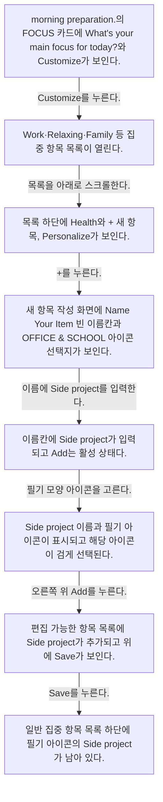
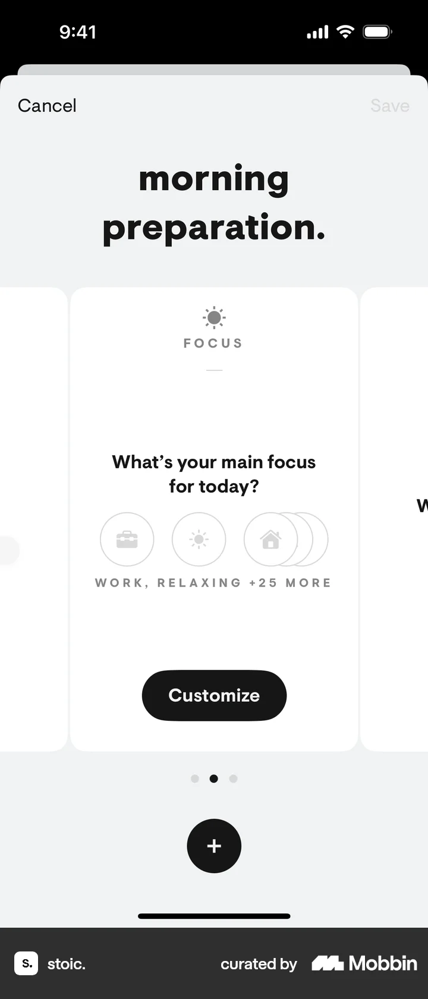
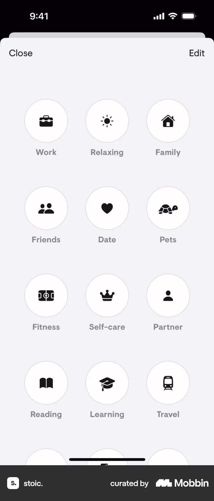
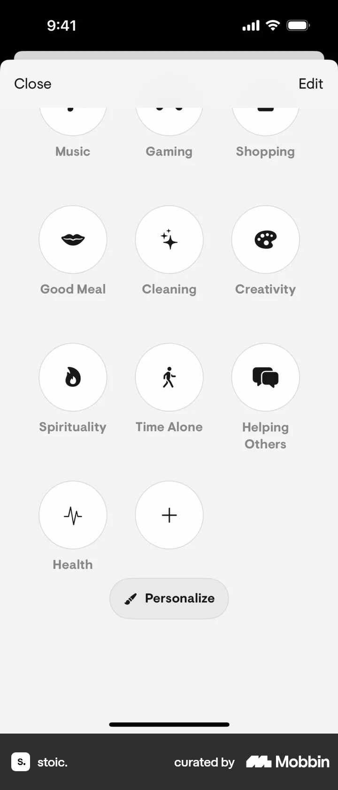
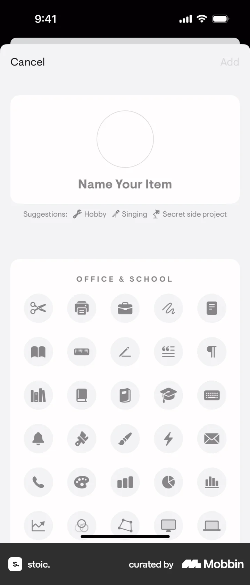
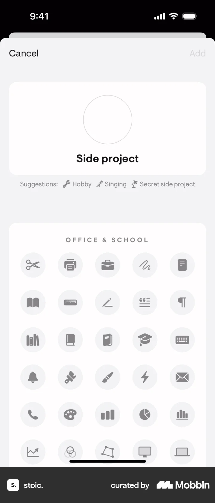
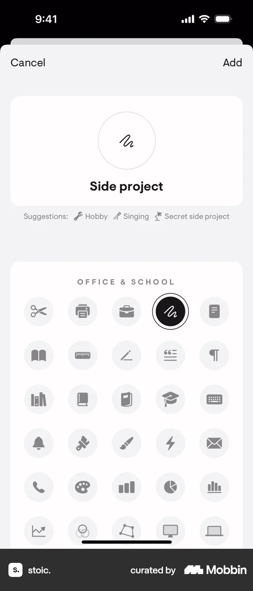
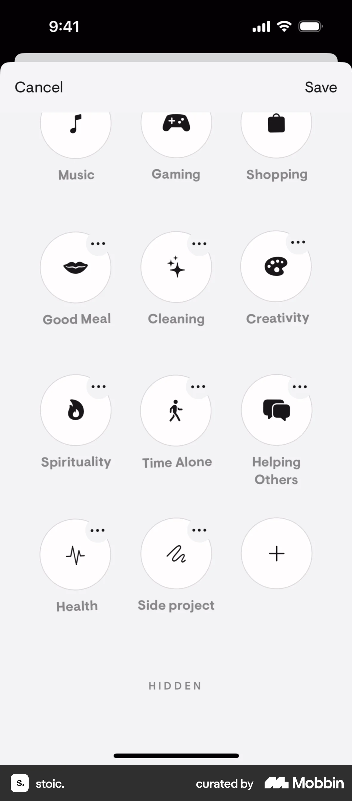
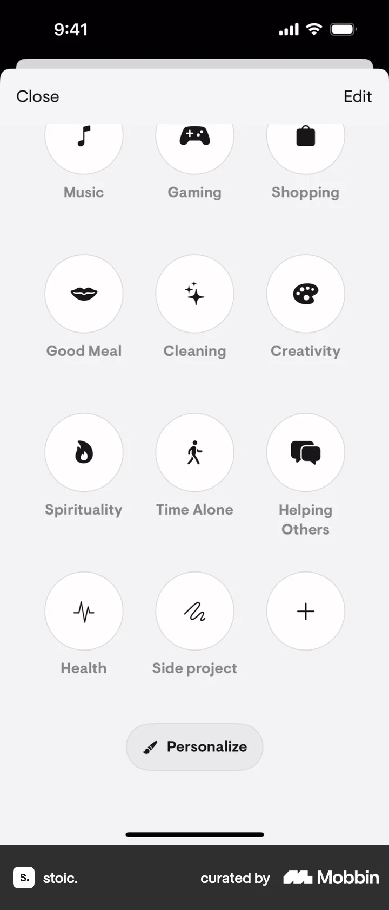

# Adding a focus from Today

- Mobbin 상세 페이지: https://mobbin.com/flows/a9a2260b-e7b7-43d8-9233-c95ee20d5f09?tab=screens
- 앱·기기: stoic. iOS, 393×852
- 화면 수: 상세 페이지 8장 / 저장 이미지 8장 / 아래 설명 8개
- 검증 상태: **verified** — 목록 제목·상세 제목·URL과 화면별 이미지 수·순서·상태 변화를 대조했다.

## 화면별 기록

1.  morning preparation.의 FOCUS 카드에 `What's your main focus for today?`와 Customize가 보인다. `Customize`를 누른다. 다음 화면에서는 Work·Relaxing·Family 등 집중 항목 목록이 열린다.
2.  Work·Relaxing·Family 등 집중 항목 목록이 열린다. 목록을 아래로 스크롤한다. 다음 화면에서는 목록 하단에 Health와 `+` 새 항목, `Personalize`가 보인다.
3.  목록 하단에 Health와 `+` 새 항목, `Personalize`가 보인다. `+`를 누른다. 다음 화면에서는 새 항목 작성 화면에 `Name Your Item` 빈 이름칸과 OFFICE & SCHOOL 아이콘 선택지가 보인다.
4.  새 항목 작성 화면에 `Name Your Item` 빈 이름칸과 OFFICE & SCHOOL 아이콘 선택지가 보인다. 이름에 `Side project`를 입력한다. 다음 화면에서는 이름칸에 `Side project`가 입력되고 Add는 활성 상태다.
5.  이름칸에 `Side project`가 입력되고 Add는 활성 상태다. 필기 모양 아이콘을 고른다. 다음 화면에서는 Side project 이름과 필기 아이콘이 표시되고 해당 아이콘이 검게 선택된다.
6.  Side project 이름과 필기 아이콘이 표시되고 해당 아이콘이 검게 선택된다. 오른쪽 위 `Add`를 누른다. 다음 화면에서는 편집 가능한 항목 목록에 `Side project`가 추가되고 위에 `Save`가 보인다.
7.  편집 가능한 항목 목록에 `Side project`가 추가되고 위에 `Save`가 보인다. `Save`를 누른다. 다음 화면에서는 일반 집중 항목 목록 하단에 필기 아이콘의 `Side project`가 남아 있다.
8.  일반 집중 항목 목록 하단에 필기 아이콘의 `Side project`가 남아 있다.

## BMad handoff notes

- **관찰된 진입 상태:** Morning Preparation의 집중 카드.
- **주요 행동:** Customize에서 새 Side project 집중 항목을 만들고 아이콘을 골라 저장한다.
- **기대 결과:** Side project가 집중 항목 목록에 추가된다.
- **되돌릴 수 있거나 파괴적인 동작:** 편집 목록에서 항목 점 세 개 메뉴를 사용할 수 있으나 삭제·숨김 결과는 이 플로우에서 확인 불가.
