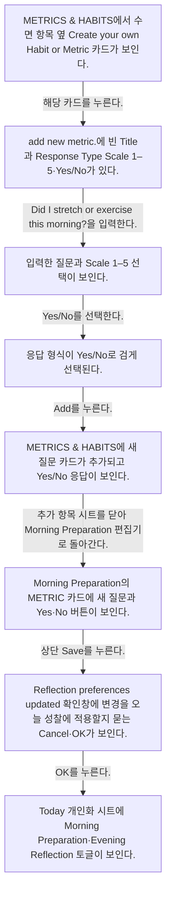
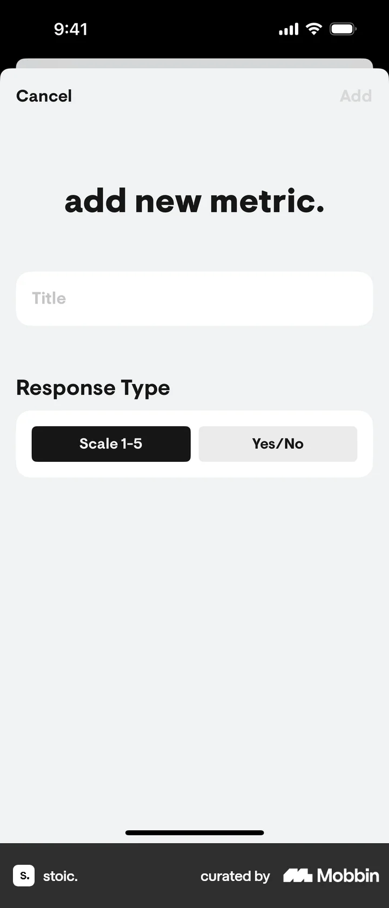
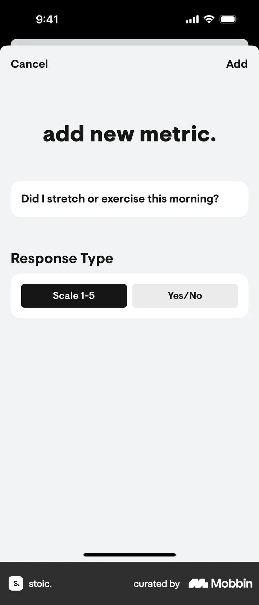
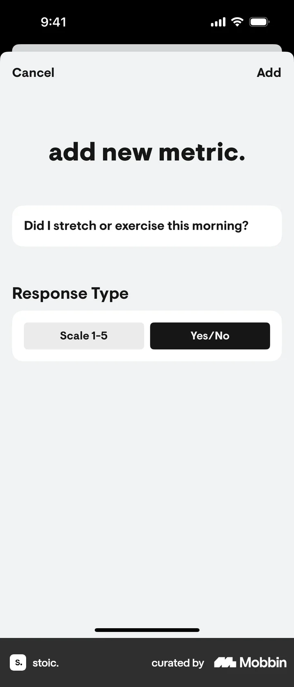
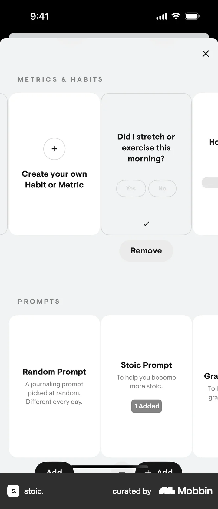
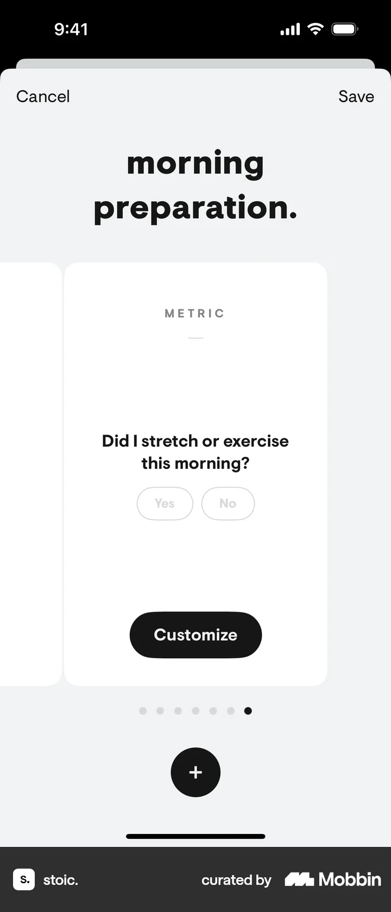

# Adding a metric to daily reflections from Today

- Mobbin 상세 페이지: https://mobbin.com/flows/6d713043-b5ba-4c90-85f7-b1a5803af97b?tab=screens
- 앱·기기: stoic. iOS, 393×852
- 화면 수: 상세 페이지 8장 / 저장 이미지 8장 / 아래 설명 8개
- 검증 상태: **verified** — 목록 제목·상세 제목·URL과 화면별 이미지 수·순서·상태 변화를 대조했다.

## 화면별 기록

1.  METRICS & HABITS에서 수면 항목 옆 `Create your own Habit or Metric` 카드가 보인다. 해당 카드를 누른다. 다음 화면에서는 `add new metric.`에 빈 Title과 Response Type `Scale 1–5`·`Yes/No`가 있다.
2.  `add new metric.`에 빈 Title과 Response Type `Scale 1–5`·`Yes/No`가 있다. `Did I stretch or exercise this morning?`을 입력한다. 다음 화면에서는 입력한 질문과 Scale 1–5 선택이 보인다.
3.  입력한 질문과 Scale 1–5 선택이 보인다. `Yes/No`를 선택한다. 다음 화면에서는 응답 형식이 Yes/No로 검게 선택된다.
4.  응답 형식이 Yes/No로 검게 선택된다. `Add`를 누른다. 다음 화면에서는 METRICS & HABITS에 새 질문 카드가 추가되고 Yes/No 응답이 보인다.
5.  METRICS & HABITS에 새 질문 카드가 추가되고 Yes/No 응답이 보인다. 추가 항목 시트를 닫아 Morning Preparation 편집기로 돌아간다. 다음 화면에서는 Morning Preparation의 METRIC 카드에 새 질문과 Yes·No 버튼이 보인다.
6.  Morning Preparation의 METRIC 카드에 새 질문과 Yes·No 버튼이 보인다. 상단 `Save`를 누른다. 다음 화면에서는 `Reflection preferences updated` 확인창에 변경을 오늘 성찰에 적용할지 묻는 Cancel·OK가 보인다.
7.  `Reflection preferences updated` 확인창에 변경을 오늘 성찰에 적용할지 묻는 Cancel·OK가 보인다. `OK`를 누른다. 다음 화면에서는 Today 개인화 시트에 Morning Preparation·Evening Reflection 토글이 보인다.
8.  Today 개인화 시트에 Morning Preparation·Evening Reflection 토글이 보인다.

## BMad handoff notes

- **관찰된 진입 상태:** 성찰 사용자 지정의 METRICS & HABITS 목록.
- **주요 행동:** Yes/No 응답형 아침 운동 질문을 만들고 성찰 변경을 확인한다.
- **기대 결과:** 새 METRIC 카드가 Morning Preparation에 나타난다. 실제 오늘 성찰 응답 저장은 화면에서 확인 불가.
- **되돌릴 수 있거나 파괴적인 동작:** 추가 목록의 Remove 버튼이 보인다. 제거 결과는 확인 불가.
