# Adding prompts to daily reflections from Today

- Mobbin 상세 페이지: https://mobbin.com/flows/982d4e6c-d95d-4a70-84a3-fb5ad1902041?tab=screens
- 앱·기기: stoic. iOS, 393×852
- 화면 수: 상세 페이지 15장 / 저장 이미지 15장 / 아래 설명 15개
- 검증 상태: **blocked** — 7→8 `+ Add`가 라이브러리를 여는 정확한 터치 지점과 12→13 시트 닫기 경로를 캡처에서 확정할 수 없다.

```mermaid
flowchart TD
  S1["today"]
  S1 -->|Morning Preparation을 누른다.| S2
  S2["morning preparation.의 수면 METRIC 카드와 하단 +가 보인다."]
  S2 -->|카드를 넘겨 FOCUS로 이동한다.| S3
  S3["FOCUS 카드에 What's your main focus for today?와 Customize가 보인다."]
  S3 -->|하단 +를 누른다.| S4
  S4["add items.의 MORNING SPECIALS 카드와 METRICS & HABITS 항목이 보인다."]
  S4 -->|아래로 스크롤한다.| S5
  S5["PROMPTS 섹션에 Random Prompt와 Stoic Prompt 카드가 보인다."]
  S5 -->|계속 스크롤해 PROMPTS를 가운데 놓는다.| S6
  S6["Random Prompt와 Stoic Prompt 각각 Add 버튼이 보인다."]
  S6 -->|Stoic Prompt의 Add를 누른다.| S7
  S7["Stoic Prompt가 1 Added로 표시되고 PROMPTS 아래의 영감 카드가 보인다."]
  S7 -->|추가된 프롬프트의 + Add를 눌러 라이브러리를 연다.| S8
  S8["YOUR OWN PROMPTS의 Write New Prompt와 PROMPTS LIBRARY의 질문 목록이 열린다."]
  S8 -->|Write New Prompt를 누른다.| S9
  S9["add new prompt"]
  S9 -->|What does success look like for me by the end of today?를 입력한다.| S10
  S10["입력한 성공 질문과 활성 Add가 보인다."]
  S10 -->|Add를 누른다.| S11
  S11["YOUR OWN PROMPTS에 새 질문이 체크된 상태로 추가되고 기존 질문 What do you plan to do today?도 체크된다."]
  S11 -->|How can you improve today? 질문을 선택한다.| S12
  S12["PROMPTS LIBRARY에서 How can you improve today?에도 체크가 추가된다."]
  S12 -->|시트를 닫아 성찰 편집기로 돌아간다.| S13
  S13["Morning Preparation의 PROMPT 카드에 새 성공 질문이 표시된다."]
  S13 -->|상단 Save를 누른다.| S14
  S14["Reflection preferences updated 확인창에 오늘 성찰에 적용할지 묻는 Cancel·OK가 보인다."]
  S14 -->|OK를 누른다.| S15
  S15["today"]
```

## 화면별 기록

1.  today. 개인화 시트에 Morning Preparation·Evening Reflection 토글과 성찰 사용자 지정 카드가 보인다. Morning Preparation을 누른다. 다음 화면에서는 morning preparation.의 수면 METRIC 카드와 하단 `+`가 보인다.
2. 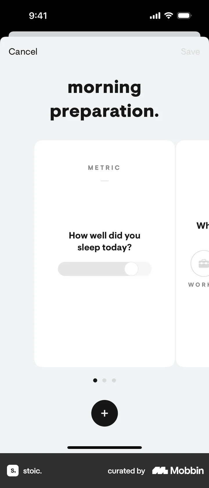 morning preparation.의 수면 METRIC 카드와 하단 `+`가 보인다. 카드를 넘겨 FOCUS로 이동한다. 다음 화면에서는 FOCUS 카드에 `What's your main focus for today?`와 Customize가 보인다.
3.  FOCUS 카드에 `What's your main focus for today?`와 Customize가 보인다. 하단 `+`를 누른다. 다음 화면에서는 `add items.`의 MORNING SPECIALS 카드와 METRICS & HABITS 항목이 보인다.
4. 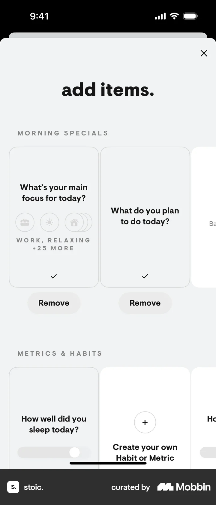 `add items.`의 MORNING SPECIALS 카드와 METRICS & HABITS 항목이 보인다. 아래로 스크롤한다. 다음 화면에서는 PROMPTS 섹션에 Random Prompt와 Stoic Prompt 카드가 보인다.
5. 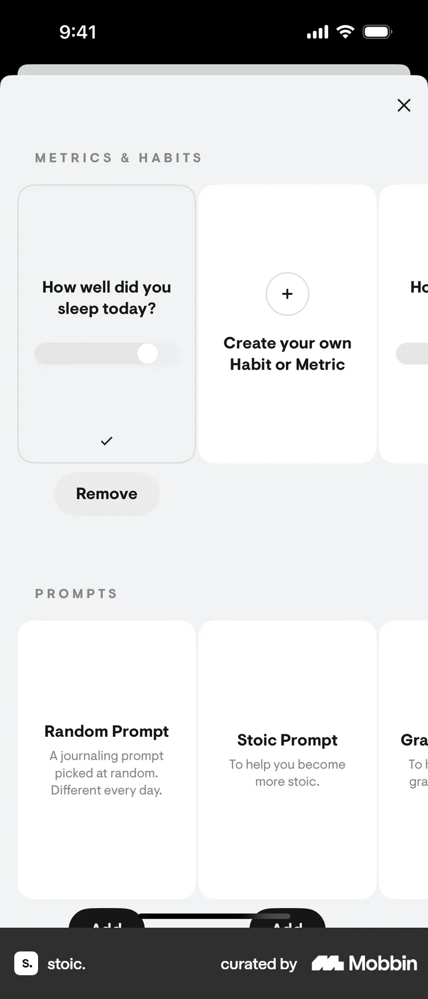 PROMPTS 섹션에 Random Prompt와 Stoic Prompt 카드가 보인다. 계속 스크롤해 PROMPTS를 가운데 놓는다. 다음 화면에서는 Random Prompt와 Stoic Prompt 각각 `Add` 버튼이 보인다.
6. 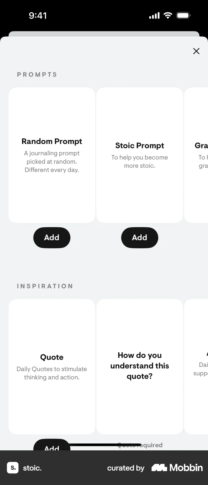 Random Prompt와 Stoic Prompt 각각 `Add` 버튼이 보인다. Stoic Prompt의 `Add`를 누른다. 다음 화면에서는 Stoic Prompt가 `1 Added`로 표시되고 PROMPTS 아래의 영감 카드가 보인다.
7. 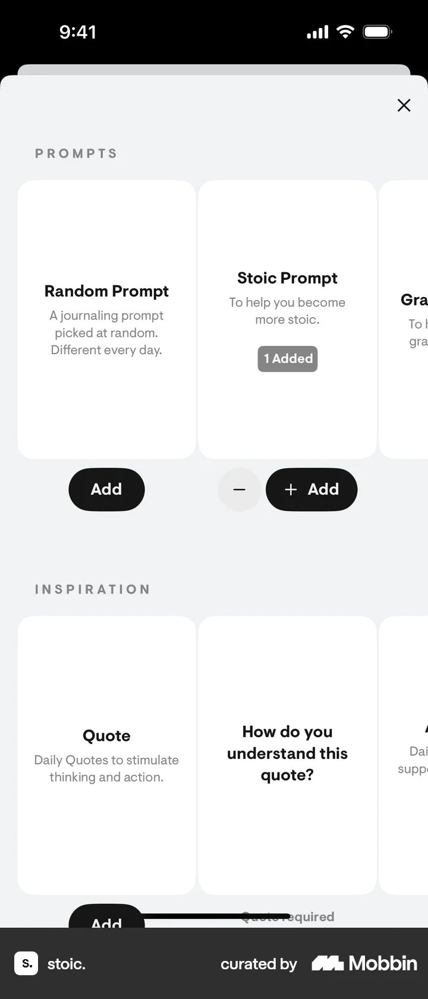 Stoic Prompt가 `1 Added`로 표시되고 PROMPTS 아래의 영감 카드가 보인다. 추가된 프롬프트의 `+ Add`를 눌러 라이브러리를 연다. 다음 화면에서는 YOUR OWN PROMPTS의 `Write New Prompt`와 PROMPTS LIBRARY의 질문 목록이 열린다.
8. 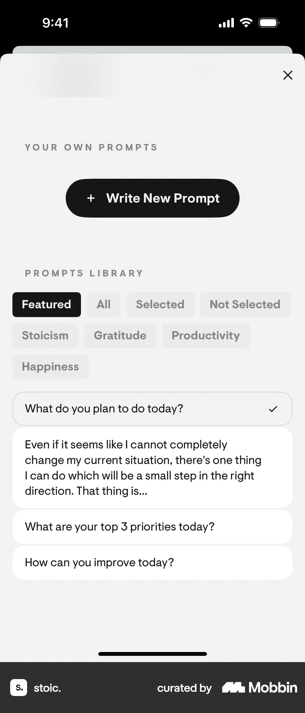 YOUR OWN PROMPTS의 `Write New Prompt`와 PROMPTS LIBRARY의 질문 목록이 열린다. `Write New Prompt`를 누른다. 다음 화면에서는 `add new prompt.` 빈 Title과 비활성 Add가 보인다.
9. 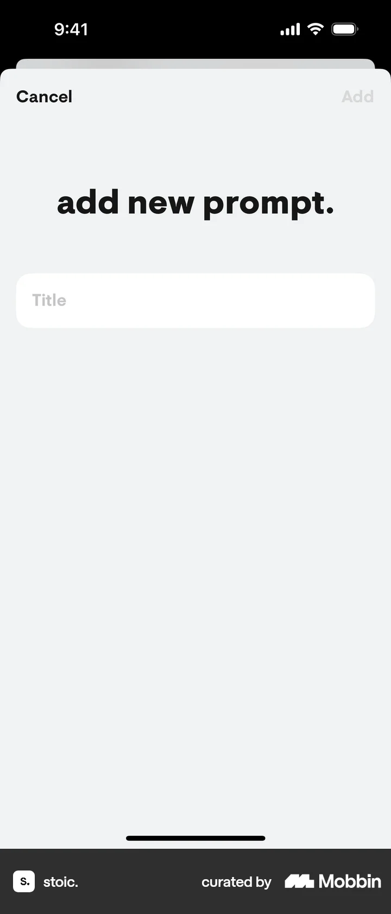 `add new prompt.` 빈 Title과 비활성 Add가 보인다. `What does success look like for me by the end of today?`를 입력한다. 다음 화면에서는 입력한 성공 질문과 활성 Add가 보인다.
10. 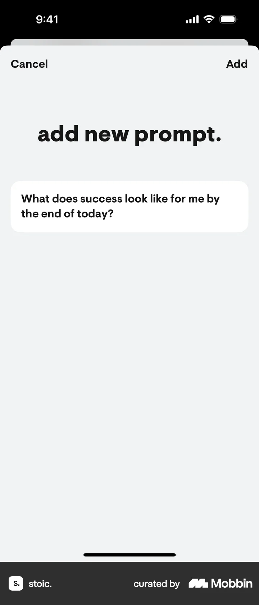 입력한 성공 질문과 활성 Add가 보인다. `Add`를 누른다. 다음 화면에서는 YOUR OWN PROMPTS에 새 질문이 체크된 상태로 추가되고 기존 질문 `What do you plan to do today?`도 체크된다.
11.  YOUR OWN PROMPTS에 새 질문이 체크된 상태로 추가되고 기존 질문 `What do you plan to do today?`도 체크된다. `How can you improve today?` 질문을 선택한다. 다음 화면에서는 PROMPTS LIBRARY에서 `How can you improve today?`에도 체크가 추가된다.
12. 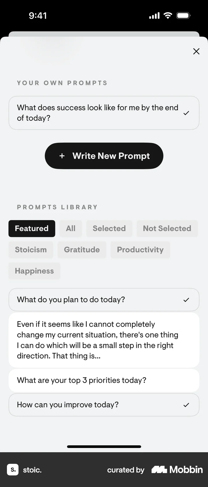 PROMPTS LIBRARY에서 `How can you improve today?`에도 체크가 추가된다. 시트를 닫아 성찰 편집기로 돌아간다. 다음 화면에서는 Morning Preparation의 PROMPT 카드에 새 성공 질문이 표시된다.
13. 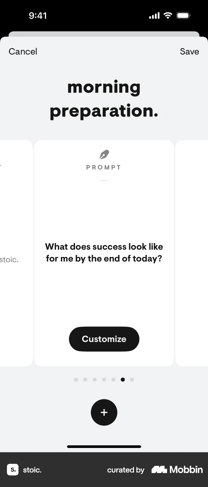 Morning Preparation의 PROMPT 카드에 새 성공 질문이 표시된다. 상단 `Save`를 누른다. 다음 화면에서는 `Reflection preferences updated` 확인창에 오늘 성찰에 적용할지 묻는 Cancel·OK가 보인다.
14. 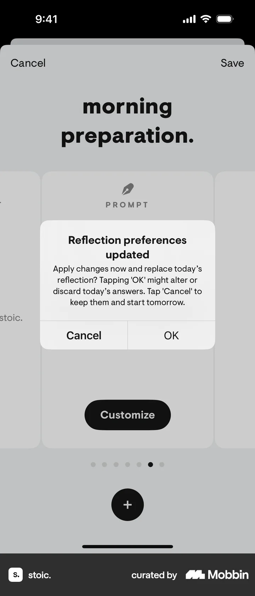 `Reflection preferences updated` 확인창에 오늘 성찰에 적용할지 묻는 Cancel·OK가 보인다. `OK`를 누른다. 다음 화면에서는 today. 개인화 시트가 다시 보이고 Morning Preparation 토글이 켜져 있다.
15.  today. 개인화 시트가 다시 보이고 Morning Preparation 토글이 켜져 있다.

## BMad handoff notes

- **관찰된 진입 상태:** Today 개인화 시트에서 Morning Preparation을 편집할 수 있다.
- **주요 행동:** PROMPTS 항목을 추가하고 새 성공 질문을 작성·선택한 뒤 성찰 설정을 저장한다.
- **기대 결과:** PROMPT 카드에 새 질문이 나타난다. 실제 성찰 시작 후 질문 표시 여부는 화면에서 확인 불가.
- **되돌릴 수 있거나 파괴적인 동작:** 프롬프트 라이브러리의 체크를 해제할 수 있을 것으로 추정된다. 삭제 결과는 확인 불가.
