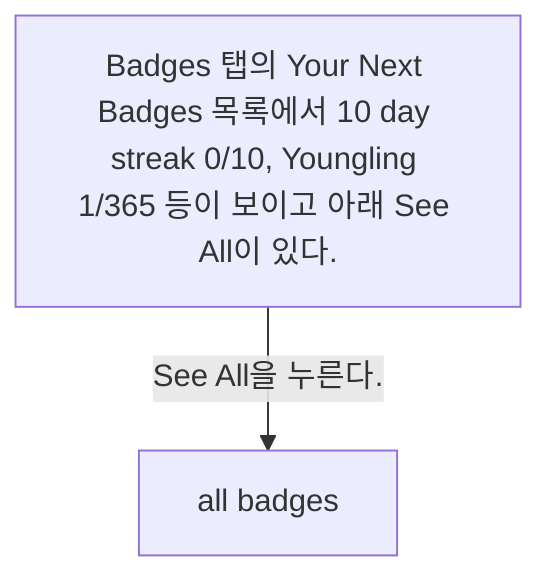
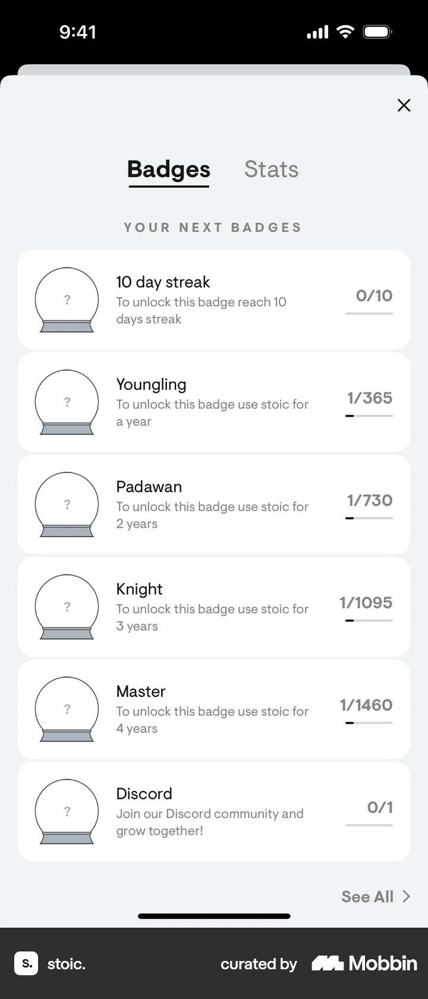
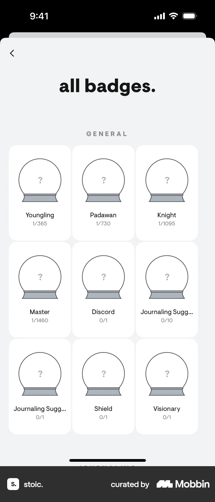

# All badges from Badges

- Mobbin 상세 페이지: https://mobbin.com/flows/00766360-0970-49eb-9359-b51185401078?tab=screens
- 앱·기기: stoic. iOS, 393×852
- 화면 수: 상세 페이지 2장 / 저장 이미지 2장 / 아래 설명 2개
- 검증 상태: **verified** — 목록 제목·상세 제목·URL과 화면별 이미지 수·순서·상태 변화를 대조했다.

## 화면별 기록

1.  Badges 탭의 Your Next Badges 목록에서 10 day streak 0/10, Youngling 1/365 등이 보이고 아래 `See All`이 있다. `See All`을 누른다. 다음 화면에서는 `all badges.` 페이지의 GENERAL 그리드에 Youngling, Padawan, Knight, Master와 다른 미획득 배지들이 물음표로 표시된다.
2.  `all badges.` 페이지의 GENERAL 그리드에 Youngling, Padawan, Knight, Master와 다른 미획득 배지들이 물음표로 표시된다.

## BMad handoff notes

- **관찰된 진입 상태:** Badges 탭의 다음 배지 목록.
- **주요 행동:** See All로 전체 배지를 연다.
- **기대 결과:** 전체 일반 배지의 이름과 진행 수치를 본다.
- **되돌릴 수 있거나 파괴적인 동작:** 왼쪽 위 뒤로 가기가 보인다. 삭제 동작은 없다.
