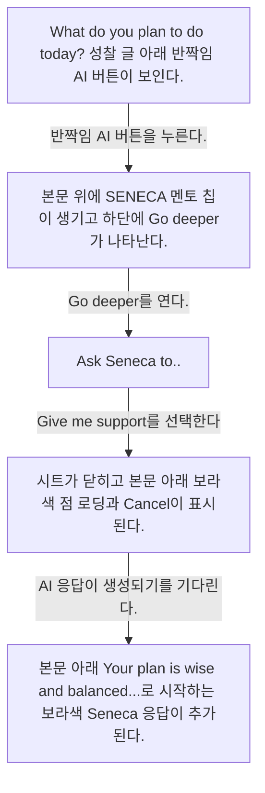
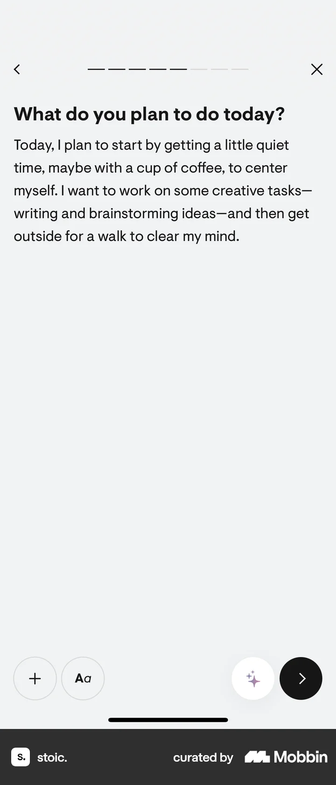
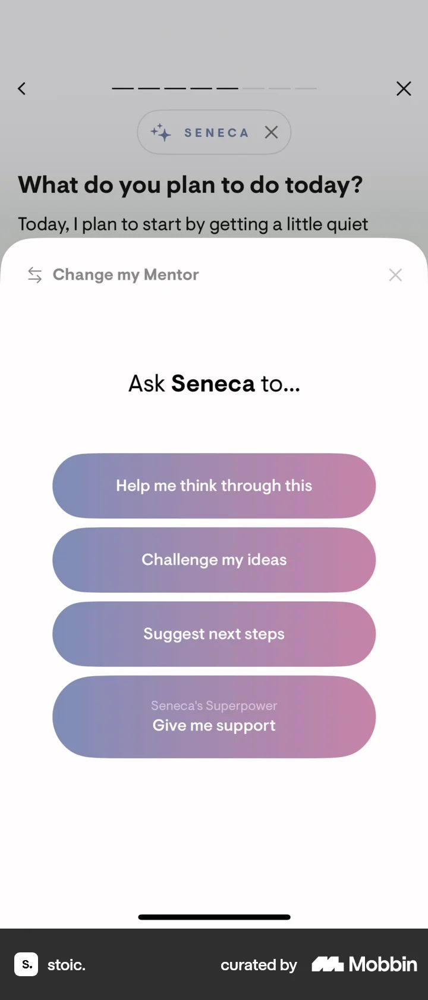
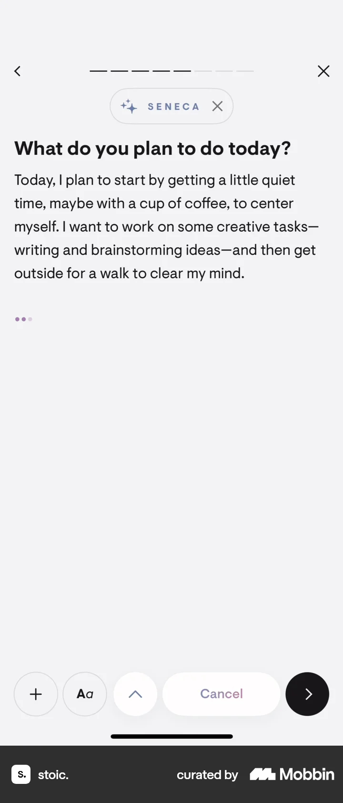
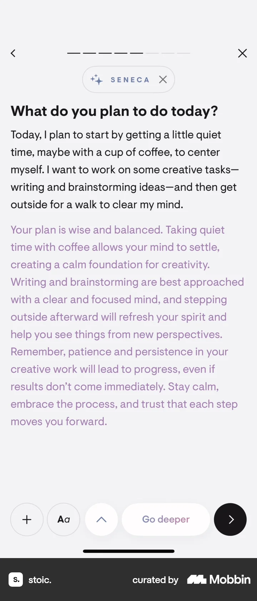

# Asking AI for insights from Logging a daily reflection (morning)

- Mobbin 상세 페이지: https://mobbin.com/flows/a84f10c7-df4b-4efa-add8-7d7f8438196d?tab=screens
- 앱·기기: stoic. iOS, 393×852
- 화면 수: 상세 페이지 5장 / 저장 이미지 5장 / 아래 설명 5개
- 검증 상태: **verified** — 목록·상세 제목·URL과 5장의 순서를 대조했다. Seneca의 `Give me support` 선택은 사용자 확인을 받았다.

## 화면별 기록

1.  `What do you plan to do today?` 성찰 글 아래 반짝임 AI 버튼이 보인다. 반짝임 AI 버튼을 누른다. 다음 화면에서는 본문 위에 `SENECA` 멘토 칩이 생기고 하단에 `Go deeper`가 나타난다.
2.  본문 위에 `SENECA` 멘토 칩이 생기고 하단에 `Go deeper`가 나타난다. `Go deeper`를 연다. 다음 화면에서는 `Ask Seneca to...` 시트에 `Help me think through this`, `Challenge my ideas`, `Suggest next steps`, `Give me support`가 보인다.
3.  `Ask Seneca to...` 시트에 `Help me think through this`, `Challenge my ideas`, `Suggest next steps`, `Give me support`가 보인다. 사용자 확인에 따르면 `Give me support`를 선택했다. 다음 화면에서는 시트가 닫히고 본문 아래 보라색 점 로딩과 `Cancel`이 표시된다.
4.  시트가 닫히고 본문 아래 보라색 점 로딩과 `Cancel`이 표시된다. AI 응답이 생성되기를 기다린다. 다음 화면에서는 본문 아래 `Your plan is wise and balanced...`로 시작하는 보라색 Seneca 응답이 추가된다.
5.  본문 아래 `Your plan is wise and balanced...`로 시작하는 보라색 Seneca 응답이 추가된다.

## BMad handoff notes

- **관찰된 진입 상태:** 문장이 입력된 일일 성찰 편집기.
- **주요 행동:** AI 멘토 Seneca를 열어 `Give me support`를 선택한다.
- **기대 결과:** 성찰 글 아래 AI 응답이 표시된다. 서버에 저장됐는지는 화면에서 확인 불가.
- **되돌릴 수 있거나 파괴적인 동작:** 생성 중 `Cancel`과 멘토 칩의 닫기 아이콘이 보인다. 삭제 결과는 확인 불가.
