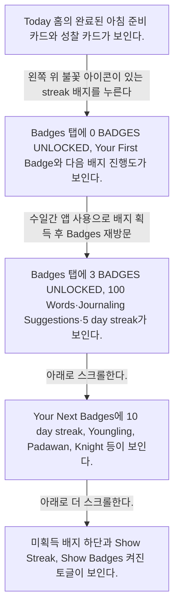

# Badges

- Mobbin 상세 페이지: https://mobbin.com/flows/6b59a91e-58e4-406d-8e7f-35cc5b6cb6cd?tab=screens
- 앱·기기: stoic. iOS, 393×852
- 화면 수: 상세 페이지 5장 / 저장 이미지 5장 / 아래 설명 5개
- 검증 상태: **verified** — Today 왼쪽 위 불꽃 아이콘이 있는 streak 배지를 눌러 Badges로 들어간다. 0개에서 3개로 바뀐 것은 수일간 앱을 사용하며 배지를 획득한 전후 상태다(사용자 확인).

## 화면별 기록

1.  Today 홈의 완료된 아침 준비 카드와 성찰 카드가 보인다. 왼쪽 위 불꽃 아이콘이 있는 streak 배지를 누른다(사용자 확인). 다음 화면에서는 Badges 탭에 `0 BADGES UNLOCKED`, Your First Badge와 다음 배지 진행도가 보인다.
2.  Badges 탭에 `0 BADGES UNLOCKED`, Your First Badge와 다음 배지 진행도가 보인다. 수일간 앱을 사용해 배지를 획득한 뒤 Badges에 다시 방문한다(사용자 확인). 배지별 획득 행동은 이 상세 페이지에 없다. 다음 화면에서는 Badges 탭에 `3 BADGES UNLOCKED`, 100 Words·Journaling Suggestions·5 day streak가 보인다.
3.  Badges 탭에 `3 BADGES UNLOCKED`, 100 Words·Journaling Suggestions·5 day streak가 보인다. 아래로 스크롤한다. 다음 화면에서는 Your Next Badges에 10 day streak, Youngling, Padawan, Knight 등이 보인다.
4.  Your Next Badges에 10 day streak, Youngling, Padawan, Knight 등이 보인다. 아래로 더 스크롤한다. 다음 화면에서는 미획득 배지 하단과 `Show Streak`, `Show Badges` 켜진 토글이 보인다.
5.  미획득 배지 하단과 `Show Streak`, `Show Badges` 켜진 토글이 보인다.

## BMad handoff notes

- **관찰된 진입 상태:** Today 왼쪽 위에 불꽃 아이콘이 있는 streak 배지가 보인다.
- **주요 행동:** streak 배지를 눌러 Badges를 열고, 수일간 앱을 사용해 3개 배지를 획득한 전후의 배지 현황과 다음 배지 목록을 본다.
- **기대 결과:** 잠금 해제 배지와 미획득 배지의 진행도가 보인다.
- **되돌릴 수 있거나 파괴적인 동작:** Show Streak·Show Badges 토글은 다시 바꿀 수 있다. 배지 삭제는 관찰되지 않는다.
