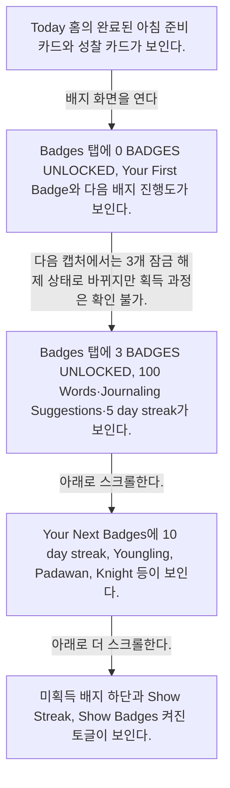
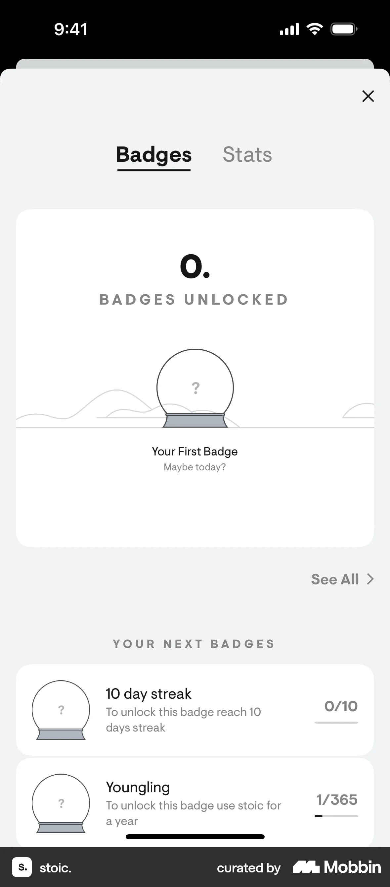
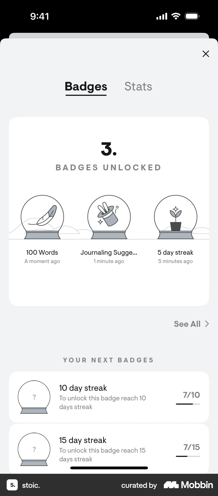
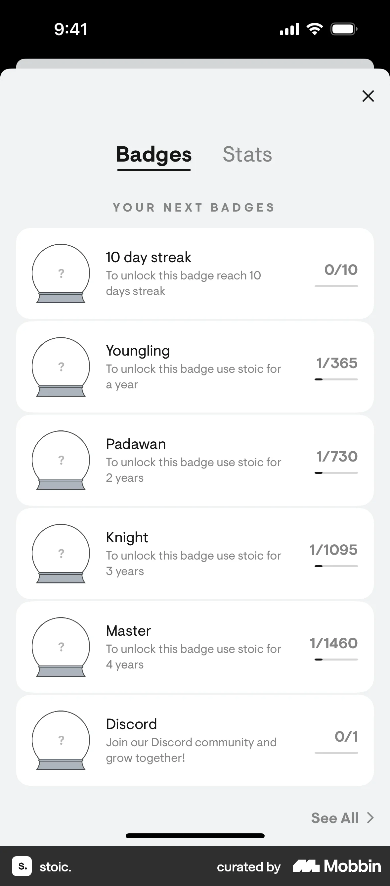
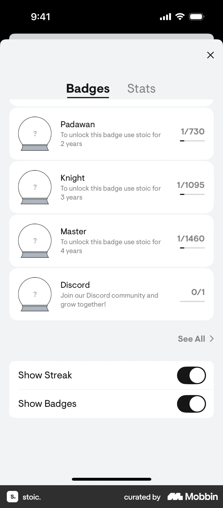

# Badges

- Mobbin 상세 페이지: https://mobbin.com/flows/6b59a91e-58e4-406d-8e7f-35cc5b6cb6cd?tab=screens
- 앱·기기: stoic. iOS, 393×852
- 화면 수: 상세 페이지 5장 / 저장 이미지 5장 / 아래 설명 5개
- 검증 상태: **blocked** — 잠금 해제 배지 수가 0에서 3으로 바뀌는 원인 행동이 캡처에 없다.

## 화면별 기록

1.  Today 홈의 완료된 아침 준비 카드와 성찰 카드가 보인다. 배지 화면을 연다. 정확한 진입 지점은 화면에서 확인 불가. 다음 화면에서는 Badges 탭에 `0 BADGES UNLOCKED`, Your First Badge와 다음 배지 진행도가 보인다.
2.  Badges 탭에 `0 BADGES UNLOCKED`, Your First Badge와 다음 배지 진행도가 보인다. 다음 캡처에서는 3개 잠금 해제 상태로 바뀌지만 획득 과정은 확인 불가. 다음 화면에서는 Badges 탭에 `3 BADGES UNLOCKED`, 100 Words·Journaling Suggestions·5 day streak가 보인다.
3.  Badges 탭에 `3 BADGES UNLOCKED`, 100 Words·Journaling Suggestions·5 day streak가 보인다. 아래로 스크롤한다. 다음 화면에서는 Your Next Badges에 10 day streak, Youngling, Padawan, Knight 등이 보인다.
4.  Your Next Badges에 10 day streak, Youngling, Padawan, Knight 등이 보인다. 아래로 더 스크롤한다. 다음 화면에서는 미획득 배지 하단과 `Show Streak`, `Show Badges` 켜진 토글이 보인다.
5.  미획득 배지 하단과 `Show Streak`, `Show Badges` 켜진 토글이 보인다.

## BMad handoff notes

- **관찰된 진입 상태:** Today에서 배지 화면을 연다.
- **주요 행동:** 배지 현황과 다음 배지 목록을 스크롤한다. 3개 획득 과정은 확인 불가.
- **기대 결과:** 잠금 해제 배지와 미획득 배지의 진행도가 보인다.
- **되돌릴 수 있거나 파괴적인 동작:** Show Streak·Show Badges 토글은 다시 바꿀 수 있다. 배지 삭제는 관찰되지 않는다.
