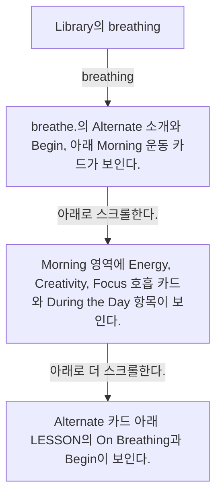

# Breathe from Library

- Mobbin 상세 페이지: https://mobbin.com/flows/a4a51054-0a2b-4d99-aa45-c76f08de53a0?tab=screens
- 앱·기기: stoic. iOS, 393×852
- 화면 수: 상세 페이지 4장 / 저장 이미지 4장 / 아래 설명 4개
- 검증 상태: **verified** — 목록 제목·상세 제목·URL과 화면별 이미지 수·순서·상태 변화를 대조했다.

## 화면별 기록

1.  Library의 `breathing.` 카드 옆에 `meditation.` 카드가 보인다. `breathing.` 카드를 누른다. 다음 화면에서는 `breathe.`의 Alternate 소개와 `Begin`, 아래 Morning 운동 카드가 보인다.
2.  `breathe.`의 Alternate 소개와 `Begin`, 아래 Morning 운동 카드가 보인다. 아래로 스크롤한다. 다음 화면에서는 Morning 영역에 Energy, Creativity, Focus 호흡 카드와 `During the Day` 항목이 보인다.
3.  Morning 영역에 Energy, Creativity, Focus 호흡 카드와 `During the Day` 항목이 보인다. 아래로 더 스크롤한다. 다음 화면에서는 Alternate 카드 아래 `LESSON`의 `On Breathing`과 `Begin`이 보인다.
4.  Alternate 카드 아래 `LESSON`의 `On Breathing`과 `Begin`이 보인다.

## BMad handoff notes

- **관찰된 진입 상태:** Library의 breathing 카드가 보인다.
- **주요 행동:** breathing 섹션을 열어 호흡 운동과 수업 목록을 스크롤한다.
- **기대 결과:** Alternate, 시간대별 호흡 운동, On Breathing 수업이 표시된다.
- **되돌릴 수 있거나 파괴적인 동작:** 스크롤과 뒤로 가기로 탐색을 되돌릴 수 있다. 삭제 동작은 없다.
