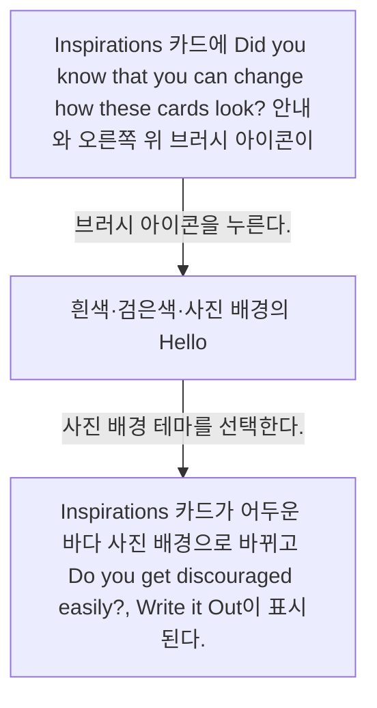
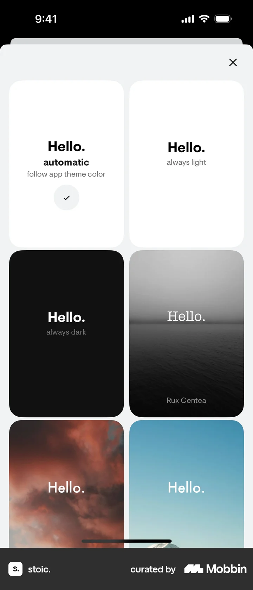
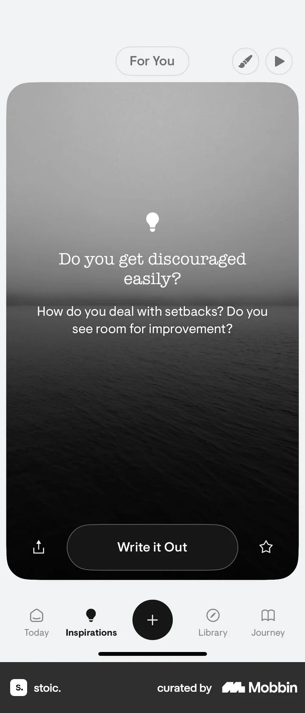

# Choosing a card theme from Inspirations

- Mobbin 상세 페이지: https://mobbin.com/flows/4bb317ac-987e-4486-8b50-ed2e04ad305a?tab=screens
- 앱·기기: stoic. iOS, 393×852
- 화면 수: 상세 페이지 3장 / 저장 이미지 3장 / 아래 설명 3개
- 검증 상태: **verified** — 목록 제목·상세 제목·URL과 화면별 이미지 수·순서·상태 변화를 대조했다.

## 화면별 기록

1.  Inspirations 카드에 `Did you know that you can change how these cards look?` 안내와 오른쪽 위 브러시 아이콘이 보인다. 브러시 아이콘을 누른다. 다음 화면에서는 흰색·검은색·사진 배경의 `Hello.` 테마 카드 그리드가 열리고 현재 테마에 체크가 있다.
2.  흰색·검은색·사진 배경의 `Hello.` 테마 카드 그리드가 열리고 현재 테마에 체크가 있다. 사진 배경 테마를 선택한다. 다음 화면에서는 Inspirations 카드가 어두운 바다 사진 배경으로 바뀌고 `Do you get discouraged easily?`, `Write it Out`이 표시된다.
3.  Inspirations 카드가 어두운 바다 사진 배경으로 바뀌고 `Do you get discouraged easily?`, `Write it Out`이 표시된다.

## BMad handoff notes

- **관찰된 진입 상태:** Inspirations 카드의 테마 변경 안내가 보인다.
- **주요 행동:** 브러시 아이콘으로 테마 선택기를 열고 사진 배경을 고른다.
- **기대 결과:** 질문 카드의 배경이 사진 테마로 변경된다.
- **되돌릴 수 있거나 파괴적인 동작:** 테마 선택기에서 다시 다른 테마를 선택할 수 있다. 삭제 동작은 없다.
