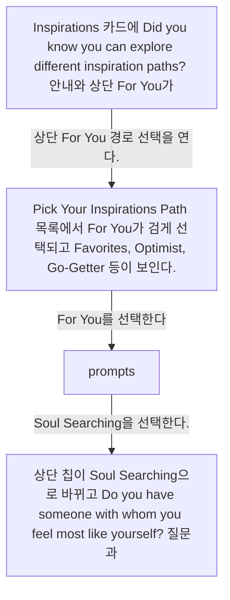
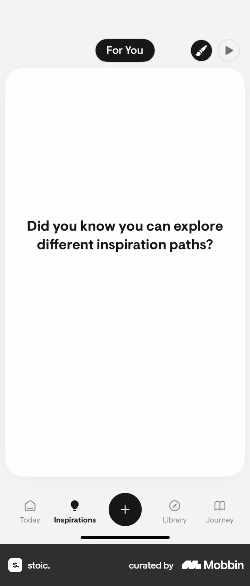
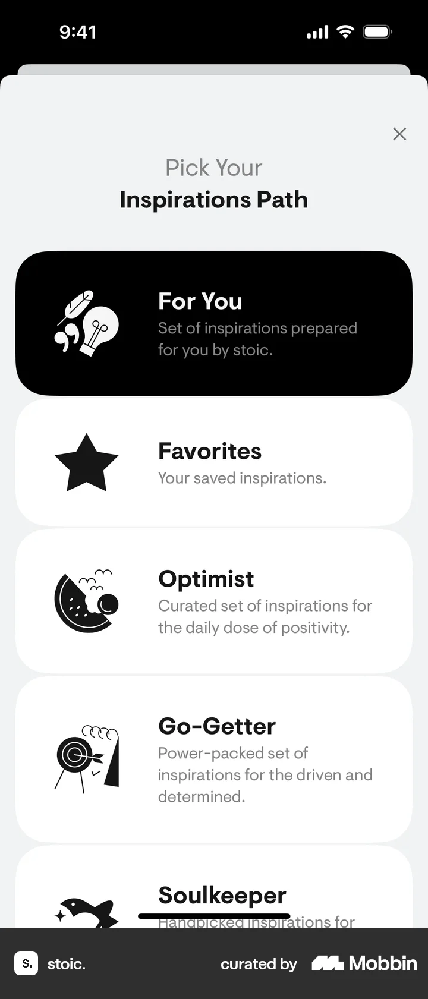
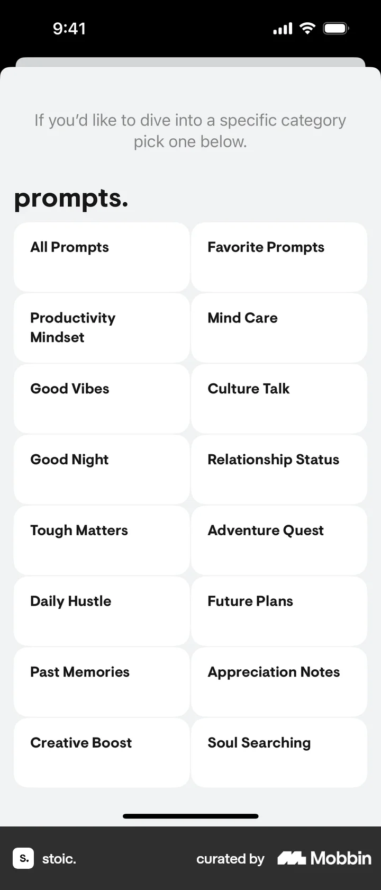
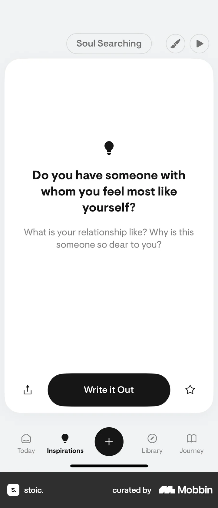

# Choosing a prompt category from Inspirations

- Mobbin 상세 페이지: https://mobbin.com/flows/d3701069-53c3-46bb-a63e-e22f7152ee34?tab=screens
- 앱·기기: stoic. iOS, 393×852
- 화면 수: 상세 페이지 4장 / 저장 이미지 4장 / 아래 설명 4개
- 검증 상태: **verified** — 목록·상세 제목·URL과 이미지 4장의 순서를 대조했다. Inspirations Path에서 `For You`를 선택한 경로는 사용자 확인을 받았다.

## 화면별 기록

1.  Inspirations 카드에 `Did you know you can explore different inspiration paths?` 안내와 상단 `For You`가 보인다. 상단 `For You` 경로 선택을 연다. 다음 화면에서는 `Pick Your Inspirations Path` 목록에서 `For You`가 검게 선택되고 Favorites, Optimist, Go-Getter 등이 보인다.
2.  `Pick Your Inspirations Path` 목록에서 `For You`가 검게 선택되고 Favorites, Optimist, Go-Getter 등이 보인다. `For You`를 선택한다(사용자 확인). 다음 화면에서는 `prompts.` 그리드에 All Prompts, Favorite Prompts, Productivity Mindset, Soul Searching 등 범주가 보인다.
3.  `prompts.` 그리드에 All Prompts, Favorite Prompts, Productivity Mindset, Soul Searching 등 범주가 보인다. `Soul Searching`을 선택한다. 다음 화면에서는 상단 칩이 `Soul Searching`으로 바뀌고 `Do you have someone with whom you feel most like yourself?` 질문과 `Write it Out`이 나타난다.
4.  상단 칩이 `Soul Searching`으로 바뀌고 `Do you have someone with whom you feel most like yourself?` 질문과 `Write it Out`이 나타난다.

## BMad handoff notes

- **관찰된 진입 상태:** Inspirations의 For You 경로와 안내 카드가 보인다.
- **주요 행동:** 경로 선택 화면에서 `For You`를 선택해 프롬프트 범주 목록을 열고 Soul Searching을 선택한다.
- **기대 결과:** Soul Searching 질문 카드가 표시된다.
- **되돌릴 수 있거나 파괴적인 동작:** 상단 범주를 다시 열어 다른 항목을 선택할 수 있다. 삭제 동작은 없다.
