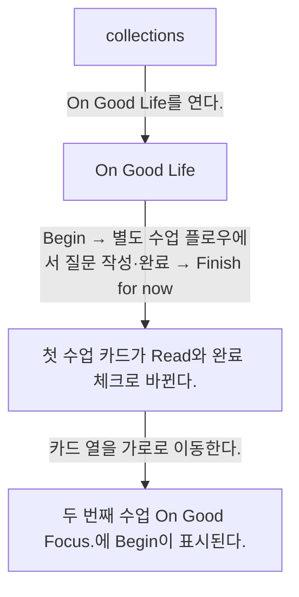
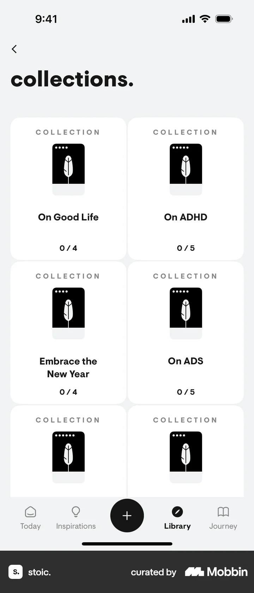
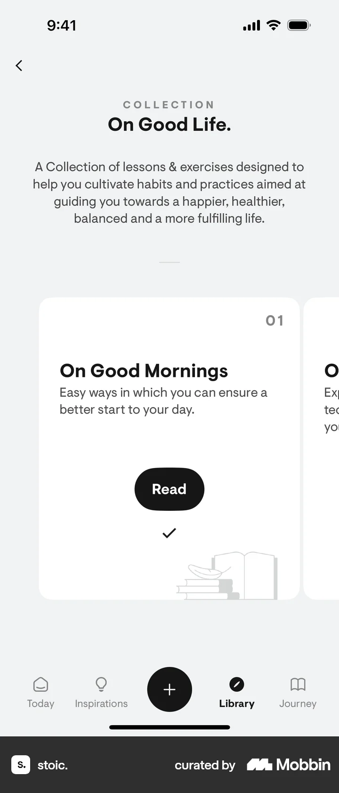
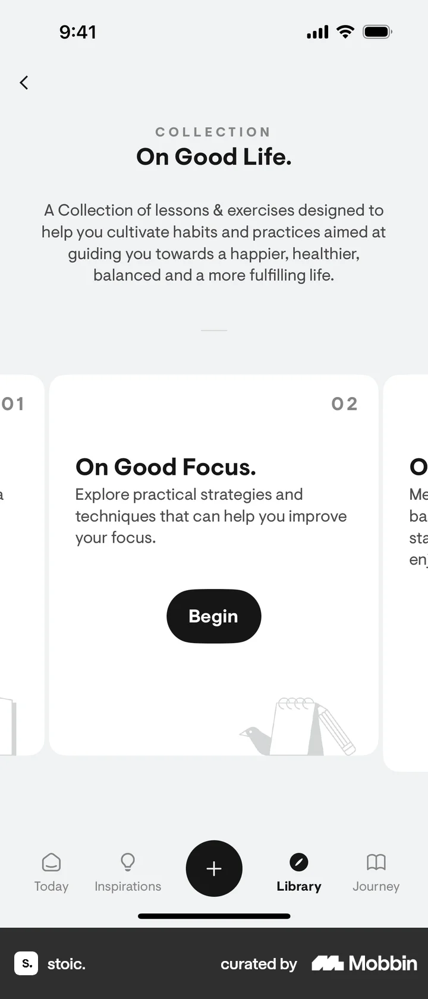

# Collection detail from Collections

- Mobbin 상세 페이지: https://mobbin.com/flows/dc9e8970-ab4c-4c12-8d72-b0dc689ff805?tab=screens
- 앱·기기: stoic. iOS, 393×852
- 화면 수: 상세 페이지 4장 / 저장 이미지 4장 / 아래 설명 4개
- 검증 상태: **verified** — 목록·상세 제목·URL과 이미지 4장의 순서를 대조했다. 화면 2→3 사이 `Begin`에서 이어지는 수업 수행은 사용자가 확인한 별도 [Completing a lesson](../completing-a-lesson-from-collection-detail-92380915/README.md) 플로우에 기록되어 있다.

## 화면별 기록

1.  `collections.` 그리드에 `On Good Life 0/4`, `On ADHD 0/5`, `Embrace the New Year 0/4`가 보인다. `On Good Life`를 연다. 다음 화면에서는 `On Good Life.` 상세에 컬렉션 설명과 첫 수업 `On Good Mornings`의 `Begin`이 보인다.
2.  `On Good Life.` 상세에 컬렉션 설명과 첫 수업 `On Good Mornings`의 `Begin`이 보인다. `Begin`을 누르면 별도 [Completing a lesson](../completing-a-lesson-from-collection-detail-92380915/README.md) 플로우로 이어진다(사용자 확인). 그 화면에서 질문에 답하고 수업을 완료한 뒤 `Finish for now`로 돌아온다. 이 상세 플로우 자체에는 중간 수업 화면이 없다. 다음 화면에서는 첫 수업 카드가 `Read`와 완료 체크로 바뀐다.
3.  첫 수업 카드가 `Read`와 완료 체크로 바뀐다. 카드 열을 가로로 이동한다. 다음 화면에서는 두 번째 수업 `On Good Focus.`에 `Begin`이 표시된다.
4.  두 번째 수업 `On Good Focus.`에 `Begin`이 표시된다.

## BMad handoff notes

- **관찰된 진입 상태:** Collections의 미완료 컬렉션 그리드.
- **주요 행동:** On Good Life 컬렉션을 열고 `Begin`으로 별도 수업 플로우를 수행·완료한 뒤 다음 카드를 탐색한다.
- **기대 결과:** 첫 카드가 완료 표시로 바뀌고 다음 수업에 Begin이 보인다.
- **되돌릴 수 있거나 파괴적인 동작:** 완료된 수업을 Read로 다시 열 수 있다. 완료 취소·삭제 경로는 확인 불가.
