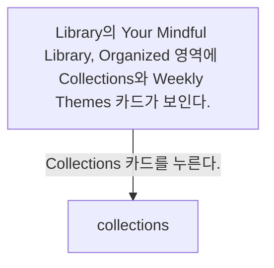
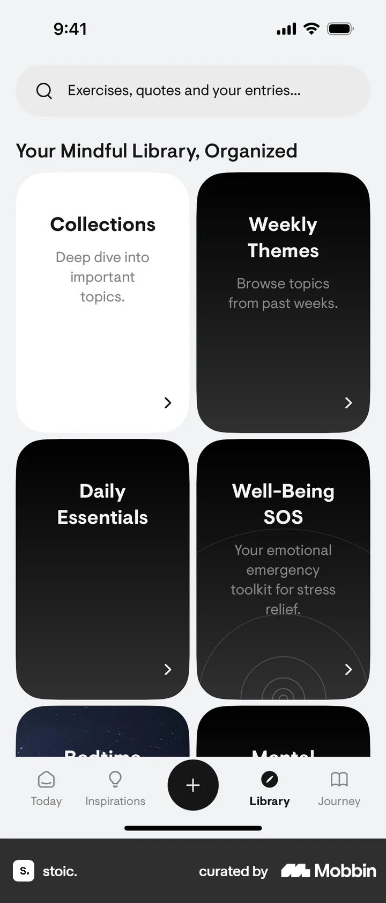
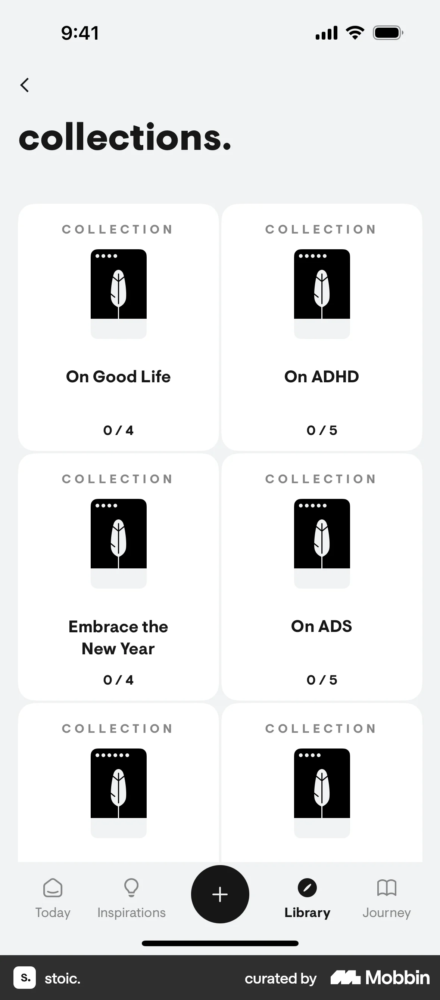

# Collections from Library

- Mobbin 상세 페이지: https://mobbin.com/flows/0741e2ac-c263-4a00-981a-b2c7ce873fb8?tab=screens
- 앱·기기: stoic. iOS, 393×852
- 화면 수: 상세 페이지 2장 / 저장 이미지 2장 / 아래 설명 2개
- 검증 상태: **verified** — 목록 제목·상세 제목·URL과 화면별 이미지 수·순서·상태 변화를 대조했다.

## 화면별 기록

1.  Library의 `Your Mindful Library, Organized` 영역에 `Collections`와 `Weekly Themes` 카드가 보인다. `Collections` 카드를 누른다. 다음 화면에서는 `collections.` 화면에 On Good Life, On ADHD, Embrace the New Year, On ADS 등의 컬렉션 카드와 진행 수가 나타난다.
2.  `collections.` 화면에 On Good Life, On ADHD, Embrace the New Year, On ADS 등의 컬렉션 카드와 진행 수가 나타난다.

## BMad handoff notes

- **관찰된 진입 상태:** Library의 Collections 카드가 보인다.
- **주요 행동:** Collections 카드를 열어 컬렉션 목록으로 이동한다.
- **기대 결과:** 주제별 컬렉션과 각 완료 수가 보인다.
- **되돌릴 수 있거나 파괴적인 동작:** 뒤로 가기로 Library에 돌아갈 수 있다. 삭제 동작은 없다.
