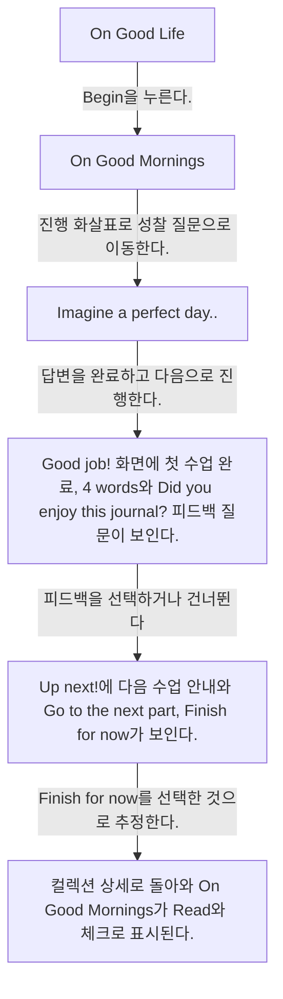
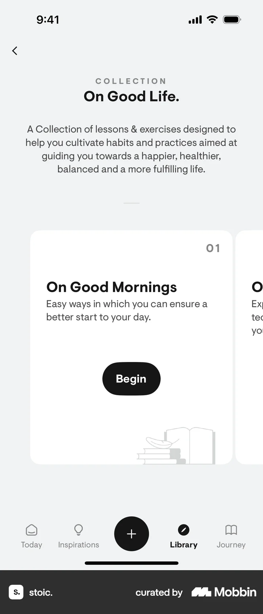
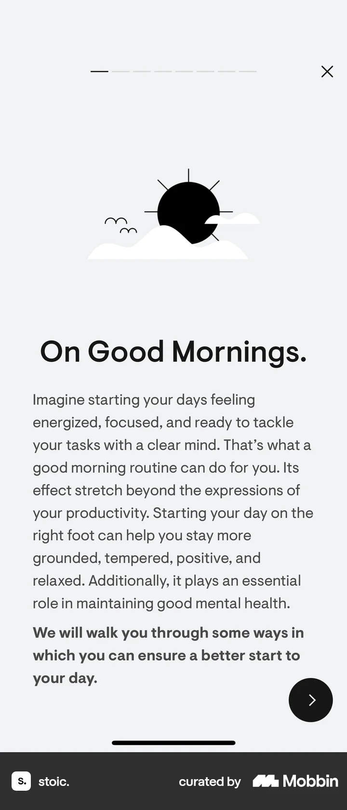
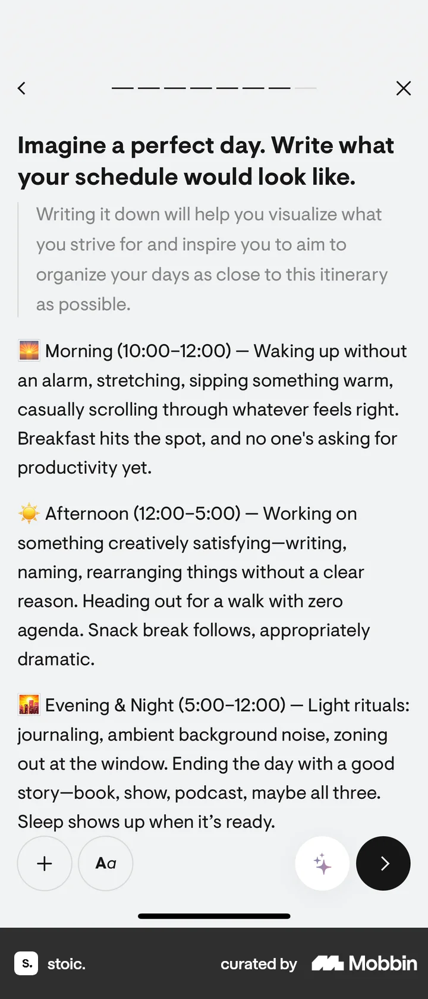
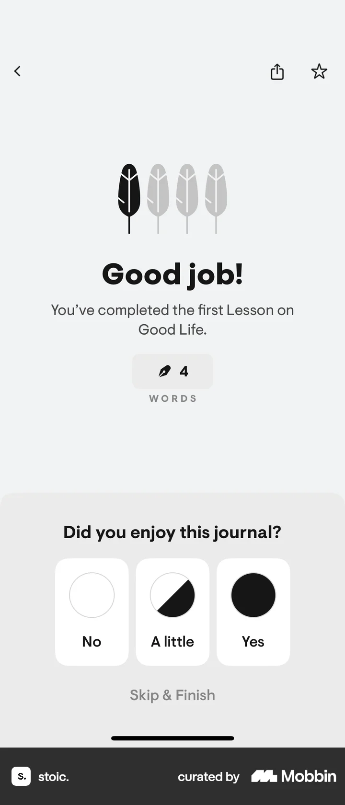
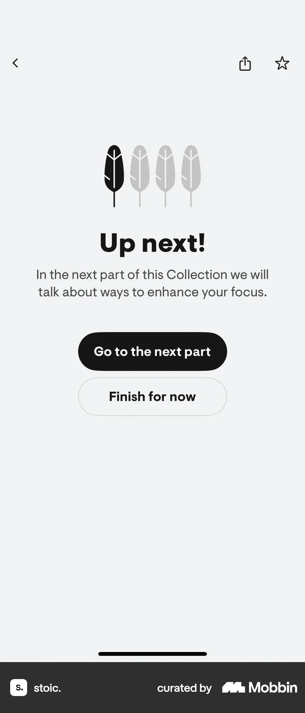

# Completing a lesson from Collection detail

- Mobbin 상세 페이지: https://mobbin.com/flows/92380915-d1d3-4c2b-b2da-f6f7a6e2c84b?tab=screens
- 앱·기기: stoic. iOS, 393×852
- 화면 수: 상세 페이지 6장 / 저장 이미지 6장 / 아래 설명 6개
- 검증 상태: **blocked** — 완료 후 피드백을 선택했는지 건너뛰었는지 화면에서 확인할 수 없다.

## 화면별 기록

1.  `On Good Life.` 컬렉션의 첫 카드 `On Good Mornings`에 `Begin`이 보인다. `Begin`을 누른다. 다음 화면에서는 `On Good Mornings.` 수업의 도입 설명과 오른쪽 진행 화살표가 보인다.
2.  `On Good Mornings.` 수업의 도입 설명과 오른쪽 진행 화살표가 보인다. 진행 화살표로 성찰 질문으로 이동한다. 다음 화면에서는 `Imagine a perfect day...` 질문에 아침·오후·저녁 일정을 적은 답변이 있고 오른쪽 진행 화살표가 보인다.
3.  `Imagine a perfect day...` 질문에 아침·오후·저녁 일정을 적은 답변이 있고 오른쪽 진행 화살표가 보인다. 답변을 완료하고 다음으로 진행한다. 다음 화면에서는 `Good job!` 화면에 첫 수업 완료, 4 words와 `Did you enjoy this journal?` 피드백 질문이 보인다.
4.  `Good job!` 화면에 첫 수업 완료, 4 words와 `Did you enjoy this journal?` 피드백 질문이 보인다. 피드백을 선택하거나 건너뛴다. 어느 쪽인지는 화면에서 확인 불가. 다음 화면에서는 `Up next!`에 다음 수업 안내와 `Go to the next part`, `Finish for now`가 보인다.
5.  `Up next!`에 다음 수업 안내와 `Go to the next part`, `Finish for now`가 보인다. `Finish for now`를 선택한 것으로 추정한다. 다음 화면에서는 컬렉션 상세로 돌아와 `On Good Mornings`가 `Read`와 체크로 표시된다.
6.  컬렉션 상세로 돌아와 `On Good Mornings`가 `Read`와 체크로 표시된다.

## BMad handoff notes

- **관찰된 진입 상태:** On Good Life 컬렉션의 첫 수업 카드.
- **주요 행동:** 첫 수업을 시작하고 완벽한 하루 질문에 답한 뒤 마친다.
- **기대 결과:** 수업 완료와 다음 수업 안내가 나오며 컬렉션 카드에 완료 체크가 붙는다.
- **되돌릴 수 있거나 파괴적인 동작:** 완료된 수업은 Read로 재열람 가능하다. 답변 수정·삭제 경로는 확인 불가.
