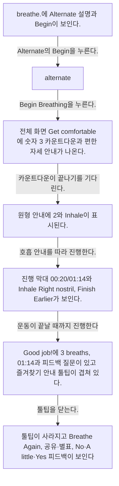
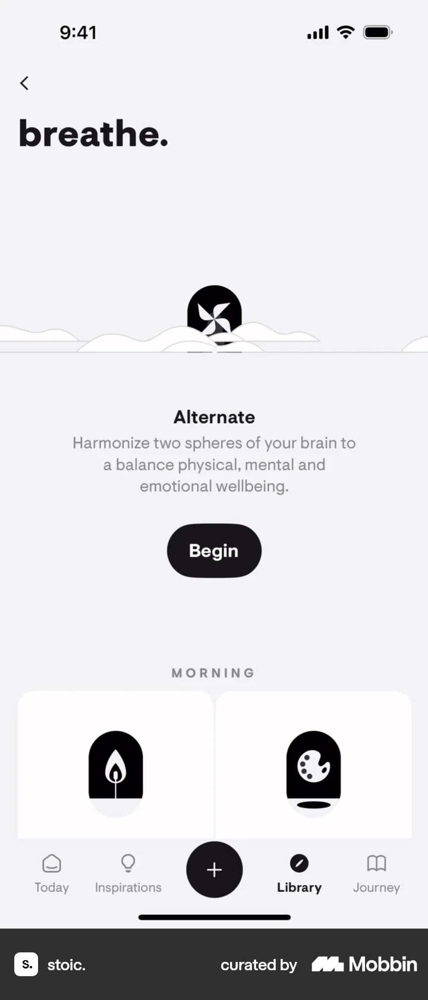
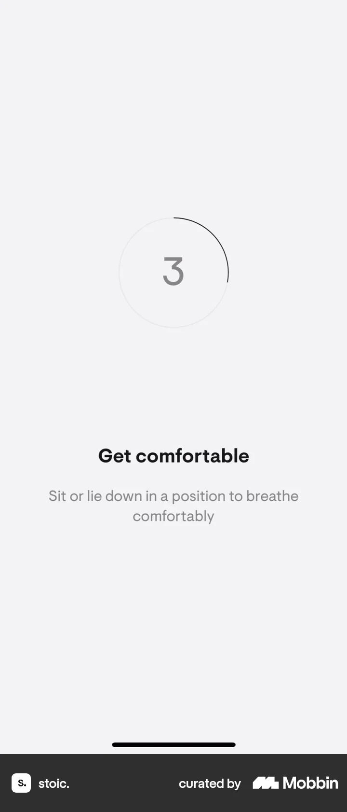
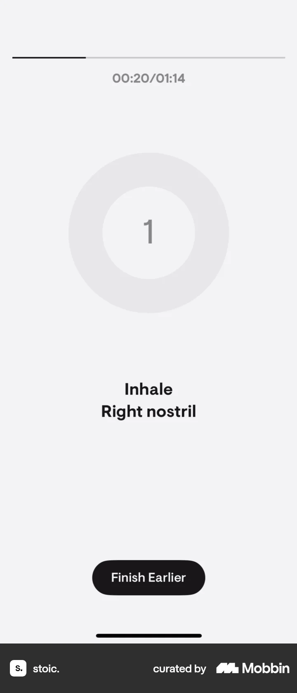
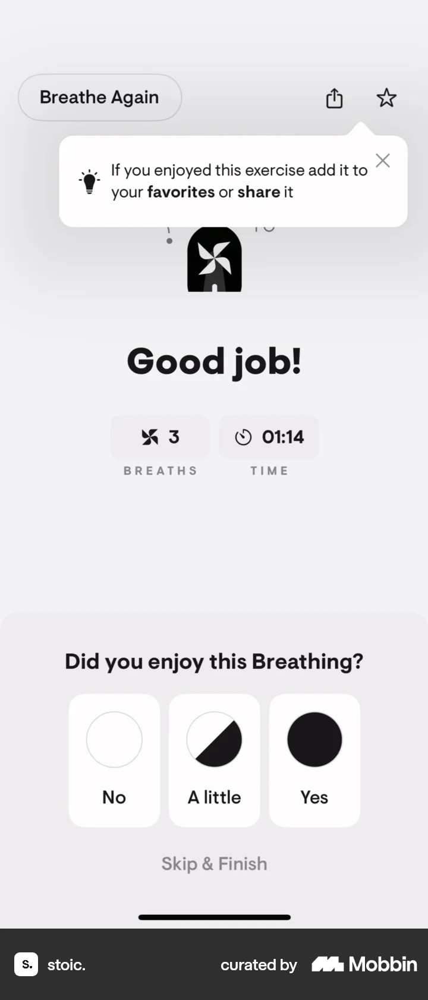
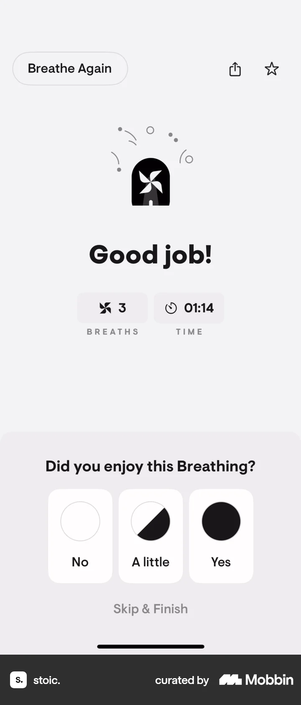

# Completing an exercise (breathing) from Breathe

- Mobbin 상세 페이지: https://mobbin.com/flows/9ca89b41-e6bd-4978-a9f0-02360e3f735c?tab=screens
- 앱·기기: stoic. iOS, 393×852
- 화면 수: 상세 페이지 7장 / 저장 이미지 7장 / 아래 설명 7개
- 검증 상태: **verified** — 목록 제목·상세 제목·URL과 화면별 이미지 수·순서·상태 변화를 대조했다.

## 화면별 기록

1.  `breathe.`에 Alternate 설명과 `Begin`이 보인다. Alternate의 `Begin`을 누른다. 다음 화면에서는 `alternate.` 시트에 1·2·4분 길이, `More`, `Begin Breathing`이 보이고 1분이 선택돼 있다.
2.  `alternate.` 시트에 1·2·4분 길이, `More`, `Begin Breathing`이 보이고 1분이 선택돼 있다. `Begin Breathing`을 누른다. 다음 화면에서는 전체 화면 `Get comfortable`에 숫자 3 카운트다운과 편한 자세 안내가 나온다.
3.  전체 화면 `Get comfortable`에 숫자 3 카운트다운과 편한 자세 안내가 나온다. 카운트다운이 끝나기를 기다린다. 다음 화면에서는 원형 안내에 `2`와 `Inhale`이 표시된다.
4.  원형 안내에 `2`와 `Inhale`이 표시된다. 호흡 안내를 따라 진행한다. 다음 화면에서는 진행 막대 00:20/01:14와 `Inhale Right nostril`, `Finish Earlier`가 보인다.
5.  진행 막대 00:20/01:14와 `Inhale Right nostril`, `Finish Earlier`가 보인다. 운동이 끝날 때까지 진행한다. 조기 종료 여부는 화면에서 확인 불가. 다음 화면에서는 `Good job!`에 3 breaths, 01:14과 피드백 질문이 있고 즐겨찾기 안내 툴팁이 겹쳐 있다.
6.  `Good job!`에 3 breaths, 01:14과 피드백 질문이 있고 즐겨찾기 안내 툴팁이 겹쳐 있다. 툴팁을 닫는다. 다음 화면에서는 툴팁이 사라지고 `Breathe Again`, 공유·별표, No·A little·Yes 피드백이 보인다. 피드백 선택 결과는 확인 불가.
7.  툴팁이 사라지고 `Breathe Again`, 공유·별표, No·A little·Yes 피드백이 보인다. 피드백 선택 결과는 확인 불가.

## BMad handoff notes

- **관찰된 진입 상태:** breathe 섹션의 Alternate 호흡 운동.
- **주요 행동:** 1분 Alternate를 시작해 카운트다운과 호흡 안내를 따른다.
- **기대 결과:** 완료 화면에 3 breaths와 01:14가 표시된다.
- **되돌릴 수 있거나 파괴적인 동작:** 도중 `Finish Earlier`, 완료 후 `Breathe Again`이 보인다. 피드백 결과와 기록 삭제는 확인 불가.
