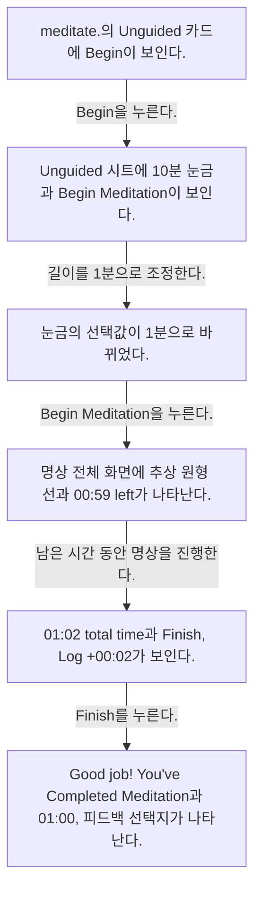
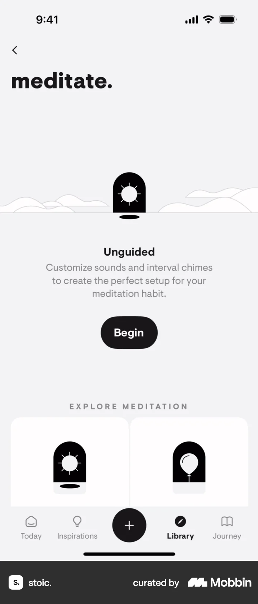
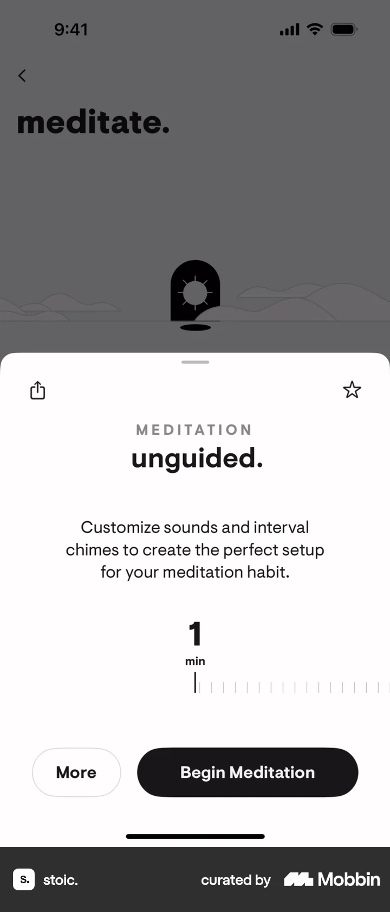
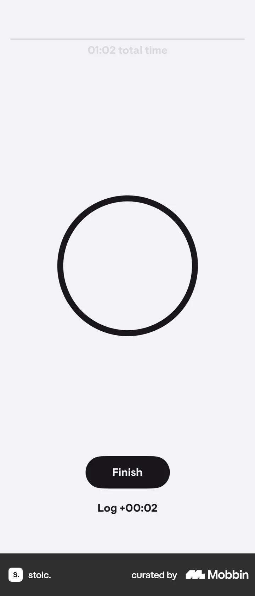
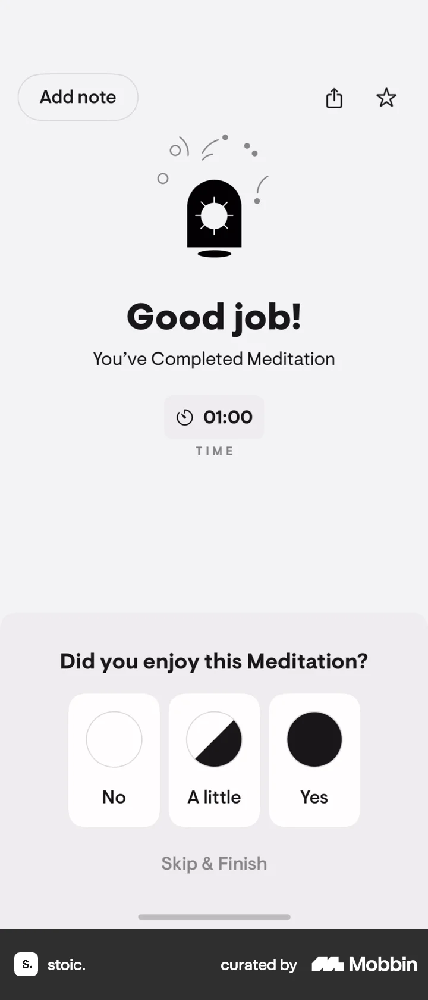

# Completing an exercise (meditation) from Meditate

- Mobbin 상세 페이지: https://mobbin.com/flows/2f47389f-316e-4118-8cca-2ad0323be980?tab=screens
- 앱·기기: stoic. iOS, 393×852
- 화면 수: 상세 페이지 6장 / 저장 이미지 6장 / 아래 설명 6개
- 검증 상태: **verified** — 목록 제목·상세 제목·URL과 화면별 이미지 수·순서·상태 변화를 대조했다.

## 화면별 기록

1.  `meditate.`의 Unguided 카드에 `Begin`이 보인다. `Begin`을 누른다. 다음 화면에서는 Unguided 시트에 10분 눈금과 `Begin Meditation`이 보인다.
2.  Unguided 시트에 10분 눈금과 `Begin Meditation`이 보인다. 길이를 1분으로 조정한다. 다음 화면에서는 눈금의 선택값이 1분으로 바뀌었다.
3.  눈금의 선택값이 1분으로 바뀌었다. `Begin Meditation`을 누른다. 다음 화면에서는 명상 전체 화면에 추상 원형 선과 `00:59 left`가 나타난다.
4.  명상 전체 화면에 추상 원형 선과 `00:59 left`가 나타난다. 남은 시간 동안 명상을 진행한다. 다음 화면에서는 `01:02 total time`과 `Finish`, `Log +00:02`가 보인다.
5.  `01:02 total time`과 `Finish`, `Log +00:02`가 보인다. `Finish`를 누른다. 다음 화면에서는 `Good job! You've Completed Meditation`과 01:00, 피드백 선택지가 나타난다.
6.  `Good job! You've Completed Meditation`과 01:00, 피드백 선택지가 나타난다.

## BMad handoff notes

- **관찰된 진입 상태:** meditate 섹션의 Unguided 명상.
- **주요 행동:** 길이를 1분으로 바꾸고 명상을 시작한 뒤 Finish로 끝낸다.
- **기대 결과:** 완료 화면에 01:00이 기록된다. 피드백 전송 결과는 확인 불가.
- **되돌릴 수 있거나 파괴적인 동작:** 실행 중 종료와 마지막 화면의 Add note가 보인다. 기록 삭제 경로는 확인 불가.
