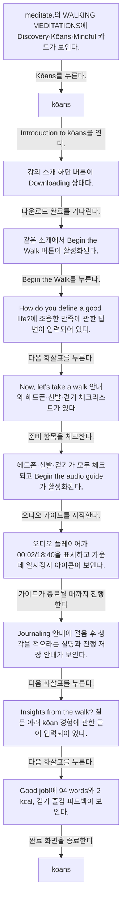
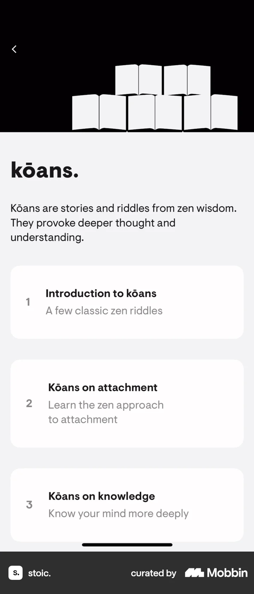
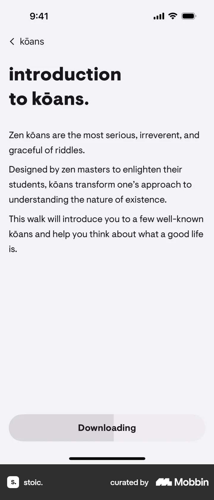
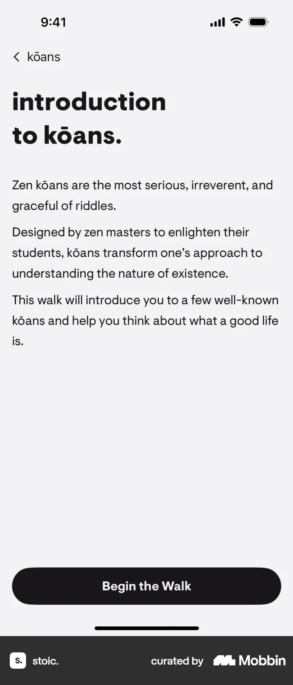
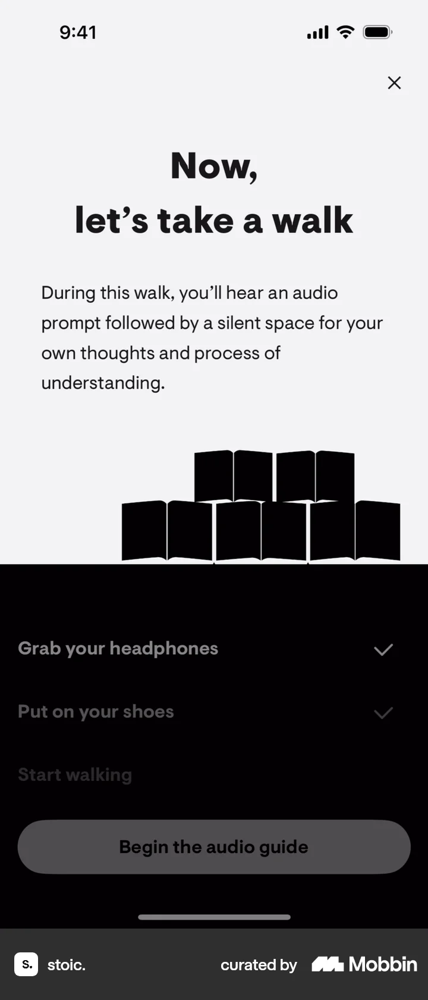
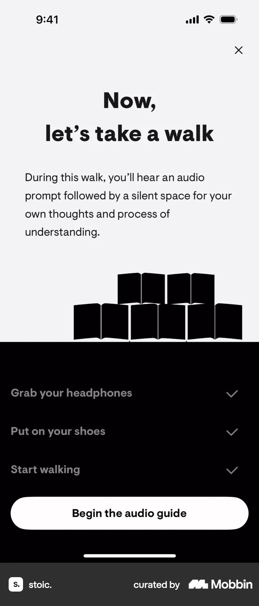
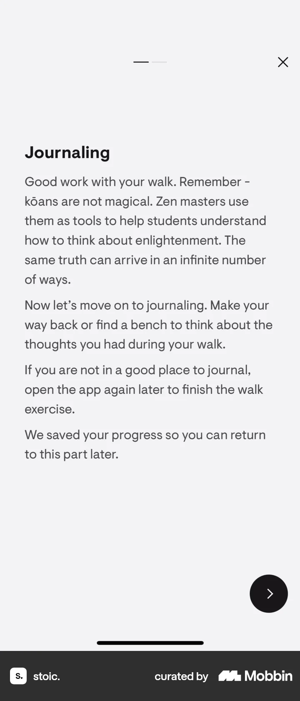
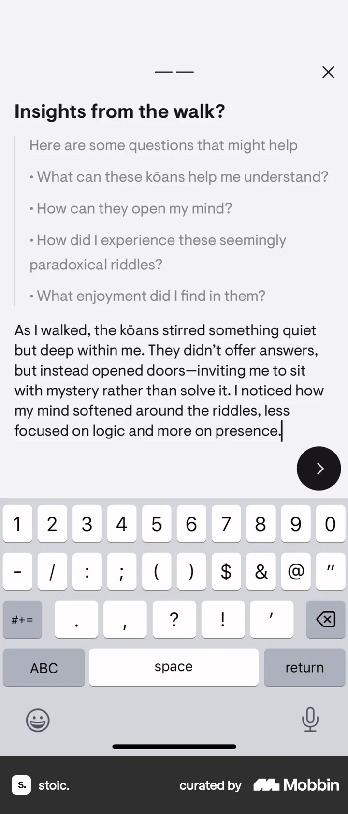
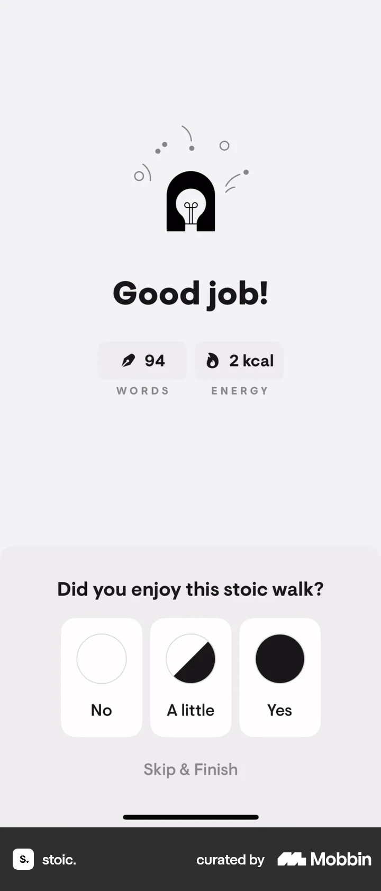
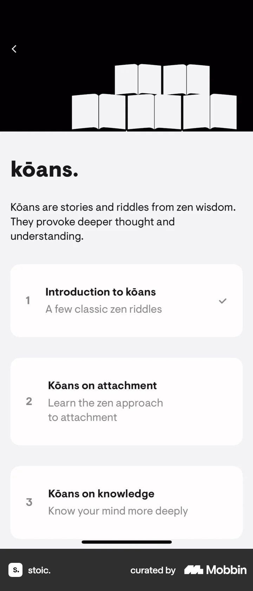

# Completing an exercise (walking meditation) from Meditate

- Mobbin 상세 페이지: https://mobbin.com/flows/39c34c63-77e8-412b-8d8a-b7e58a223d1d?tab=screens
- 앱·기기: stoic. iOS, 393×852
- 화면 수: 상세 페이지 12장 / 저장 이미지 12장 / 아래 설명 12개
- 검증 상태: **blocked** — 8→9 18:40 오디오의 재생 완료 과정과 11→12 종료 입력이 캡처되지 않았다.

## 화면별 기록

1.  meditate.의 WALKING MEDITATIONS에 Discovery·Kōans·Mindful 카드가 보인다. `Kōans`를 누른다. 다음 화면에서는 kōans. 컬렉션에 Introduction to kōans와 후속 강의 카드가 보인다.
2.  kōans. 컬렉션에 Introduction to kōans와 후속 강의 카드가 보인다. `Introduction to kōans`를 연다. 다음 화면에서는 강의 소개 하단 버튼이 `Downloading` 상태다.
3.  강의 소개 하단 버튼이 `Downloading` 상태다. 다운로드 완료를 기다린다. 다음 화면에서는 같은 소개에서 `Begin the Walk` 버튼이 활성화된다.
4.  같은 소개에서 `Begin the Walk` 버튼이 활성화된다. `Begin the Walk`를 누른다. 다음 화면에서는 `How do you define a good life?`에 조용한 만족에 관한 답변이 입력되어 있다.
5.  `How do you define a good life?`에 조용한 만족에 관한 답변이 입력되어 있다. 다음 화살표를 누른다. 다음 화면에서는 `Now, let's take a walk` 안내와 헤드폰·신발·걷기 체크리스트가 있다. 오디오 시작 버튼은 비활성이다.
6.  `Now, let's take a walk` 안내와 헤드폰·신발·걷기 체크리스트가 있다. 오디오 시작 버튼은 비활성이다. 준비 항목을 체크한다. 다음 화면에서는 헤드폰·신발·걷기가 모두 체크되고 `Begin the audio guide`가 활성화된다.
7.  헤드폰·신발·걷기가 모두 체크되고 `Begin the audio guide`가 활성화된다. 오디오 가이드를 시작한다. 다음 화면에서는 오디오 플레이어가 00:02/18:40을 표시하고 가운데 일시정지 아이콘이 보인다.
8.  오디오 플레이어가 00:02/18:40을 표시하고 가운데 일시정지 아이콘이 보인다. 가이드가 종료될 때까지 진행한다. 경과 과정은 화면에서 확인 불가. 다음 화면에서는 `Journaling` 안내에 걸음 후 생각을 적으라는 설명과 진행 저장 안내가 보인다.
9.  `Journaling` 안내에 걸음 후 생각을 적으라는 설명과 진행 저장 안내가 보인다. 다음 화살표를 누른다. 다음 화면에서는 `Insights from the walk?` 질문 아래 kōan 경험에 관한 글이 입력되어 있다.
10.  `Insights from the walk?` 질문 아래 kōan 경험에 관한 글이 입력되어 있다. 다음 화살표를 누른다. 다음 화면에서는 `Good job!`에 94 words와 2 kcal, 걷기 즐김 피드백이 보인다.
11.  `Good job!`에 94 words와 2 kcal, 걷기 즐김 피드백이 보인다. 완료 화면을 종료한다. 정확한 입력은 화면에서 확인 불가. 다음 화면에서는 kōans. 목록의 Introduction to kōans 카드에 완료 체크가 표시된다.
12.  kōans. 목록의 Introduction to kōans 카드에 완료 체크가 표시된다.

## BMad handoff notes

- **관찰된 진입 상태:** Library의 meditate. 걷기 명상 목록.
- **주요 행동:** Kōans 첫 강의를 받아 사전 질문에 답하고 준비 체크 후 오디오 가이드를 듣고 저널을 작성한다.
- **기대 결과:** 94단어·2 kcal 완료 화면과 첫 강의 완료 체크가 보인다.
- **되돌릴 수 있거나 파괴적인 동작:** 진행 화면의 X와 소개 화면의 뒤로 가기가 보인다. 완료 후 기록 삭제는 확인 불가.
