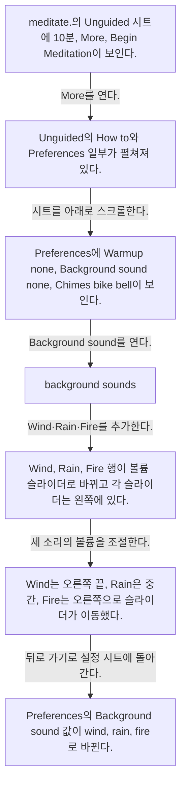
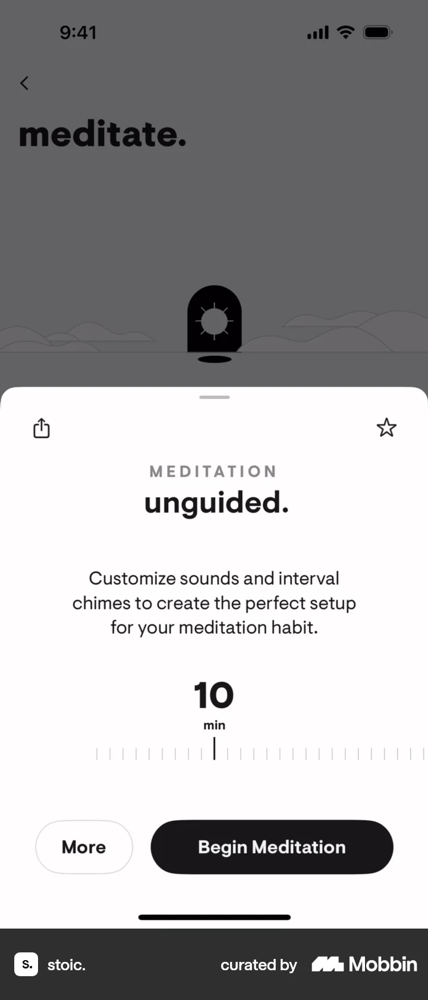
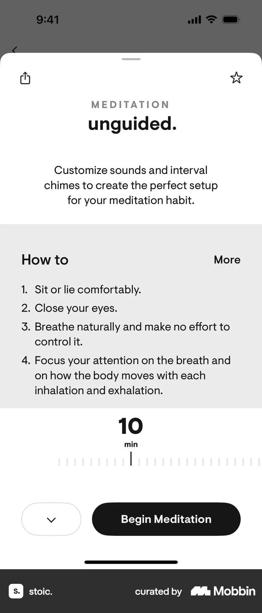
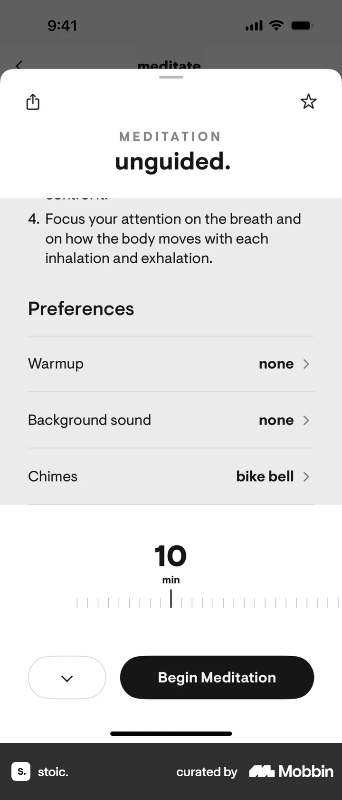
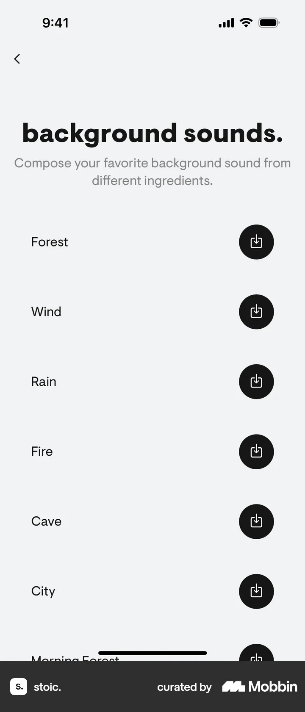
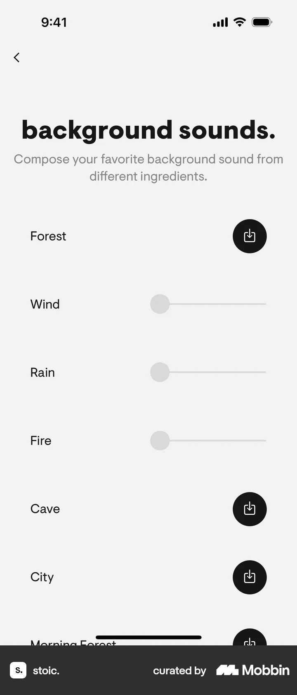
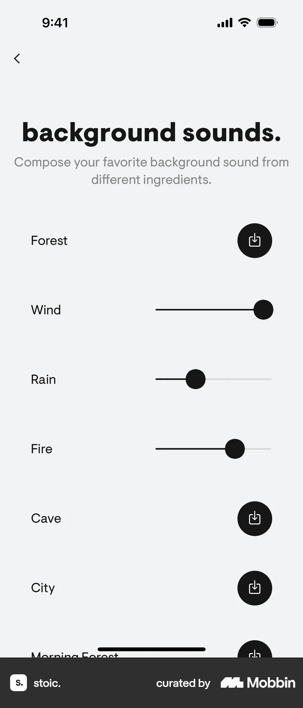

# Customizing background sounds from Completing an exercise (meditation)

- Mobbin 상세 페이지: https://mobbin.com/flows/55313375-ed81-4d66-afce-da326af60fda?tab=screens
- 앱·기기: stoic. iOS, 393×852
- 화면 수: 상세 페이지 7장 / 저장 이미지 7장 / 아래 설명 7개
- 검증 상태: **verified** — 목록 제목·상세 제목·URL과 화면별 이미지 수·순서·상태 변화를 대조했다.

## 화면별 기록

1.  `meditate.`의 Unguided 시트에 10분, `More`, `Begin Meditation`이 보인다. `More`를 연다. 다음 화면에서는 Unguided의 `How to`와 Preferences 일부가 펼쳐져 있다.
2.  Unguided의 `How to`와 Preferences 일부가 펼쳐져 있다. 시트를 아래로 스크롤한다. 다음 화면에서는 Preferences에 Warmup none, Background sound none, Chimes bike bell이 보인다.
3.  Preferences에 Warmup none, Background sound none, Chimes bike bell이 보인다. `Background sound`를 연다. 다음 화면에서는 `background sounds.` 목록에 Forest, Wind, Rain, Fire 등이 검은 추가 버튼으로 보인다.
4.  `background sounds.` 목록에 Forest, Wind, Rain, Fire 등이 검은 추가 버튼으로 보인다. Wind·Rain·Fire를 추가한다. 다음 화면에서는 Wind, Rain, Fire 행이 볼륨 슬라이더로 바뀌고 각 슬라이더는 왼쪽에 있다.
5.  Wind, Rain, Fire 행이 볼륨 슬라이더로 바뀌고 각 슬라이더는 왼쪽에 있다. 세 소리의 볼륨을 조절한다. 다음 화면에서는 Wind는 오른쪽 끝, Rain은 중간, Fire는 오른쪽으로 슬라이더가 이동했다.
6.  Wind는 오른쪽 끝, Rain은 중간, Fire는 오른쪽으로 슬라이더가 이동했다. 뒤로 가기로 설정 시트에 돌아간다. 다음 화면에서는 Preferences의 Background sound 값이 `wind, rain, fire`로 바뀐다.
7.  Preferences의 Background sound 값이 `wind, rain, fire`로 바뀐다.

## BMad handoff notes

- **관찰된 진입 상태:** Unguided 명상의 10분 설정 시트.
- **주요 행동:** Background sound에서 Wind·Rain·Fire를 추가하고 볼륨을 조절한다.
- **기대 결과:** 설정 요약에 wind, rain, fire가 반영된다. 명상 실행은 확인 불가.
- **되돌릴 수 있거나 파괴적인 동작:** 소리와 볼륨을 다시 조절할 수 있다. 삭제 동작은 없다.
