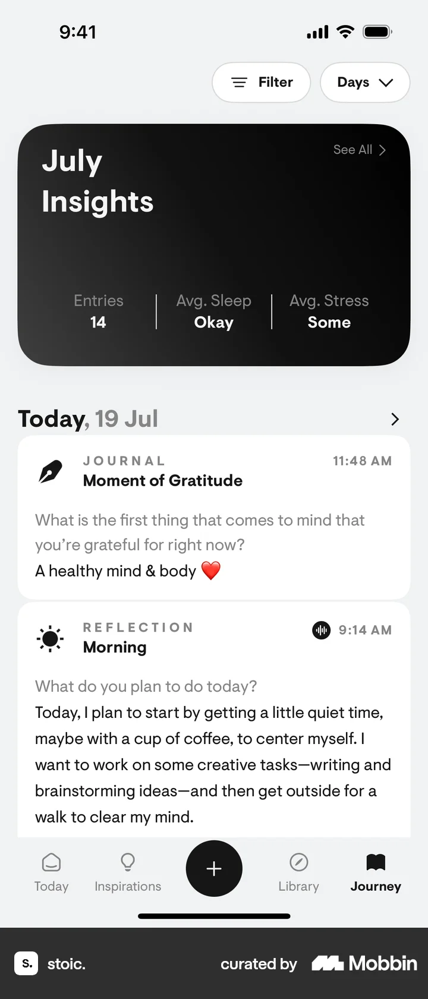

# Daily entries from Journey

- Mobbin 상세 페이지: https://mobbin.com/flows/57fd0d4e-72ed-4dec-9d48-5cd80cd16dab?tab=screens
- 앱·기기: stoic. iOS, 393×852
- 화면 수: 상세 페이지 2장 / 저장 이미지 2장 / 아래 설명 2개
- 검증 상태: **verified** — 목록 제목·상세 제목·URL과 화면별 이미지 수·순서·상태 변화를 대조했다.

## 화면별 기록

1.  Journey에 `July Insights`, 오늘 19 Jul의 Moment of Gratitude와 Morning Reflection 카드가 보인다. `Today, 19 Jul` 행을 누른다. 다음 화면에서는 `19 JULY Saturday` 일일 목록에 두 기록과 Morning Reflection의 수면·집중·계획 답변이 펼쳐져 있다.
2.  `19 JULY Saturday` 일일 목록에 두 기록과 Morning Reflection의 수면·집중·계획 답변이 펼쳐져 있다.

## BMad handoff notes

- **관찰된 진입 상태:** Journey 날짜별 카드 목록.
- **주요 행동:** 오늘 날짜 행을 열어 일일 기록을 본다.
- **기대 결과:** 19 July의 저널과 Morning Reflection이 한 화면에 나타난다.
- **되돌릴 수 있거나 파괴적인 동작:** 뒤로 가기로 Journey 목록에 돌아갈 수 있다. 삭제 동작은 없다.
