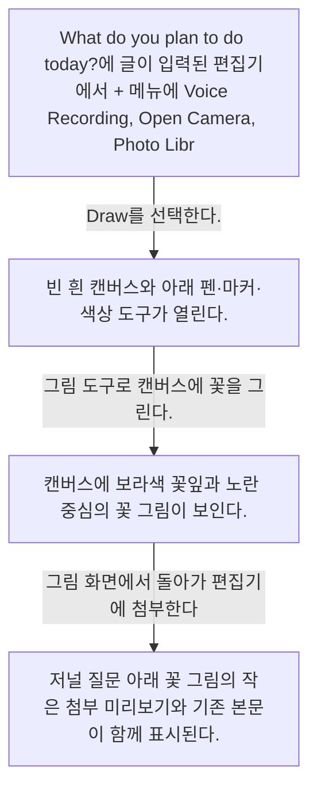
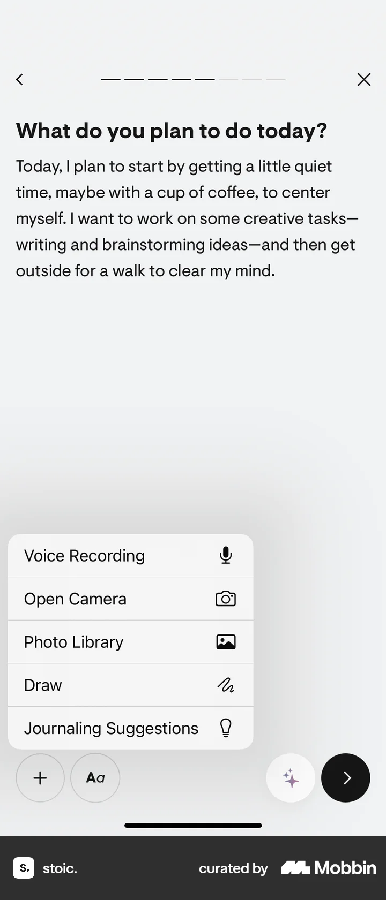
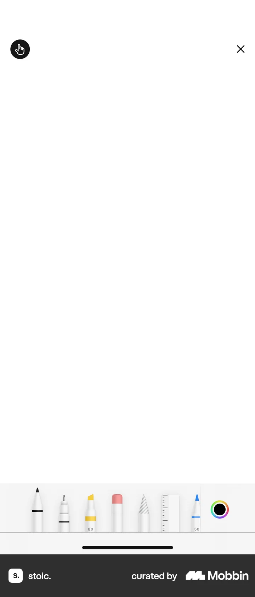
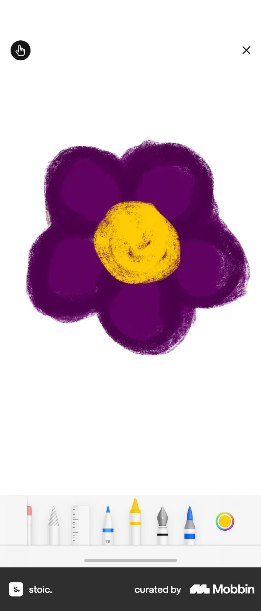
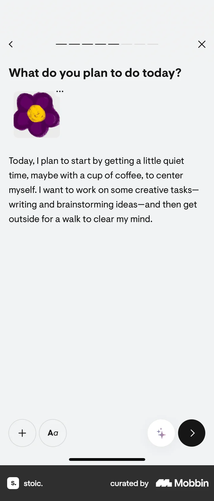

# Drawing a sketch from Recording a voice note

- Mobbin 상세 페이지: https://mobbin.com/flows/e6ca1bb5-350b-49b6-9074-e35ddd18f046?tab=screens
- 앱·기기: stoic. iOS, 393×852
- 화면 수: 상세 페이지 4장 / 저장 이미지 4장 / 아래 설명 4개
- 검증 상태: **blocked** — 그림 화면에서 저널 첨부로 돌아오는 저장·완료 조작이 캡처에 보이지 않는다.

## 화면별 기록

1.  `What do you plan to do today?`에 글이 입력된 편집기에서 `+` 메뉴에 Voice Recording, Open Camera, Photo Library, Draw가 보인다. `Draw`를 선택한다. 다음 화면에서는 빈 흰 캔버스와 아래 펜·마커·색상 도구가 열린다.
2.  빈 흰 캔버스와 아래 펜·마커·색상 도구가 열린다. 그림 도구로 캔버스에 꽃을 그린다. 다음 화면에서는 캔버스에 보라색 꽃잎과 노란 중심의 꽃 그림이 보인다.
3.  캔버스에 보라색 꽃잎과 노란 중심의 꽃 그림이 보인다. 그림 화면에서 돌아가 편집기에 첨부한다. 완료 제스처는 화면에서 확인 불가. 다음 화면에서는 저널 질문 아래 꽃 그림의 작은 첨부 미리보기와 기존 본문이 함께 표시된다.
4.  저널 질문 아래 꽃 그림의 작은 첨부 미리보기와 기존 본문이 함께 표시된다.

## BMad handoff notes

- **관찰된 진입 상태:** 이미 텍스트가 있는 일일 성찰 편집기에서 첨부 메뉴가 열려 있다.
- **주요 행동:** Draw를 열어 꽃을 그린 뒤 저널에 첨부한다.
- **기대 결과:** 꽃 그림이 본문 위에 첨부 미리보기로 나타난다. 성찰 전체 저장 여부는 화면에서 확인 불가.
- **되돌릴 수 있거나 파괴적인 동작:** 첨부 미리보기의 옵션 메뉴는 보이나 제거 동작과 결과는 화면에서 확인 불가.
