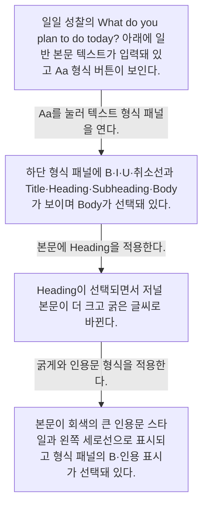
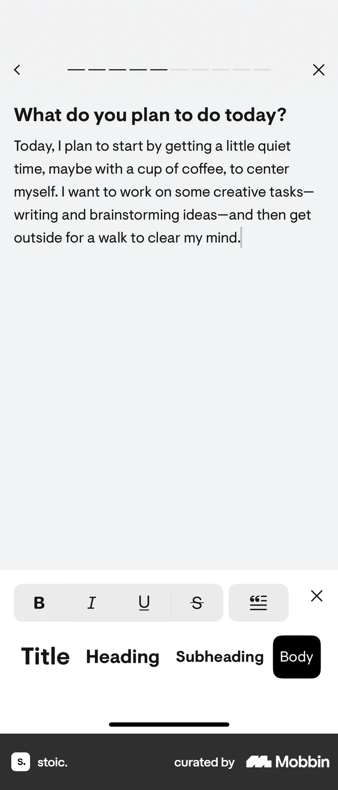
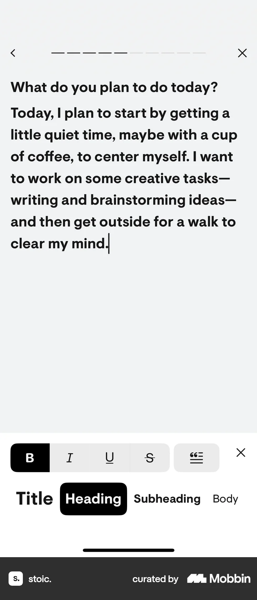
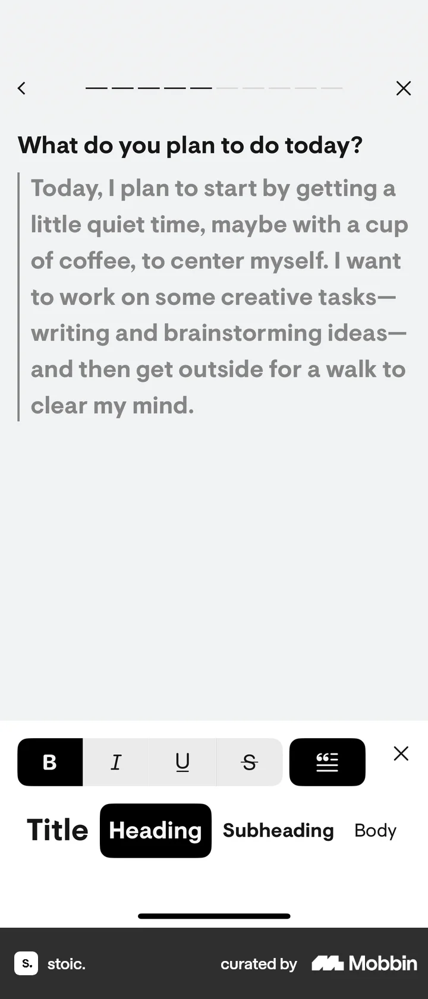

# Editing text format from Logging a daily reflection (morning)

- Mobbin 상세 페이지: https://mobbin.com/flows/7a22dbb1-23c6-4b84-ad6d-e2ea2ccb334d?tab=screens
- 앱·기기: stoic. iOS, 393×852
- 화면 수: 상세 페이지 4장 / 저장 이미지 4장 / 아래 설명 4개
- 검증 상태: **verified** — 목록 제목·상세 제목·URL과 화면별 이미지 수·순서·상태 변화를 대조했다.

## 화면별 기록

1.  일일 성찰의 `What do you plan to do today?` 아래에 일반 본문 텍스트가 입력돼 있고 `Aa` 형식 버튼이 보인다. `Aa`를 눌러 텍스트 형식 패널을 연다. 다음 화면에서는 하단 형식 패널에 B·I·U·취소선과 Title·Heading·Subheading·Body가 보이며 Body가 선택돼 있다.
2.  하단 형식 패널에 B·I·U·취소선과 Title·Heading·Subheading·Body가 보이며 Body가 선택돼 있다. 본문에 Heading을 적용한다. 다음 화면에서는 `Heading`이 선택되면서 저널 본문이 더 크고 굵은 글씨로 바뀐다.
3.  `Heading`이 선택되면서 저널 본문이 더 크고 굵은 글씨로 바뀐다. 굵게와 인용문 형식을 적용한다. 다음 화면에서는 본문이 회색의 큰 인용문 스타일과 왼쪽 세로선으로 표시되고 형식 패널의 B·인용 표시가 선택돼 있다.
4.  본문이 회색의 큰 인용문 스타일과 왼쪽 세로선으로 표시되고 형식 패널의 B·인용 표시가 선택돼 있다.

## BMad handoff notes

- **관찰된 진입 상태:** 텍스트가 입력된 일일 성찰 편집기.
- **주요 행동:** Aa 형식 패널에서 본문을 Heading으로 바꾸고 굵게·인용문 형식을 적용한다.
- **기대 결과:** 동일한 글의 크기·굵기·인용 레이아웃이 변한다. 저장 완료 여부는 화면에서 확인 불가.
- **되돌릴 수 있거나 파괴적인 동작:** 형식 버튼을 다시 선택해 바꿀 수 있다. 원문 삭제는 관찰되지 않는다.
