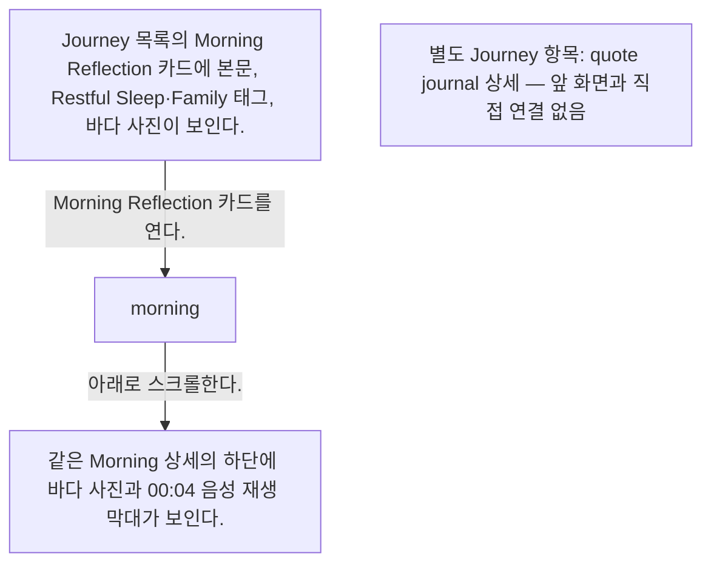
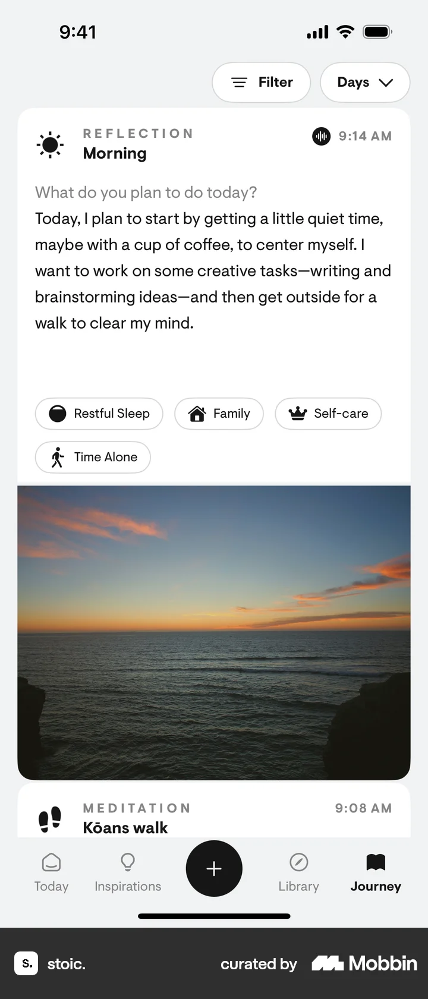
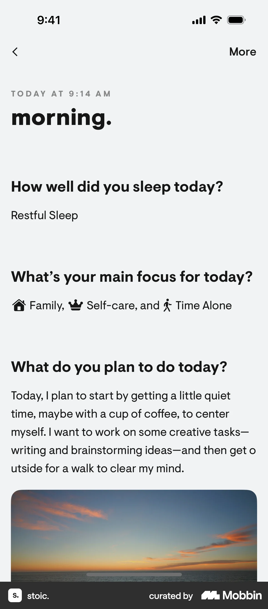
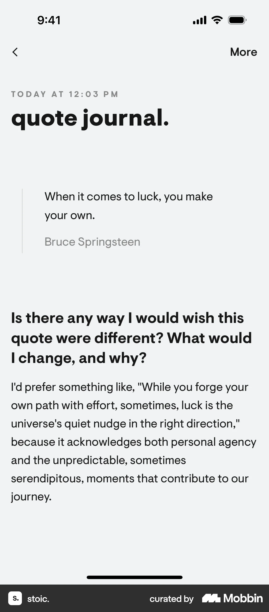

# Entry detail from Journey

- Mobbin 상세 페이지: https://mobbin.com/flows/6d60494e-372e-40eb-9a85-7918a006669d?tab=screens
- 앱·기기: stoic. iOS, 393×852
- 화면 수: 상세 페이지 4장 / 저장 이미지 4장 / 아래 설명 4개
- 검증 상태: **blocked** — 화면 4의 Quote Journal 상세는 Morning Reflection 상세에서 이어진 화면이 아니다. 사용자 확인에 따르면 Journey의 별도 Quote Journal 기록을 열었을 때 나오는 화면이 이 플로우에 섞여 있다. 목록 복귀·별도 기록 선택 화면이 없어 하나의 연속 플로우로 검증할 수 없다.

## 화면별 기록

1.  Journey 목록의 Morning Reflection 카드에 본문, Restful Sleep·Family 태그, 바다 사진이 보인다. Morning Reflection 카드를 연다. 다음 화면에서는 `morning.` 상세에 수면, 오늘의 집중, 계획 문장과 바다 사진이 보인다.
2.  `morning.` 상세에 수면, 오늘의 집중, 계획 문장과 바다 사진이 보인다. 아래로 스크롤한다. 다음 화면에서는 같은 Morning 상세의 하단에 바다 사진과 00:04 음성 재생 막대가 보인다.
3.  같은 Morning 상세의 하단에 바다 사진과 00:04 음성 재생 막대가 보인다. 다음 이미지는 Journey의 별도 Quote Journal 기록을 열었을 때의 상세 화면이 잘못 섞인 것이다(사용자 확인). 목록 복귀와 별도 기록 선택 과정은 캡처되지 않았다.
4.  `quote journal.` 상세에 Bruce Springsteen 명언과 질문에 대한 긴 답변이 보인다. 이 화면은 Journey의 별도 Quote Journal 기록을 열었을 때 표시되며, 앞선 Morning Reflection과 직접 이어지지 않는다.

## BMad handoff notes

- **관찰된 진입 상태:** Journey의 Morning Reflection 카드.
- **주요 행동:** Journey의 Morning Reflection 상세를 열어 사진·음성까지 스크롤한다. 별도 Quote Journal 상세 이미지가 뒤에 섞여 있으므로 두 기록을 하나의 전환으로 구현하지 않는다.
- **기대 결과:** Morning Reflection 상세와 별도 Quote Journal 상세가 각각 보인다. 두 화면의 직접 연결은 기대 결과로 취급하지 않는다.
- **되돌릴 수 있거나 파괴적인 동작:** 상세에서 뒤로 가기가 보인다. 수정·삭제 경로는 이 플로우에서 확인 불가.
