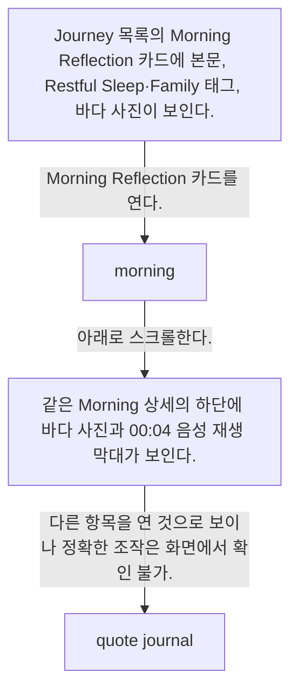

# Entry detail from Journey

- Mobbin 상세 페이지: https://mobbin.com/flows/6d60494e-372e-40eb-9a85-7918a006669d?tab=screens
- 앱·기기: stoic. iOS, 393×852
- 화면 수: 상세 페이지 4장 / 저장 이미지 4장 / 아래 설명 4개
- 검증 상태: **blocked** — Morning Reflection 상세에서 Quote Journal 상세로 이동한 진입 행동이 캡처에 없다.

## 화면별 기록

1.  Journey 목록의 Morning Reflection 카드에 본문, Restful Sleep·Family 태그, 바다 사진이 보인다. Morning Reflection 카드를 연다. 다음 화면에서는 `morning.` 상세에 수면, 오늘의 집중, 계획 문장과 바다 사진이 보인다.
2.  `morning.` 상세에 수면, 오늘의 집중, 계획 문장과 바다 사진이 보인다. 아래로 스크롤한다. 다음 화면에서는 같은 Morning 상세의 하단에 바다 사진과 00:04 음성 재생 막대가 보인다.
3.  같은 Morning 상세의 하단에 바다 사진과 00:04 음성 재생 막대가 보인다. 다른 항목을 연 것으로 보이나 정확한 조작은 화면에서 확인 불가. 다음 화면에서는 `quote journal.` 상세에 Bruce Springsteen 명언과 질문에 대한 긴 답변이 보인다.
4.  `quote journal.` 상세에 Bruce Springsteen 명언과 질문에 대한 긴 답변이 보인다.

## BMad handoff notes

- **관찰된 진입 상태:** Journey의 Morning Reflection 카드.
- **주요 행동:** Morning 상세를 열고 사진·음성까지 스크롤한다. Quote Journal로의 전환은 확인 불가.
- **기대 결과:** 두 종류의 기록 상세가 보인다.
- **되돌릴 수 있거나 파괴적인 동작:** 상세에서 뒤로 가기가 보인다. 수정·삭제 경로는 이 플로우에서 확인 불가.
