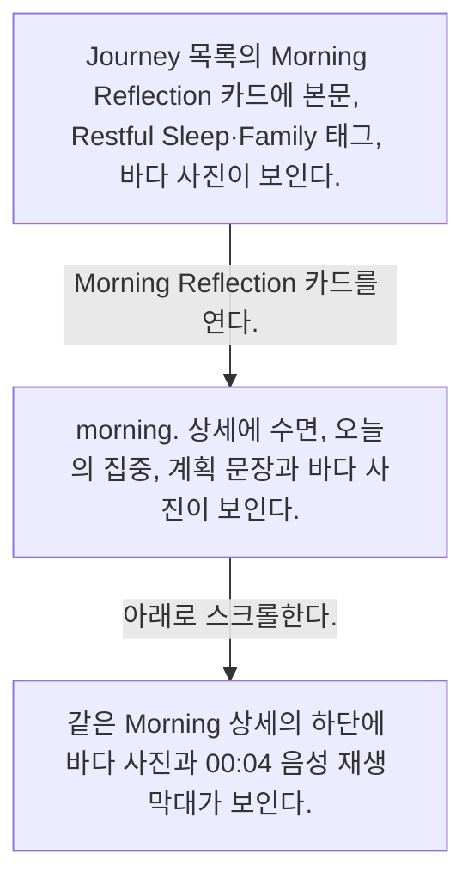

# Entry detail from Journey

- Mobbin 상세 페이지: https://mobbin.com/flows/6d60494e-372e-40eb-9a85-7918a006669d?tab=screens
- 앱·기기: stoic. iOS, 393×852
- 화면 수: Mobbin 상세 페이지 4장 / 플로우 채택 3장 / `screenshots/` 이미지 3장 / 아래 설명 3개
- 검증 상태: **verified** — 목록·상세 제목과 URL을 확인했다. 앞의 3장은 Journey의 Morning Reflection 기록을 여는 연속 플로우다. 4번째 Quote Journal 이미지는 별도 기록이 잘못 섞인 것으로 사용자 확인을 받아 플로우에서 제외했다. 제외 원본은 [excluded/screen-04-quote-journal.webp](excluded/screen-04-quote-journal.webp)에 보존했다.

## 화면별 기록

1.  Journey 목록의 Morning Reflection 카드에 본문, Restful Sleep·Family 태그, 바다 사진이 보인다. Morning Reflection 카드를 연다. 다음 화면에서는 `morning.` 상세에 수면, 오늘의 집중, 계획 문장과 바다 사진이 보인다.
2.  `morning.` 상세에 수면, 오늘의 집중, 계획 문장과 바다 사진이 보인다. 아래로 스크롤한다. 다음 화면에서는 같은 Morning 상세의 하단에 바다 사진과 00:04 음성 재생 막대가 보인다.
3.  아래로 스크롤한 같은 Morning 상세의 하단에 바다 사진과 00:04 음성 재생 막대가 보인다. 사진과 음성 재생이 기록에 포함된 상태를 확인할 수 있다. 음성 재생 버튼을 누르는 동작은 이 플로우에 없다.

## 제외한 원본 화면

Mobbin 상세 페이지의 4번째 이미지는 Journey에서 **별도 Quote Journal 기록**을 열었을 때의 상세 화면이다. Morning Reflection 상세에서 바로 이어지는 화면이 아니므로 위 플로우의 화면 수·차트·단계 설명에서 제외했다. 원본 이미지는 [여기에 보존](excluded/screen-04-quote-journal.webp)했다.

## BMad handoff notes

- **관찰된 진입 상태:** Journey의 Morning Reflection 카드.
- **주요 행동:** Journey의 Morning Reflection 카드를 열고 상세 하단의 사진·음성까지 스크롤한다.
- **기대 결과:** Morning Reflection 기록의 본문, 사진, 00:04 음성 재생 막대가 보인다. 별도 Quote Journal 기록은 이 플로우에 포함하지 않는다.
- **되돌릴 수 있거나 파괴적인 동작:** 상세에서 뒤로 가기가 보인다. 수정·삭제 경로는 이 플로우에서 확인 불가.
