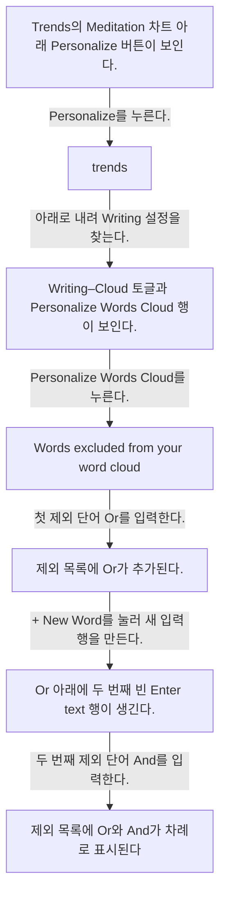
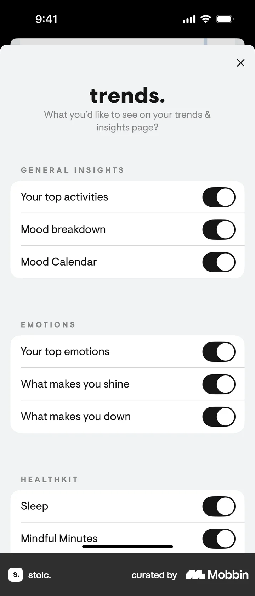
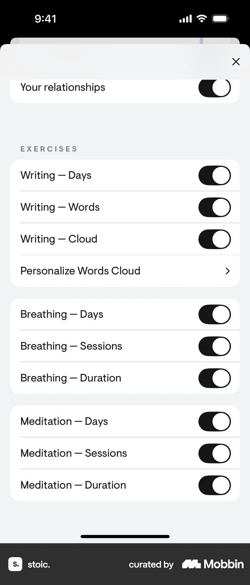
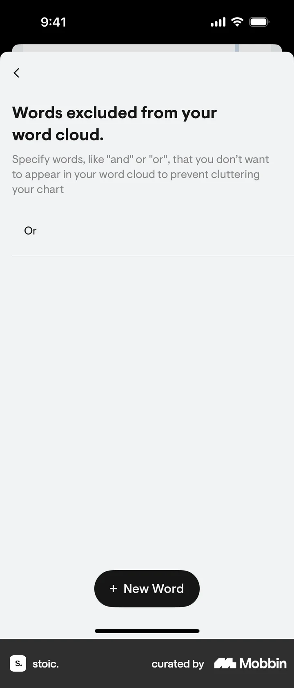
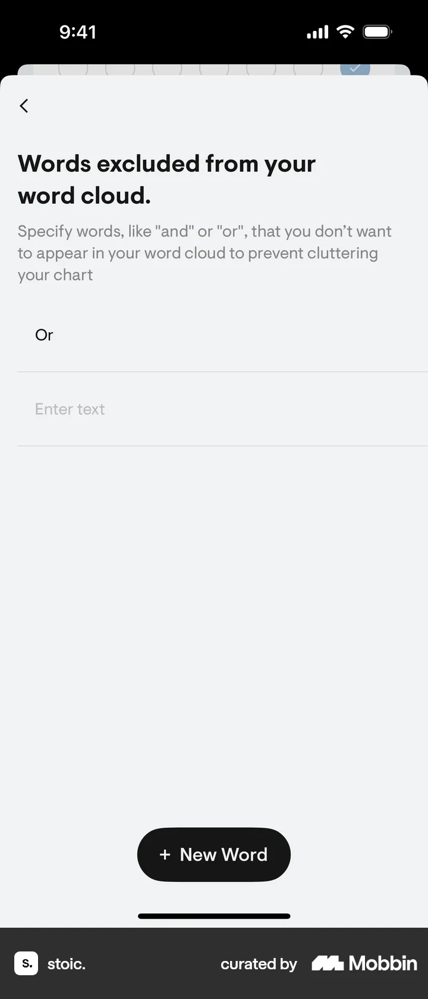

# Excluding words from words cloud from Trends & insights

- Mobbin 상세 페이지: https://mobbin.com/flows/073e4bf7-bde2-4beb-9ea0-01dac6b6295e?tab=screens
- 앱·기기: stoic. iOS, 393×852
- 화면 수: 상세 페이지 7장 / 저장 이미지 7장 / 아래 설명 7개
- 검증 상태: **verified** — 목록 제목·상세 제목·URL과 화면별 이미지 수·순서·상태 변화를 대조했다.

## 화면별 기록

1.  Trends의 Meditation 차트 아래 `Personalize` 버튼이 보인다. `Personalize`를 누른다. 다음 화면에서는 `trends.` 설정 시트의 General Insights·Emotions 토글이 보인다.
2.  `trends.` 설정 시트의 General Insights·Emotions 토글이 보인다. 아래로 내려 Writing 설정을 찾는다. 다음 화면에서는 Writing–Cloud 토글과 `Personalize Words Cloud` 행이 보인다.
3.  Writing–Cloud 토글과 `Personalize Words Cloud` 행이 보인다. `Personalize Words Cloud`를 누른다. 다음 화면에서는 `Words excluded from your word cloud.` 화면에 빈 입력 행과 `+ New Word`가 보인다.
4.  `Words excluded from your word cloud.` 화면에 빈 입력 행과 `+ New Word`가 보인다. 첫 제외 단어 `Or`를 입력한다. 다음 화면에서는 제외 목록에 `Or`가 추가된다.
5.  제외 목록에 `Or`가 추가된다. `+ New Word`를 눌러 새 입력 행을 만든다. 다음 화면에서는 `Or` 아래에 두 번째 빈 `Enter text` 행이 생긴다.
6.  `Or` 아래에 두 번째 빈 `Enter text` 행이 생긴다. 두 번째 제외 단어 `And`를 입력한다. 다음 화면에서는 제외 목록에 `Or`와 `And`가 차례로 표시된다. 단어 구름에서 실제 제거됐는지는 화면에서 확인 불가.
7.  제외 목록에 `Or`와 `And`가 차례로 표시된다. 단어 구름에서 실제 제거됐는지는 화면에서 확인 불가.

## BMad handoff notes

- **관찰된 진입 상태:** Trends의 Writing word cloud 개인화 진입점.
- **주요 행동:** Personalize Words Cloud에서 Or와 And를 제외 단어로 추가한다.
- **기대 결과:** 제외 목록에 두 단어가 나타난다. 차트 반영 결과는 이 플로우에서 확인 불가.
- **되돌릴 수 있거나 파괴적인 동작:** 목록 항목을 삭제하는 방법은 이 플로우에서 확인 불가. 삭제 실행은 관찰되지 않는다.
