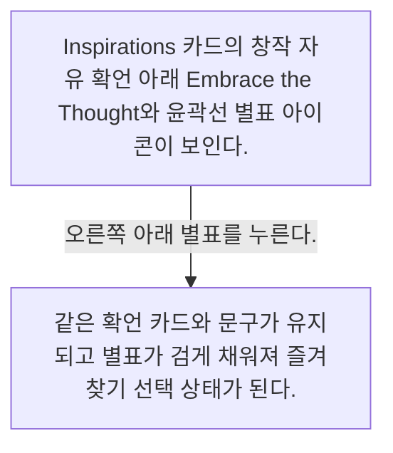
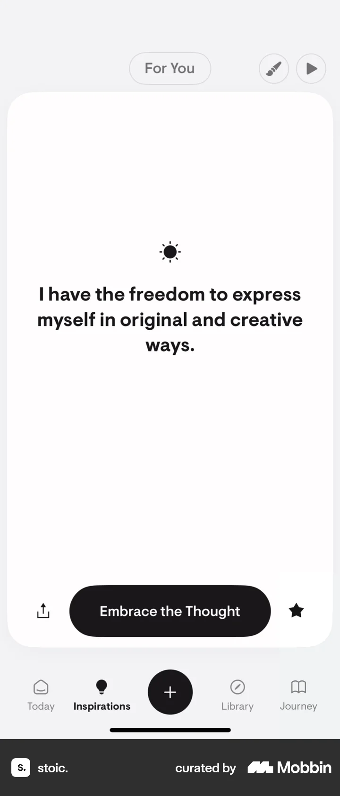

# Favoriting a prompt from Inspirations

- Mobbin 상세 페이지: https://mobbin.com/flows/e63a6af9-23c6-41c5-9b98-38f03586326e?tab=screens
- 앱·기기: stoic. iOS, 393×852
- 화면 수: 상세 페이지 2장 / 저장 이미지 2장 / 아래 설명 2개
- 검증 상태: **verified** — 목록 제목·상세 제목·URL과 화면별 이미지 수·순서·상태 변화를 대조했다.

## 화면별 기록

1.  Inspirations 카드의 창작 자유 확언 아래 `Embrace the Thought`와 윤곽선 별표 아이콘이 보인다. 오른쪽 아래 별표를 누른다. 다음 화면에서는 같은 확언 카드와 문구가 유지되고 별표가 검게 채워져 즐겨찾기 선택 상태가 된다.
2.  같은 확언 카드와 문구가 유지되고 별표가 검게 채워져 즐겨찾기 선택 상태가 된다.

## BMad handoff notes

- **관찰된 진입 상태:** Inspirations 카드의 별표가 비선택 상태다.
- **주요 행동:** 카드 오른쪽 아래 별표를 누른다.
- **기대 결과:** 별표가 채워져 즐겨찾기 선택 상태가 보인다. 별도 저장 알림은 화면에서 확인 불가.
- **되돌릴 수 있거나 파괴적인 동작:** 같은 별표를 다시 누르면 되돌릴 수 있을 것으로 추정하지만 해제 화면은 이 플로우에서 확인 불가. 삭제 동작은 없다.
