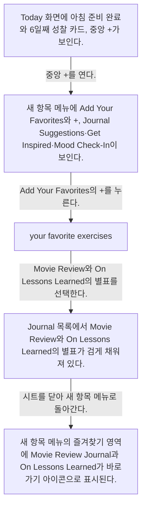
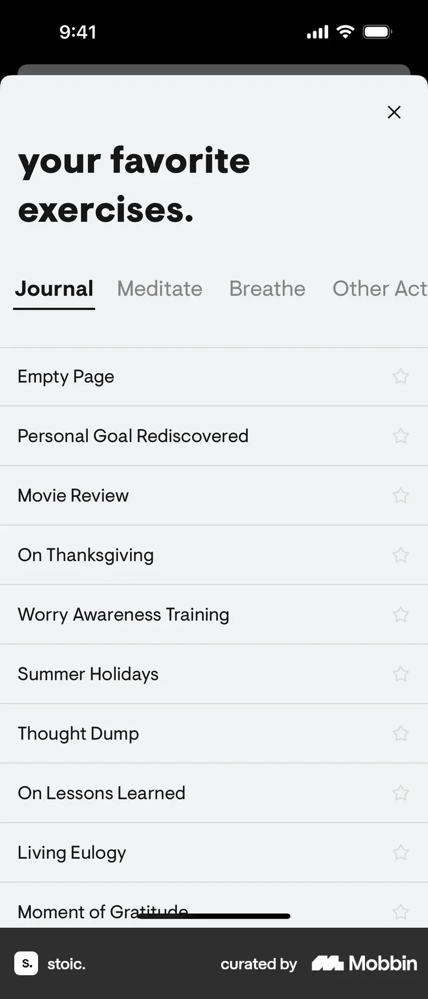
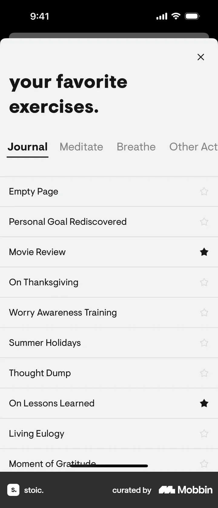

# Favoriting exercises

- Mobbin 상세 페이지: https://mobbin.com/flows/1ee2f319-6700-49f0-b0dd-a16a3c932a71?tab=screens
- 앱·기기: stoic. iOS, 393×852
- 화면 수: 상세 페이지 5장 / 저장 이미지 5장 / 아래 설명 5개
- 검증 상태: **verified** — 목록 제목·상세 제목·URL과 화면별 이미지 수·순서·상태 변화를 대조했다.

## 화면별 기록

1.  Today 화면에 아침 준비 완료와 6일째 성찰 카드, 중앙 `+`가 보인다. 중앙 `+`를 연다. 다음 화면에서는 새 항목 메뉴에 `Add Your Favorites`와 `+`, Journal Suggestions·Get Inspired·Mood Check-In이 보인다.
2.  새 항목 메뉴에 `Add Your Favorites`와 `+`, Journal Suggestions·Get Inspired·Mood Check-In이 보인다. `Add Your Favorites`의 `+`를 누른다. 다음 화면에서는 `your favorite exercises.` 시트의 Journal 탭에 Empty Page, Movie Review, On Lessons Learned 등과 빈 별표가 보인다.
3.  `your favorite exercises.` 시트의 Journal 탭에 Empty Page, Movie Review, On Lessons Learned 등과 빈 별표가 보인다. Movie Review와 On Lessons Learned의 별표를 선택한다. 다음 화면에서는 Journal 목록에서 `Movie Review`와 `On Lessons Learned`의 별표가 검게 채워져 있다.
4.  Journal 목록에서 `Movie Review`와 `On Lessons Learned`의 별표가 검게 채워져 있다. 시트를 닫아 새 항목 메뉴로 돌아간다. 다음 화면에서는 새 항목 메뉴의 즐겨찾기 영역에 Movie Review Journal과 On Lessons Learned가 바로가기 아이콘으로 표시된다.
5.  새 항목 메뉴의 즐겨찾기 영역에 Movie Review Journal과 On Lessons Learned가 바로가기 아이콘으로 표시된다.

## BMad handoff notes

- **관찰된 진입 상태:** Today의 중앙 새 항목 버튼이 보인다.
- **주요 행동:** 즐겨찾기 편집을 열고 두 Journal 항목을 별표로 선택한다.
- **기대 결과:** 새 항목 메뉴에 두 즐겨찾기 바로가기가 추가된다.
- **되돌릴 수 있거나 파괴적인 동작:** 별표를 다시 누르면 선택 해제가 가능할 것으로 추정되나 해제 화면은 확인 불가. 삭제 동작은 없다.
