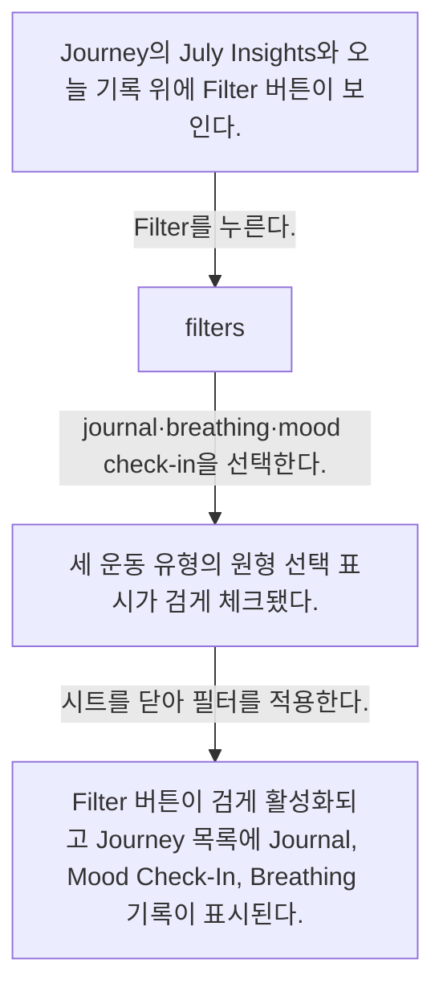
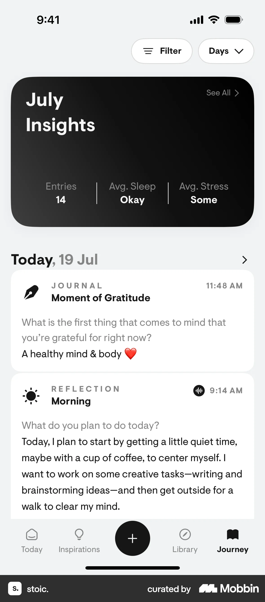
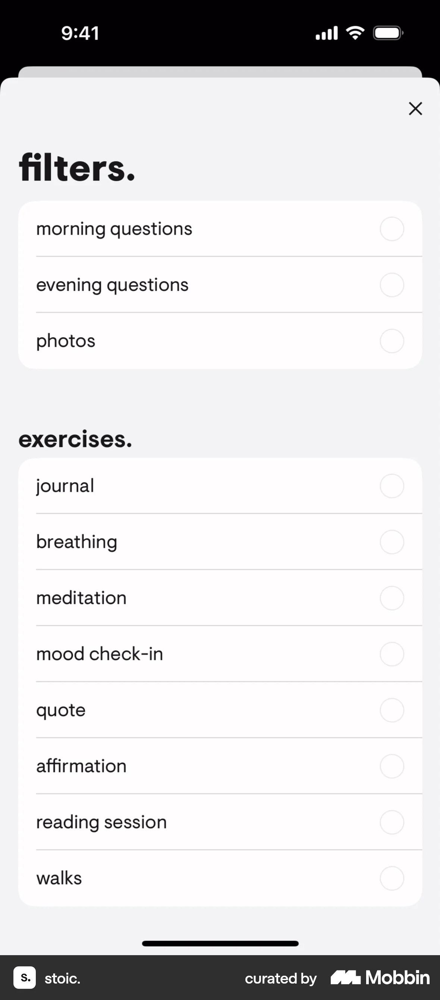
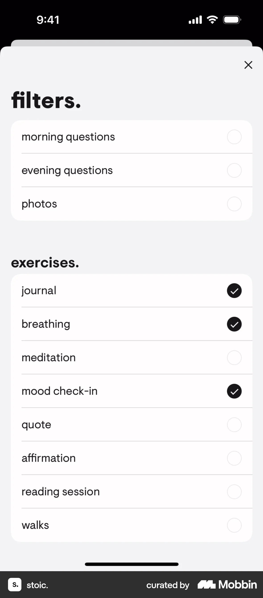
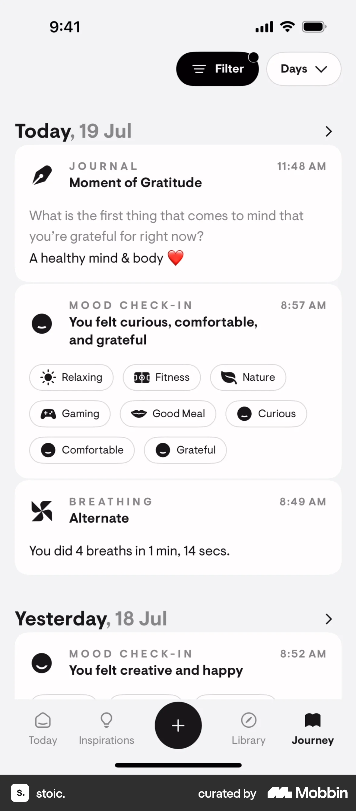

# Filtering entries from Journey

- Mobbin 상세 페이지: https://mobbin.com/flows/26be6dd7-9c58-4c79-ae6a-a94e00b2e08c?tab=screens
- 앱·기기: stoic. iOS, 393×852
- 화면 수: 상세 페이지 4장 / 저장 이미지 4장 / 아래 설명 4개
- 검증 상태: **verified** — 목록 제목·상세 제목·URL과 화면별 이미지 수·순서·상태 변화를 대조했다.

## 화면별 기록

1.  Journey의 July Insights와 오늘 기록 위에 `Filter` 버튼이 보인다. `Filter`를 누른다. 다음 화면에서는 `filters.` 시트에 morning questions, evening questions, photos와 journal·breathing·meditation·mood check-in 등이 모두 비선택이다.
2.  `filters.` 시트에 morning questions, evening questions, photos와 journal·breathing·meditation·mood check-in 등이 모두 비선택이다. journal·breathing·mood check-in을 선택한다. 다음 화면에서는 세 운동 유형의 원형 선택 표시가 검게 체크됐다.
3.  세 운동 유형의 원형 선택 표시가 검게 체크됐다. 시트를 닫아 필터를 적용한다. 다음 화면에서는 `Filter` 버튼이 검게 활성화되고 Journey 목록에 Journal, Mood Check-In, Breathing 기록이 표시된다.
4.  `Filter` 버튼이 검게 활성화되고 Journey 목록에 Journal, Mood Check-In, Breathing 기록이 표시된다.

## BMad handoff notes

- **관찰된 진입 상태:** Journey의 필터가 비활성인 기록 목록.
- **주요 행동:** Filter 시트에서 journal·breathing·mood check-in을 선택한다.
- **기대 결과:** 필터 버튼이 활성화되고 해당 유형의 기록이 목록에 보인다.
- **되돌릴 수 있거나 파괴적인 동작:** 필터를 다시 열어 체크를 해제할 수 있다. 원본 기록 삭제는 없다.
