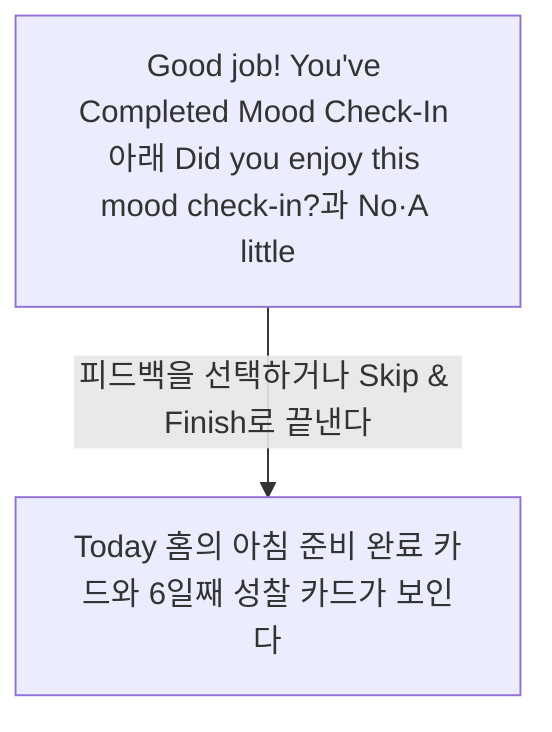
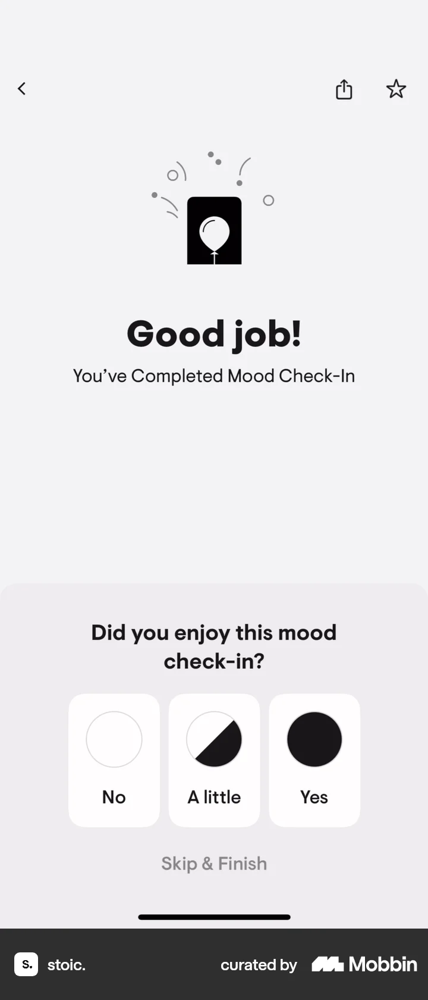
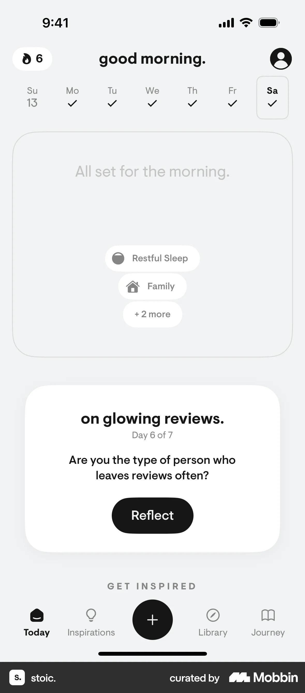

# Giving a feedback from Logging a mood check-in

- Mobbin 상세 페이지: https://mobbin.com/flows/f0178b77-ba1e-46c8-812c-441fc08aa72f?tab=screens
- 앱·기기: stoic. iOS, 393×852
- 화면 수: 상세 페이지 2장 / 저장 이미지 2장 / 아래 설명 2개
- 검증 상태: **blocked** — 피드백 선택과 건너뛰기 중 실제 경로가 두 정적 화면에서 확인되지 않는다.

## 화면별 기록

1.  `Good job! You've Completed Mood Check-In` 아래 `Did you enjoy this mood check-in?`과 No·A little·Yes, `Skip & Finish`가 보인다. 피드백을 선택하거나 `Skip & Finish`로 끝낸다. 어떤 경로인지 화면에서 확인 불가. 다음 화면에서는 Today 홈의 아침 준비 완료 카드와 6일째 성찰 카드가 보인다. 피드백 전송 성공 여부는 화면에서 확인 불가.
2.  Today 홈의 아침 준비 완료 카드와 6일째 성찰 카드가 보인다. 피드백 전송 성공 여부는 화면에서 확인 불가.

## BMad handoff notes

- **관찰된 진입 상태:** Mood Check-In을 완료한 직후 피드백 질문이 보인다.
- **주요 행동:** 피드백 항목을 고르거나 건너뛰어 Today로 돌아간다. 정확한 선택은 확인 불가.
- **기대 결과:** Today 홈이 표시된다. 피드백 저장 결과는 확인 불가.
- **되돌릴 수 있거나 파괴적인 동작:** 피드백 변경·삭제 경로는 화면에서 확인 불가.
