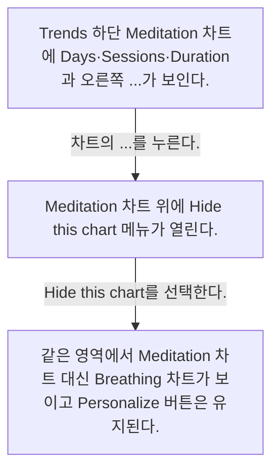
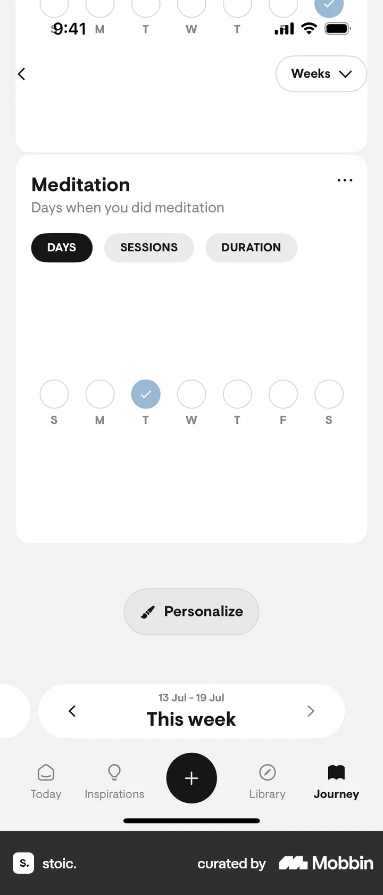
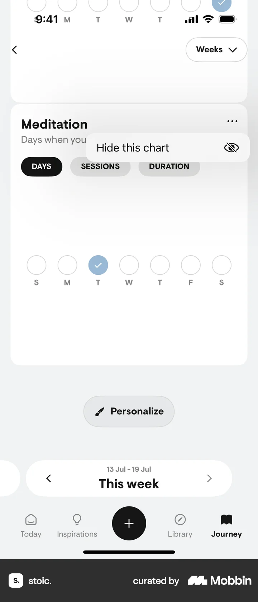
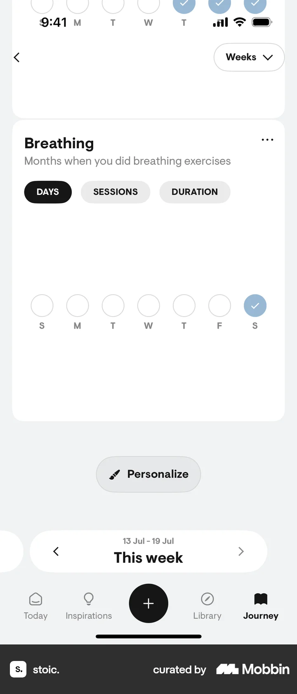

# Hiding a chart from Trends & insights

- Mobbin 상세 페이지: https://mobbin.com/flows/ac50c5bb-63ef-49b9-9f3f-22bc9797bdba?tab=screens
- 앱·기기: stoic. iOS, 393×852
- 화면 수: 상세 페이지 3장 / 저장 이미지 3장 / 아래 설명 3개
- 검증 상태: **verified** — 목록 제목·상세 제목·URL과 화면별 이미지 수·순서·상태 변화를 대조했다.

## 화면별 기록

1.  Trends 하단 Meditation 차트에 Days·Sessions·Duration과 오른쪽 `...`가 보인다. 차트의 `...`를 누른다. 다음 화면에서는 Meditation 차트 위에 `Hide this chart` 메뉴가 열린다.
2.  Meditation 차트 위에 `Hide this chart` 메뉴가 열린다. `Hide this chart`를 선택한다. 다음 화면에서는 같은 영역에서 Meditation 차트 대신 Breathing 차트가 보이고 Personalize 버튼은 유지된다.
3.  같은 영역에서 Meditation 차트 대신 Breathing 차트가 보이고 Personalize 버튼은 유지된다.

## BMad handoff notes

- **관찰된 진입 상태:** Trends에 Meditation 차트가 표시돼 있다.
- **주요 행동:** 차트 메뉴에서 Hide this chart를 선택한다.
- **기대 결과:** Meditation 차트가 보이지 않고 다음 Breathing 차트가 나타난다.
- **되돌릴 수 있거나 파괴적인 동작:** Personalize 진입점은 보이나 숨긴 차트를 다시 표시하는 정확한 경로는 이 플로우에서 확인 불가.
