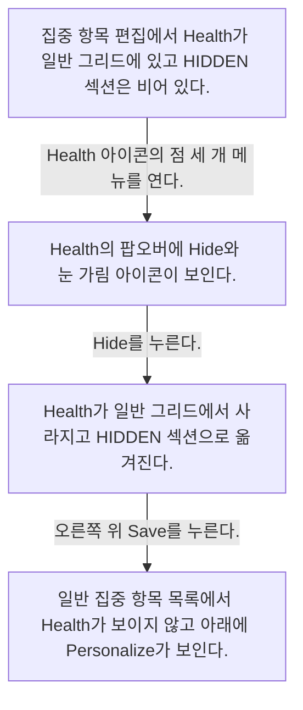
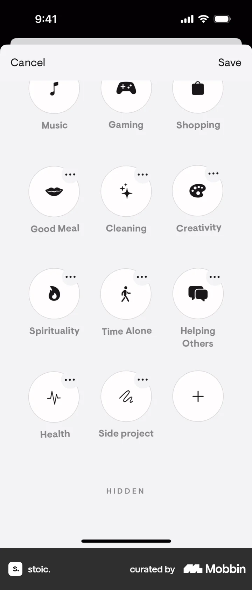
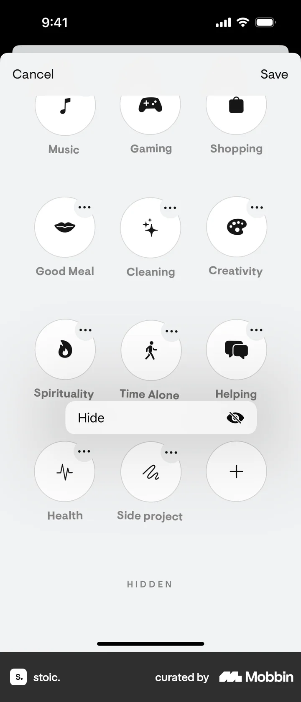
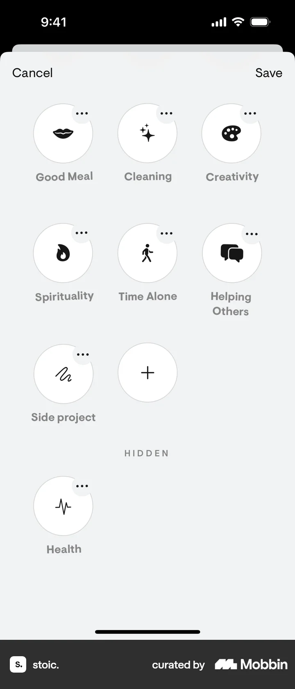
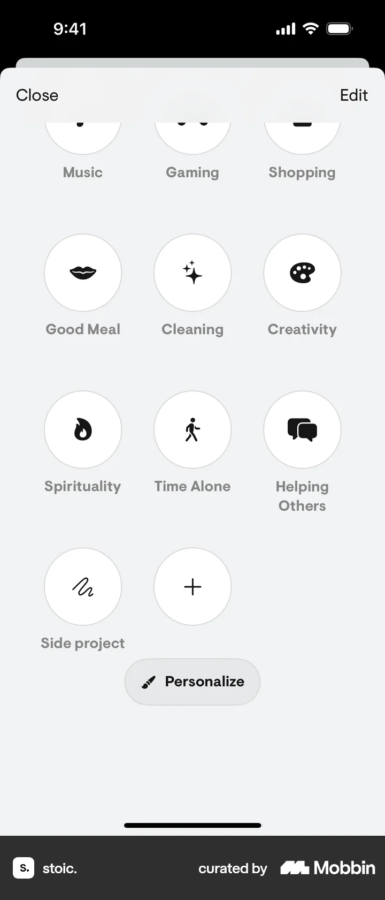

# Hiding a focus from Today

- Mobbin 상세 페이지: https://mobbin.com/flows/ce605c5c-7153-4fff-b56b-8024c8909198?tab=screens
- 앱·기기: stoic. iOS, 393×852
- 화면 수: 상세 페이지 4장 / 저장 이미지 4장 / 아래 설명 4개
- 검증 상태: **verified** — 목록 제목·상세 제목·URL과 화면별 이미지 수·순서·상태 변화를 대조했다.

## 화면별 기록

1.  집중 항목 편집에서 Health가 일반 그리드에 있고 HIDDEN 섹션은 비어 있다. Health 아이콘의 점 세 개 메뉴를 연다. 다음 화면에서는 Health의 팝오버에 `Hide`와 눈 가림 아이콘이 보인다.
2.  Health의 팝오버에 `Hide`와 눈 가림 아이콘이 보인다. `Hide`를 누른다. 다음 화면에서는 Health가 일반 그리드에서 사라지고 HIDDEN 섹션으로 옮겨진다.
3.  Health가 일반 그리드에서 사라지고 HIDDEN 섹션으로 옮겨진다. 오른쪽 위 `Save`를 누른다. 다음 화면에서는 일반 집중 항목 목록에서 Health가 보이지 않고 아래에 `Personalize`가 보인다.
4.  일반 집중 항목 목록에서 Health가 보이지 않고 아래에 `Personalize`가 보인다.

## BMad handoff notes

- **관찰된 진입 상태:** 집중 항목 편집에서 Health가 표시된 상태.
- **주요 행동:** Health 메뉴의 Hide를 누르고 Save한다.
- **기대 결과:** Health가 숨김 섹션으로 이동하고 일반 목록에서 사라진다.
- **되돌릴 수 있거나 파괴적인 동작:** HIDDEN 섹션에 Health가 남아 있어 복구 가능성이 보이나 복구 조작은 화면에서 확인 불가. 삭제는 없다.
