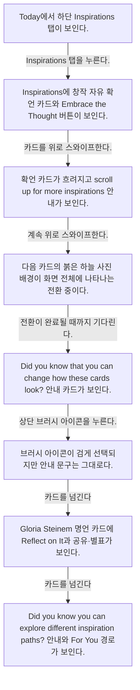
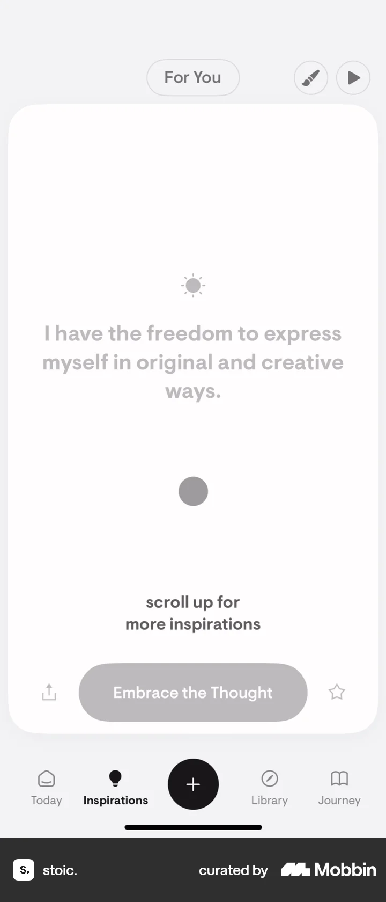
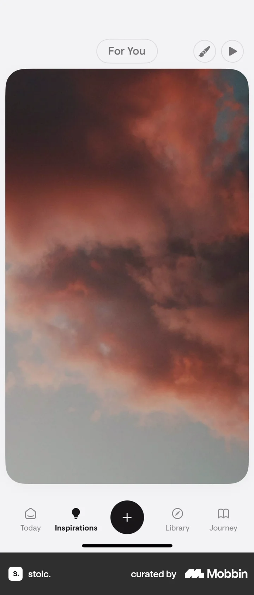
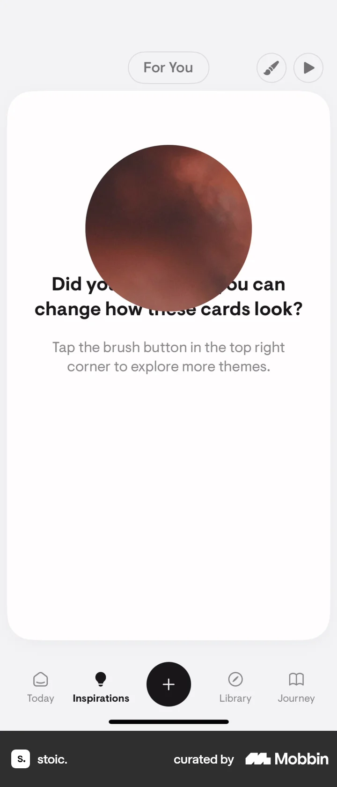
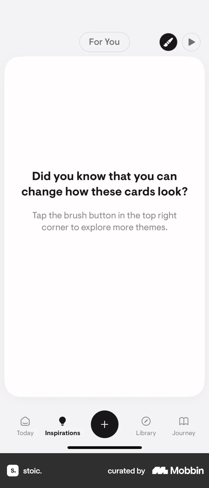
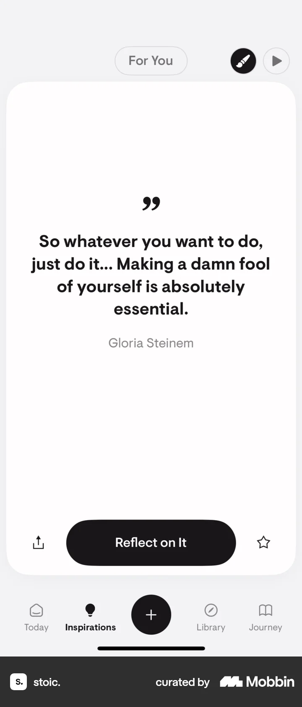

# Inspirations

- Mobbin 상세 페이지: https://mobbin.com/flows/9edc8063-68fb-493d-9093-9ec5cff81553?tab=screens
- 앱·기기: stoic. iOS, 393×852
- 화면 수: 상세 페이지 8장 / 저장 이미지 8장 / 아래 설명 8개
- 검증 상태: **blocked** — 5→6 브러시 탭의 효과와 6→8 카드 전환의 정확한 사용자 입력을 확정할 수 없다.

## 화면별 기록

1.  Today에서 하단 Inspirations 탭이 보인다. Inspirations 탭을 누른다. 다음 화면에서는 Inspirations에 창작 자유 확언 카드와 `Embrace the Thought` 버튼이 보인다.
2.  Inspirations에 창작 자유 확언 카드와 `Embrace the Thought` 버튼이 보인다. 카드를 위로 스와이프한다. 다음 화면에서는 확언 카드가 흐려지고 `scroll up for more inspirations` 안내가 보인다.
3.  확언 카드가 흐려지고 `scroll up for more inspirations` 안내가 보인다. 계속 위로 스와이프한다. 다음 화면에서는 다음 카드의 붉은 하늘 사진 배경이 화면 전체에 나타나는 전환 중이다.
4.  다음 카드의 붉은 하늘 사진 배경이 화면 전체에 나타나는 전환 중이다. 전환이 완료될 때까지 기다린다. 다음 화면에서는 `Did you know that you can change how these cards look?` 안내 카드가 보인다.
5.  `Did you know that you can change how these cards look?` 안내 카드가 보인다. 상단 브러시 아이콘을 누른다. 다음 화면에서는 브러시 아이콘이 검게 선택되지만 안내 문구는 그대로다.
6.  브러시 아이콘이 검게 선택되지만 안내 문구는 그대로다. 카드를 넘긴다. 정확한 입력은 화면에서 확인 불가. 다음 화면에서는 Gloria Steinem 명언 카드에 `Reflect on It`과 공유·별표가 보인다.
7.  Gloria Steinem 명언 카드에 `Reflect on It`과 공유·별표가 보인다. 카드를 넘긴다. 정확한 입력은 화면에서 확인 불가. 다음 화면에서는 `Did you know you can explore different inspiration paths?` 안내와 `For You` 경로가 보인다.
8.  `Did you know you can explore different inspiration paths?` 안내와 `For You` 경로가 보인다.

## BMad handoff notes

- **관찰된 진입 상태:** Today에서 Inspirations 탭으로 이동.
- **주요 행동:** 확언과 안내 카드를 스와이프하며 탐색하고 브러시를 선택한다.
- **기대 결과:** 명언 카드와 다른 inspiration path 안내가 표시된다.
- **되돌릴 수 있거나 파괴적인 동작:** 카드 탐색을 되돌리는 제스처는 화면에서 확인 불가. 삭제 동작은 없다.
