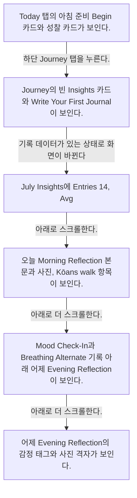
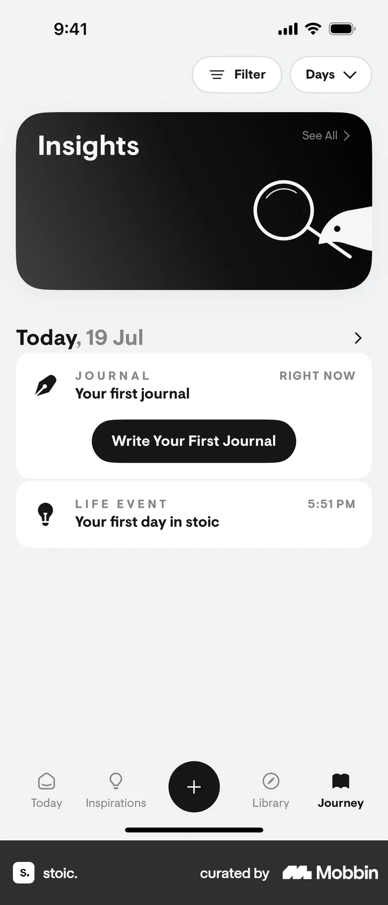
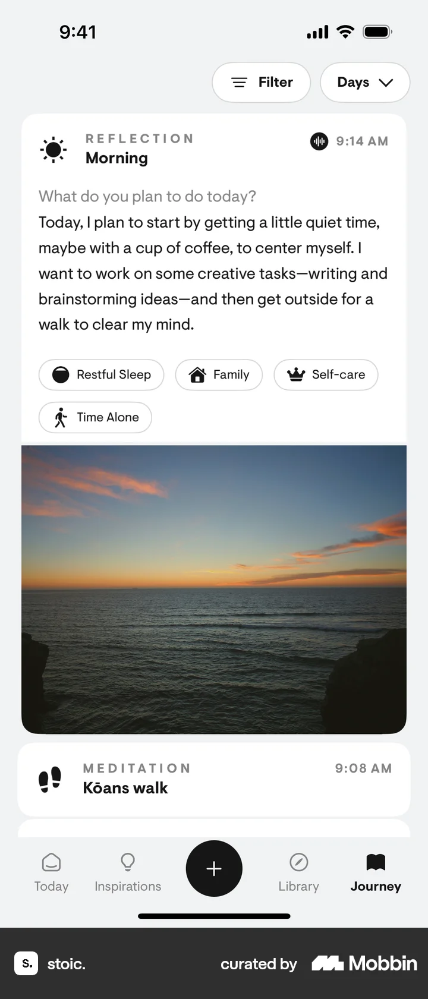
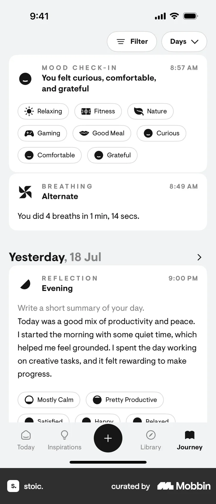
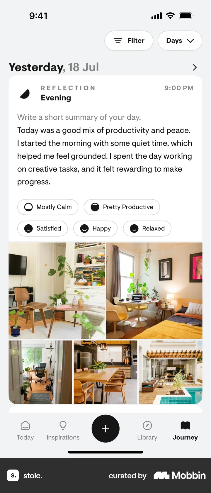

# Journey

- Mobbin 상세 페이지: https://mobbin.com/flows/f338c549-c18a-45db-81f1-12819c1eadfa?tab=screens
- 앱·기기: stoic. iOS, 393×852
- 화면 수: 상세 페이지 6장 / 저장 이미지 6장 / 아래 설명 6개
- 검증 상태: **blocked** — 빈 Journey에서 14개 기록이 있는 Journey로 바뀌는 데이터 생성 과정이 캡처에 없다.

## 화면별 기록

1.  Today 탭의 아침 준비 Begin 카드와 성찰 카드가 보인다. 하단 `Journey` 탭을 누른다. 다음 화면에서는 Journey의 빈 `Insights` 카드와 `Write Your First Journal`이 보인다.
2.  Journey의 빈 `Insights` 카드와 `Write Your First Journal`이 보인다. 기록 데이터가 있는 상태로 화면이 바뀐다. 데이터 생성 과정은 이 플로우에 없다. 다음 화면에서는 `July Insights`에 Entries 14, Avg. Sleep Okay, Avg. Stress Some과 오늘의 저널·성찰이 보인다.
3.  `July Insights`에 Entries 14, Avg. Sleep Okay, Avg. Stress Some과 오늘의 저널·성찰이 보인다. 아래로 스크롤한다. 다음 화면에서는 오늘 Morning Reflection 본문과 사진, Kōans walk 항목이 보인다.
4.  오늘 Morning Reflection 본문과 사진, Kōans walk 항목이 보인다. 아래로 더 스크롤한다. 다음 화면에서는 Mood Check-In과 Breathing Alternate 기록 아래 어제 Evening Reflection이 보인다.
5.  Mood Check-In과 Breathing Alternate 기록 아래 어제 Evening Reflection이 보인다. 아래로 더 스크롤한다. 다음 화면에서는 어제 Evening Reflection의 감정 태그와 사진 격자가 보인다.
6.  어제 Evening Reflection의 감정 태그와 사진 격자가 보인다.

## BMad handoff notes

- **관찰된 진입 상태:** Today 탭에서 Journey로 진입한다.
- **주요 행동:** Journey 탭을 열고 기록 목록을 아래로 탐색한다. 데이터 생성 과정은 확인 불가.
- **기대 결과:** Insights와 날짜별 저널·성찰·기분·운동 기록이 보인다.
- **되돌릴 수 있거나 파괴적인 동작:** 탭과 스크롤은 되돌릴 수 있다. 기록 삭제는 관찰되지 않는다.
