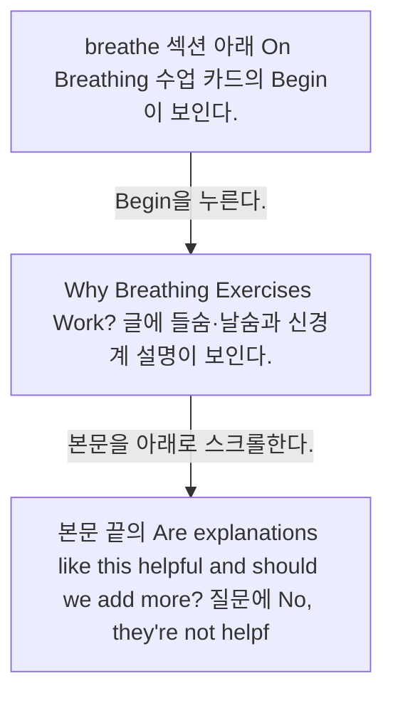
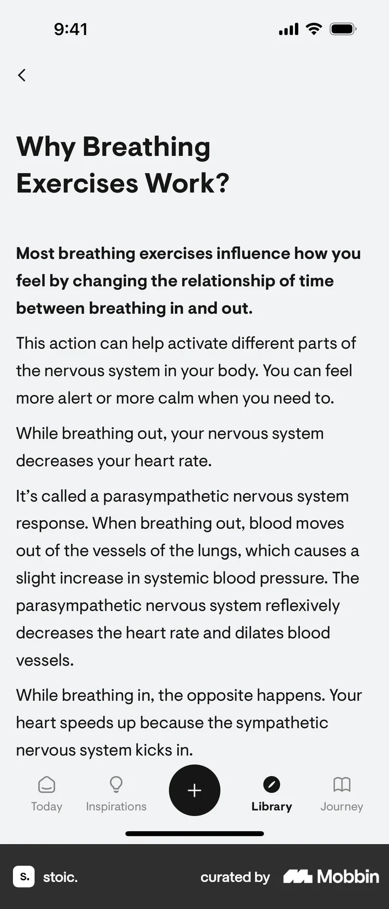
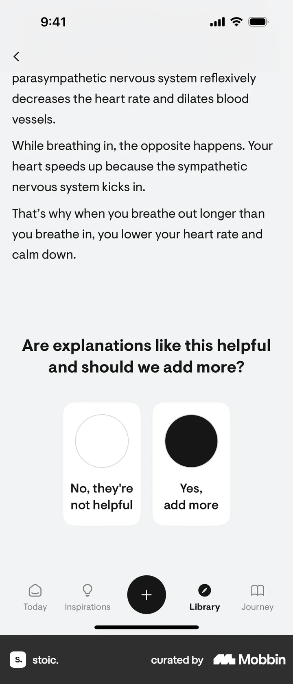

# Lesson detail from Breathe

- Mobbin 상세 페이지: https://mobbin.com/flows/ee69ad3b-7cec-4737-bc7a-425cb1c441ed?tab=screens
- 앱·기기: stoic. iOS, 393×852
- 화면 수: 상세 페이지 3장 / 저장 이미지 3장 / 아래 설명 3개
- 검증 상태: **verified** — 목록 제목·상세 제목·URL과 화면별 이미지 수·순서·상태 변화를 대조했다.

## 화면별 기록

1.  breathe 섹션 아래 `On Breathing` 수업 카드의 `Begin`이 보인다. `Begin`을 누른다. 다음 화면에서는 `Why Breathing Exercises Work?` 글에 들숨·날숨과 신경계 설명이 보인다.
2.  `Why Breathing Exercises Work?` 글에 들숨·날숨과 신경계 설명이 보인다. 본문을 아래로 스크롤한다. 다음 화면에서는 본문 끝의 `Are explanations like this helpful and should we add more?` 질문에 `No, they're not helpful`과 `Yes, add more`가 보인다. 선택 결과는 화면에서 확인 불가.
3.  본문 끝의 `Are explanations like this helpful and should we add more?` 질문에 `No, they're not helpful`과 `Yes, add more`가 보인다. 선택 결과는 화면에서 확인 불가.

## BMad handoff notes

- **관찰된 진입 상태:** breathe 섹션의 On Breathing 수업 카드.
- **주요 행동:** 수업을 열고 호흡 설명을 읽으며 아래로 스크롤한다.
- **기대 결과:** 본문 끝에 설명의 유용성에 관한 피드백 선택지가 나타난다.
- **되돌릴 수 있거나 파괴적인 동작:** 뒤로 가기로 수업을 나갈 수 있다. 피드백 제출·삭제는 확인 불가.
