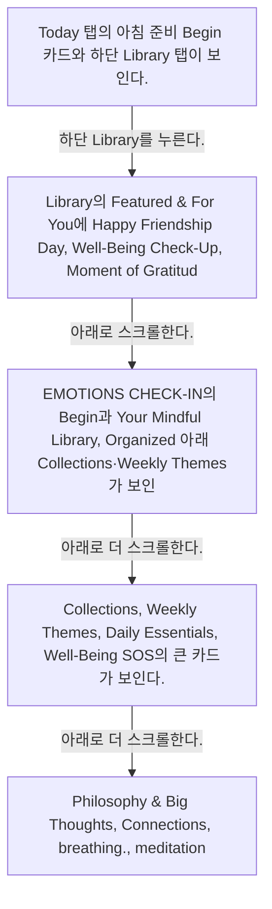
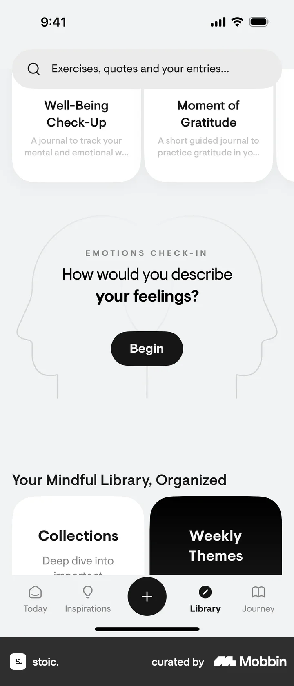

# Library

- Mobbin 상세 페이지: https://mobbin.com/flows/c5ea06fa-93c5-4b43-ba3f-a5c03b79e87c?tab=screens
- 앱·기기: stoic. iOS, 393×852
- 화면 수: 상세 페이지 5장 / 저장 이미지 5장 / 아래 설명 5개
- 검증 상태: **verified** — 목록 제목·상세 제목·URL과 화면별 이미지 수·순서·상태 변화를 대조했다.

## 화면별 기록

1.  Today 탭의 아침 준비 `Begin` 카드와 하단 `Library` 탭이 보인다. 하단 `Library`를 누른다. 다음 화면에서는 Library의 `Featured & For You`에 Happy Friendship Day, Well-Being Check-Up, Moment of Gratitude 카드가 보인다.
2.  Library의 `Featured & For You`에 Happy Friendship Day, Well-Being Check-Up, Moment of Gratitude 카드가 보인다. 아래로 스크롤한다. 다음 화면에서는 `EMOTIONS CHECK-IN`의 Begin과 `Your Mindful Library, Organized` 아래 Collections·Weekly Themes가 보인다.
3.  `EMOTIONS CHECK-IN`의 Begin과 `Your Mindful Library, Organized` 아래 Collections·Weekly Themes가 보인다. 아래로 더 스크롤한다. 다음 화면에서는 Collections, Weekly Themes, Daily Essentials, Well-Being SOS의 큰 카드가 보인다.
4.  Collections, Weekly Themes, Daily Essentials, Well-Being SOS의 큰 카드가 보인다. 아래로 더 스크롤한다. 다음 화면에서는 `Philosophy & Big Thoughts`, `Connections`, `breathing.`, `meditation.` 카드가 보인다.
5.  `Philosophy & Big Thoughts`, `Connections`, `breathing.`, `meditation.` 카드가 보인다.

## BMad handoff notes

- **관찰된 진입 상태:** Today 탭에서 Library 탭으로 이동할 수 있다.
- **주요 행동:** Library 탭을 열고 추천 항목과 주제별 카드를 세로로 탐색한다.
- **기대 결과:** Collections와 명상·호흡 등 라이브러리 진입점이 표시된다.
- **되돌릴 수 있거나 파괴적인 동작:** 탭과 스크롤 탐색은 되돌릴 수 있다. 삭제 동작은 없다.
