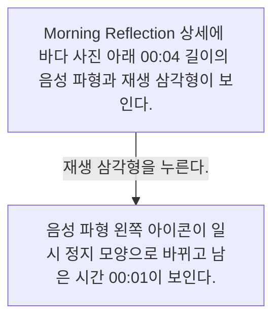
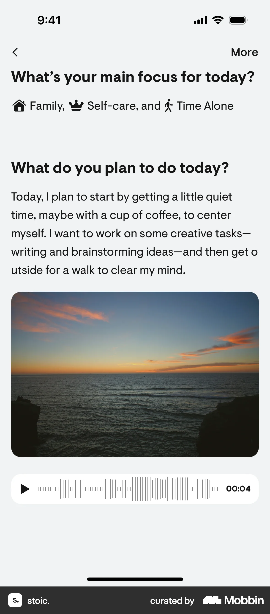
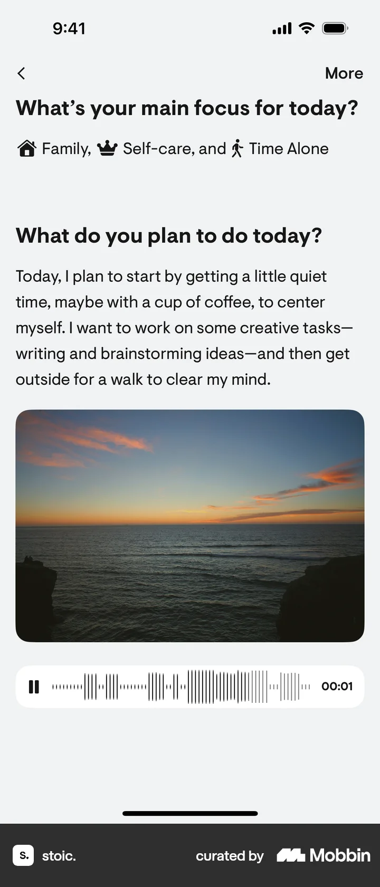

# Listening to a voice recording from Entry detail

- Mobbin 상세 페이지: https://mobbin.com/flows/051a4c2e-7372-45b6-afac-c44a35d64b14?tab=screens
- 앱·기기: stoic. iOS, 393×852
- 화면 수: 상세 페이지 2장 / 저장 이미지 2장 / 아래 설명 2개
- 검증 상태: **verified** — 목록 제목·상세 제목·URL과 화면별 이미지 수·순서·상태 변화를 대조했다.

## 화면별 기록

1.  Morning Reflection 상세에 바다 사진 아래 00:04 길이의 음성 파형과 재생 삼각형이 보인다. 재생 삼각형을 누른다. 다음 화면에서는 음성 파형 왼쪽 아이콘이 일시 정지 모양으로 바뀌고 남은 시간 00:01이 보인다.
2.  음성 파형 왼쪽 아이콘이 일시 정지 모양으로 바뀌고 남은 시간 00:01이 보인다.

## BMad handoff notes

- **관찰된 진입 상태:** 저널 상세에 녹음 첨부가 정지된 상태.
- **주요 행동:** 음성 재생 버튼을 누른다.
- **기대 결과:** 재생 중 아이콘과 남은 시간이 표시된다. 실제 소리 내용은 스크린샷에서 확인 불가.
- **되돌릴 수 있거나 파괴적인 동작:** 일시 정지 버튼으로 재생을 멈출 수 있다. 음성 삭제 동작은 관찰되지 않는다.
