# Logging a daily reflection (evening) from Today

- Mobbin 상세 페이지: https://mobbin.com/flows/c301d081-140b-44a9-983a-9b891020f3c0?tab=screens
- 앱·기기: stoic. iOS, 393×852
- 화면 수: 상세 페이지 12장 / 저장 이미지 12장 / 아래 설명 12개
- 검증 상태: **blocked** — 7→8 사진 접근 허용의 OS 화면과 11→12 완료 화면 종료 조작이 캡처에 없다.

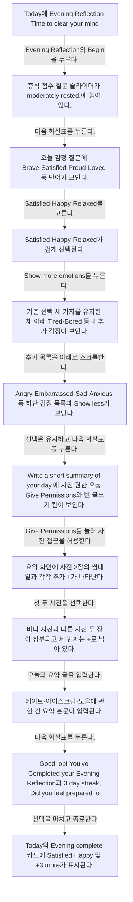

## 화면별 기록

1.  Today에 Evening Reflection `Time to clear your mind.` 카드와 Begin이 보인다. Evening Reflection의 `Begin`을 누른다. 다음 화면에서는 휴식 점수 질문 슬라이더가 `moderately rested.`에 놓여 있다.
2. 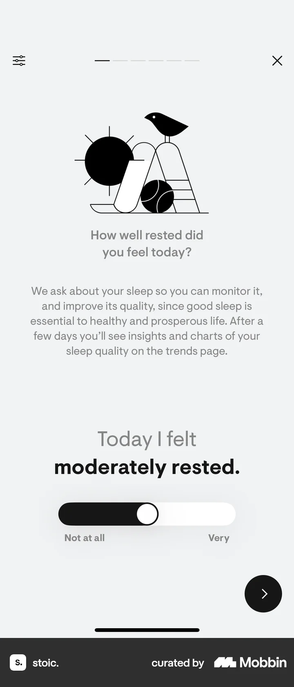 휴식 점수 질문 슬라이더가 `moderately rested.`에 놓여 있다. 다음 화살표를 누른다. 다음 화면에서는 오늘 감정 질문에 Brave·Satisfied·Proud·Loved 등 단어가 보인다.
3. 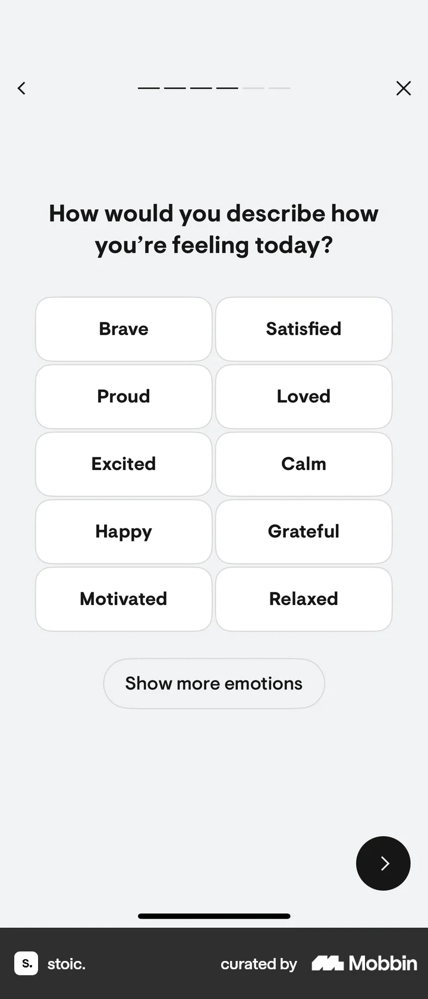 오늘 감정 질문에 Brave·Satisfied·Proud·Loved 등 단어가 보인다. Satisfied·Happy·Relaxed를 고른다. 다음 화면에서는 Satisfied·Happy·Relaxed가 검게 선택된다.
4. 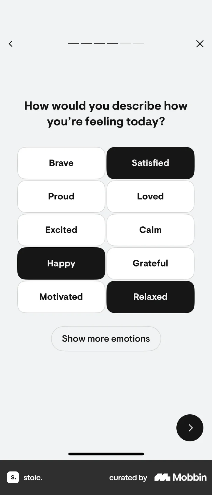 Satisfied·Happy·Relaxed가 검게 선택된다. `Show more emotions`를 누른다. 다음 화면에서는 기존 선택 세 가지를 유지한 채 아래 Tired·Bored 등의 추가 감정이 보인다.
5. 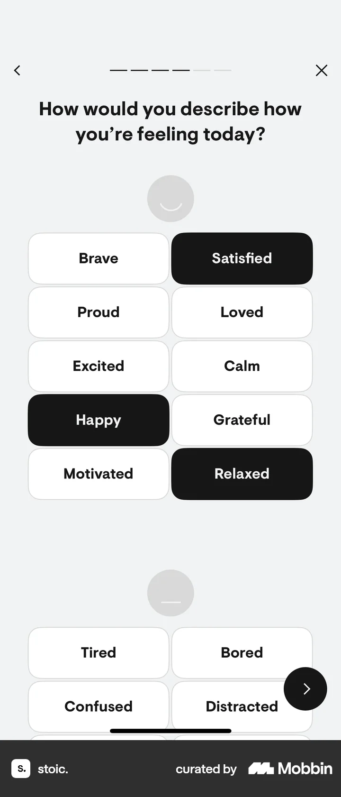 기존 선택 세 가지를 유지한 채 아래 Tired·Bored 등의 추가 감정이 보인다. 추가 목록을 아래로 스크롤한다. 다음 화면에서는 Angry·Embarrassed·Sad·Anxious 등 하단 감정 목록과 Show less가 보인다.
6. 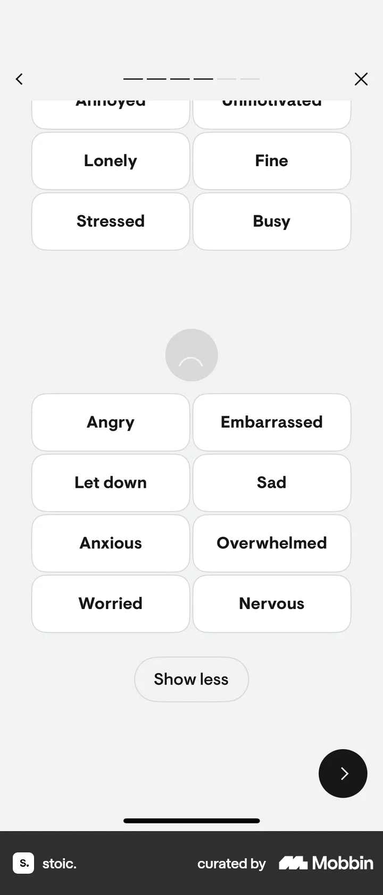 Angry·Embarrassed·Sad·Anxious 등 하단 감정 목록과 Show less가 보인다. 선택은 유지하고 다음 화살표를 누른다. 다음 화면에서는 `Write a short summary of your day.`에 사진 권한 요청 Give Permissions와 빈 글쓰기 칸이 보인다.
7. 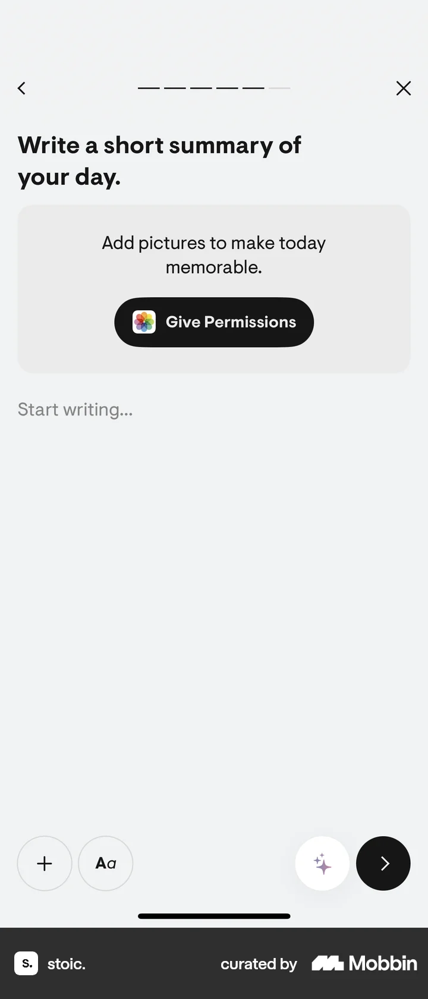 `Write a short summary of your day.`에 사진 권한 요청 Give Permissions와 빈 글쓰기 칸이 보인다. `Give Permissions`를 눌러 사진 접근을 허용한다. OS 권한 확인창은 캡처에 없다. 다음 화면에서는 요약 화면에 사진 3장의 썸네일과 각각 추가 `+`가 나타난다.
8. 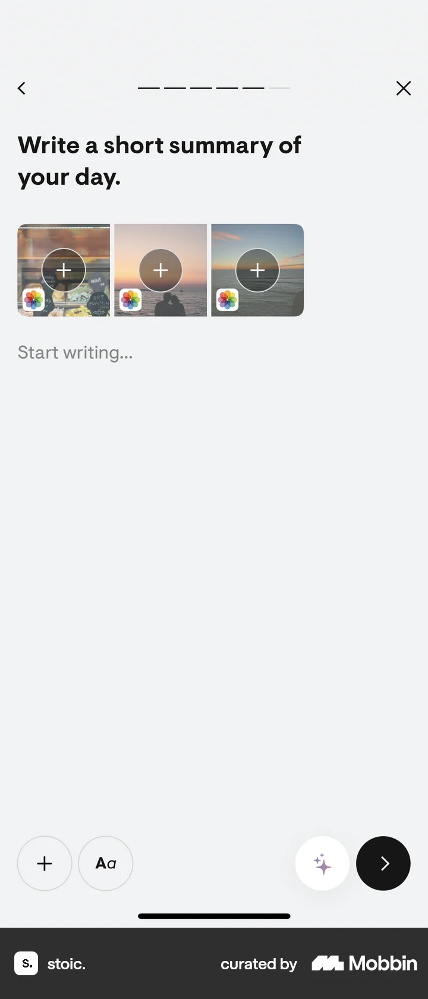 요약 화면에 사진 3장의 썸네일과 각각 추가 `+`가 나타난다. 첫 두 사진을 선택한다. 다음 화면에서는 바다 사진과 다른 사진 두 장이 첨부되고 세 번째는 `+`로 남아 있다.
9. 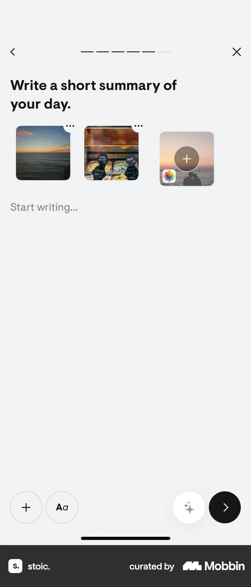 바다 사진과 다른 사진 두 장이 첨부되고 세 번째는 `+`로 남아 있다. 오늘의 요약 글을 입력한다. 다음 화면에서는 데이트·아이스크림·노을에 관한 긴 요약 본문이 입력된다.
10. 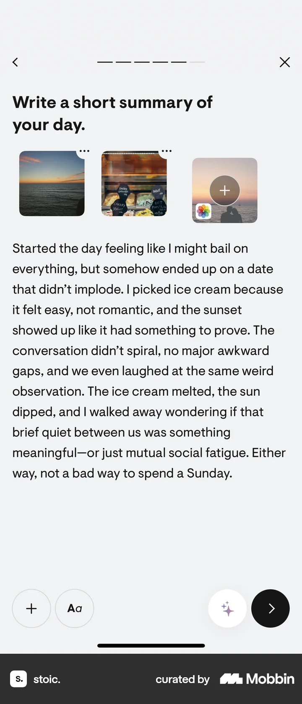 데이트·아이스크림·노을에 관한 긴 요약 본문이 입력된다. 다음 화살표를 누른다. 다음 화면에서는 `Good job! You've Completed your Evening Reflection`과 3 day streak, `Did you feel prepared for the night?` Yes 선택이 보인다.
11. 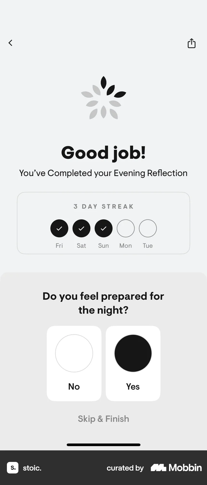 `Good job! You've Completed your Evening Reflection`과 3 day streak, `Did you feel prepared for the night?` Yes 선택이 보인다. 선택을 마치고 종료한다. 정확한 버튼 입력은 화면에서 확인 불가. 다음 화면에서는 Today의 Evening complete 카드에 Satisfied·Happy 및 +3 more가 표시된다.
12. 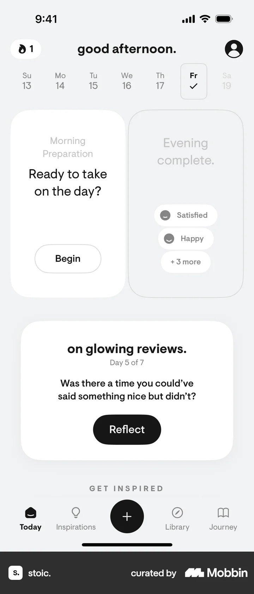 Today의 Evening complete 카드에 Satisfied·Happy 및 +3 more가 표시된다.

## BMad handoff notes

- **관찰된 진입 상태:** Today의 Evening Reflection 카드.
- **주요 행동:** 휴식 점수를 진행하고 감정 세 가지를 선택한 뒤 사진과 글로 하루를 요약한다.
- **기대 결과:** 완료 화면에 3일 연속 기록이 보이고 Today 카드가 Evening complete로 바뀐다.
- **되돌릴 수 있거나 파괴적인 동작:** 작성 중 뒤로 가기와 X가 보인다. 사진 첨부 및 완료 후 기록 삭제는 확인 불가.
