# Logging a daily reflection (morning) from Today

- Mobbin 상세 페이지: https://mobbin.com/flows/3c1b50df-db4c-4db4-ab62-8c334a0adbd6?tab=screens
- 앱·기기: stoic. iOS, 393×852
- 화면 수: 상세 페이지 18장 / 저장 이미지 18장 / 아래 설명 18개
- 검증 상태: **verified** — 목록·상세 제목·URL과 18장의 순서를 대조했다. Frida 처리 중 읽을거리 카드의 `Yes` 선택은 사용자 확인을 받았으며, AI 처리 완료는 해당 선택의 결과로 취급하지 않는다.

```mermaid
flowchart TD
  S1["Today의 Morning Preparation 카드에 New day, fresh start!와 Begin이 보인다."]
  S1 -->|Begin을 누른다.| S2
  S2["첫 daily reflection 환영 화면과 Continue가 보인다."]
  S2 -->|Continue를 누른다.| S3
  S3["수면 질문의 슬라이더가 I had a moderate night's sleep.에 놓여 있다."]
  S3 -->|슬라이더를 오른쪽으로 움직인다.| S4
  S4["수면 응답이 I slept quite well.로 바뀐다."]
  S4 -->|다음 화살표를 누른다.| S5
  S5["That's great! 수면 관련 도구 안내가 보인다."]
  S5 -->|다음 화살표를 누른다.| S6
  S6["오늘 집중 영역을 최대 3개 고르는 화면에 Work·Relaxing·Family 등이 보인다."]
  S6 -->|Family와 Self-care를 선택한다.| S7
  S7["Family와 Self-care가 검게 선택된다."]
  S7 -->|다음 화살표를 누른다.| S8
  S8["집중 항목 목록 하단에 Health·새 항목 +·Personalize가 보인다."]
  S8 -->|선택을 마치고 다음 화살표를 누른다.| S9
  S9["What do you plan to do today? 빈 편집기와 키보드가 열려 있다."]
  S9 -->|커피·조용한 시간·창작 작업·산책 계획을 입력한다.| S10
  S10["계획 본문이 입력되고 오른쪽 아래 다음 화살표가 보인다."]
  S10 -->|다음 화살표를 누른다.| S11
  S11["Deepen Your Reflection의 Heroic Hypatia 카드가 나타난다."]
  S11 -->|캐릭터를 넘겨 Funky Frida를 고른다.| S12
  S12["Funky Frida의 Add a magic touch와 Continue가 보인다."]
  S12 -->|Continue를 누른다.| S13
  S13["Frida is shaking things up.."]
  S13 -->|로딩 중 읽을거리 카드의 Yes를 눌러 다음 읽을거리로 이동| S14
  S14["같은 AI 처리 화면에 평균 수명 관련 사실과 Next가 보인다."]
  S14 -->|AI 응답이 나타날 때까지 기다린다.| S15
  S15["AI가 가족에게 존재감을 전하는 방법을 묻고, 가족에게 메모·재생목록·커피를 전하는 답변이 입력되어 있다."]
  S15 -->|다음 화살표를 누른다.| S16
  S16["첫 성찰 완료와 1 DAY STREAK, Use streaks 토글이 보인다."]
  S16 -->|다음 화살표를 누른다.| S17
  S17["연속 기록 목표를 3·10·15·30일 중 고르는 화면에서 3 days가 선택되어 있다."]
  S17 -->|오른쪽 아래 완료 체크를 누른다.| S18
  S18["1 DAY STREAK 요약에 Family·Self-care 집중과 Daily Reflection·Journaling Prompt·Daily Focus·Sleep"]
```

## 화면별 기록

1.  Today의 Morning Preparation 카드에 `New day, fresh start!`와 Begin이 보인다. `Begin`을 누른다. 다음 화면에서는 첫 daily reflection 환영 화면과 Continue가 보인다.
2. 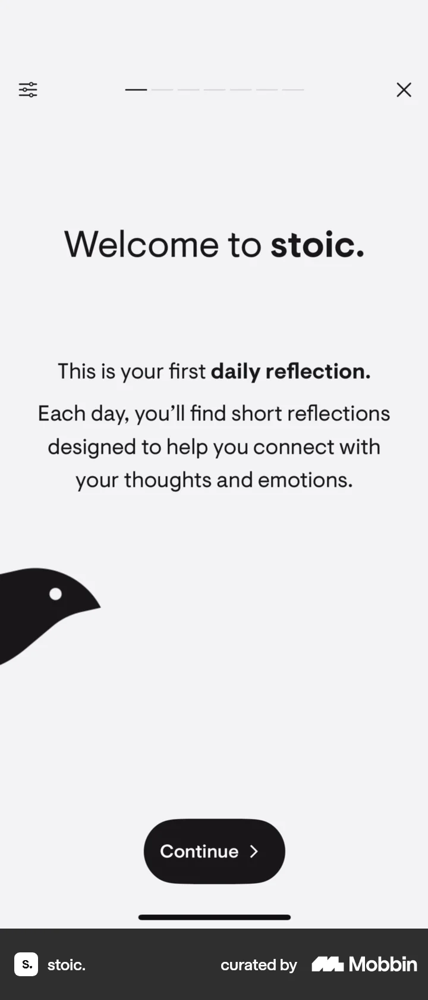 첫 daily reflection 환영 화면과 Continue가 보인다. `Continue`를 누른다. 다음 화면에서는 수면 질문의 슬라이더가 `I had a moderate night's sleep.`에 놓여 있다.
3. 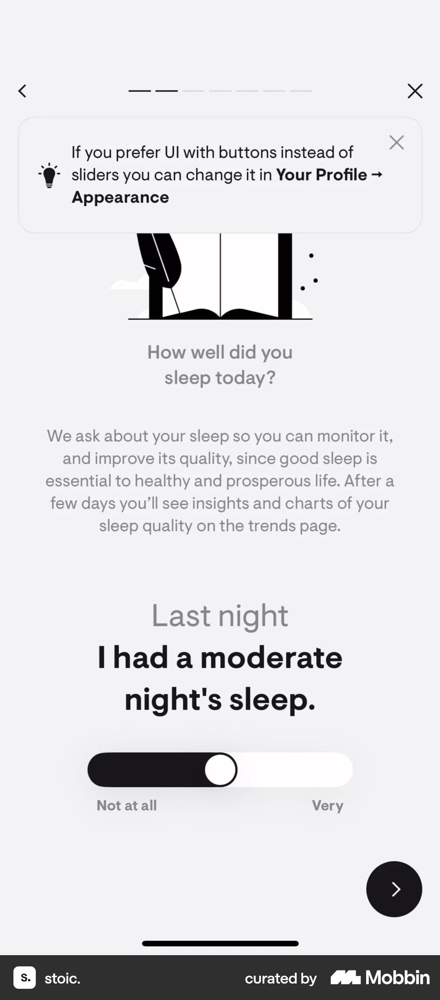 수면 질문의 슬라이더가 `I had a moderate night's sleep.`에 놓여 있다. 슬라이더를 오른쪽으로 움직인다. 다음 화면에서는 수면 응답이 `I slept quite well.`로 바뀐다.
4. 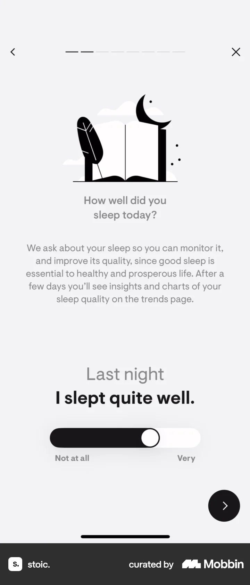 수면 응답이 `I slept quite well.`로 바뀐다. 다음 화살표를 누른다. 다음 화면에서는 `That's great!` 수면 관련 도구 안내가 보인다.
5.  `That's great!` 수면 관련 도구 안내가 보인다. 다음 화살표를 누른다. 다음 화면에서는 오늘 집중 영역을 최대 3개 고르는 화면에 Work·Relaxing·Family 등이 보인다.
6. 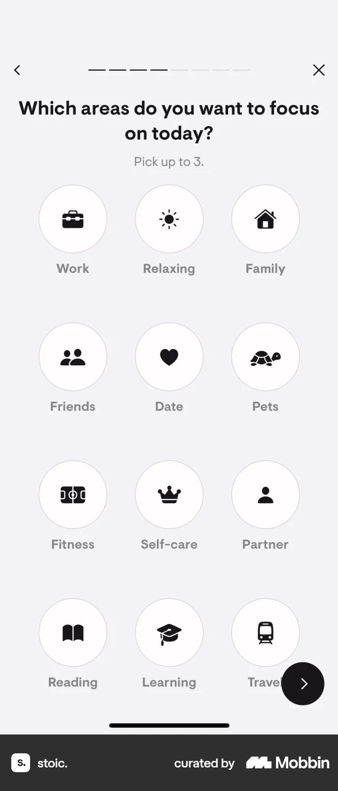 오늘 집중 영역을 최대 3개 고르는 화면에 Work·Relaxing·Family 등이 보인다. Family와 Self-care를 선택한다. 다음 화면에서는 Family와 Self-care가 검게 선택된다.
7. 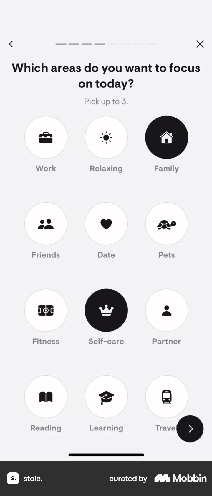 Family와 Self-care가 검게 선택된다. 다음 화살표를 누른다. 다음 화면에서는 집중 항목 목록 하단에 Health·새 항목 `+`·Personalize가 보인다.
8. 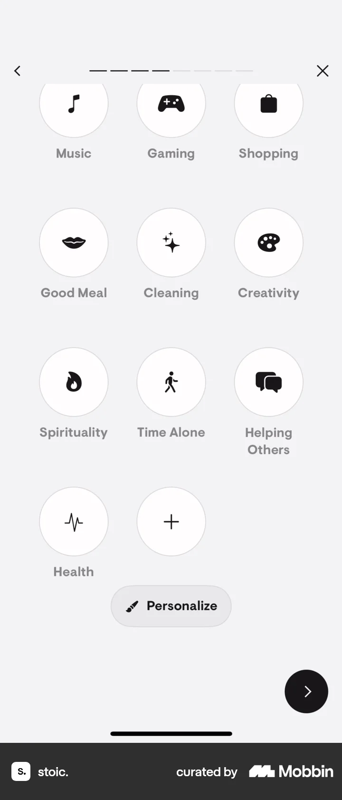 집중 항목 목록 하단에 Health·새 항목 `+`·Personalize가 보인다. 선택을 마치고 다음 화살표를 누른다. 다음 화면에서는 `What do you plan to do today?` 빈 편집기와 키보드가 열려 있다.
9. 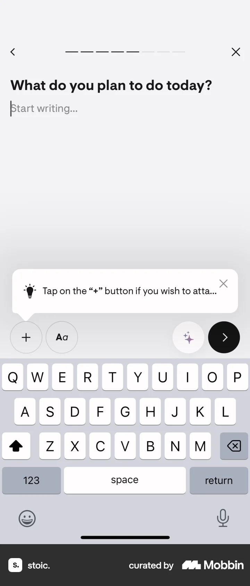 `What do you plan to do today?` 빈 편집기와 키보드가 열려 있다. 커피·조용한 시간·창작 작업·산책 계획을 입력한다. 다음 화면에서는 계획 본문이 입력되고 오른쪽 아래 다음 화살표가 보인다.
10.  계획 본문이 입력되고 오른쪽 아래 다음 화살표가 보인다. 다음 화살표를 누른다. 다음 화면에서는 Deepen Your Reflection의 Heroic Hypatia 카드가 나타난다.
11. 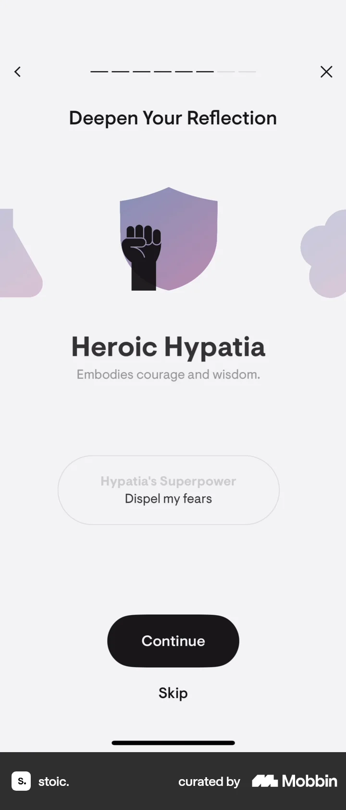 Deepen Your Reflection의 Heroic Hypatia 카드가 나타난다. 캐릭터를 넘겨 Funky Frida를 고른다. 다음 화면에서는 Funky Frida의 `Add a magic touch`와 Continue가 보인다.
12. 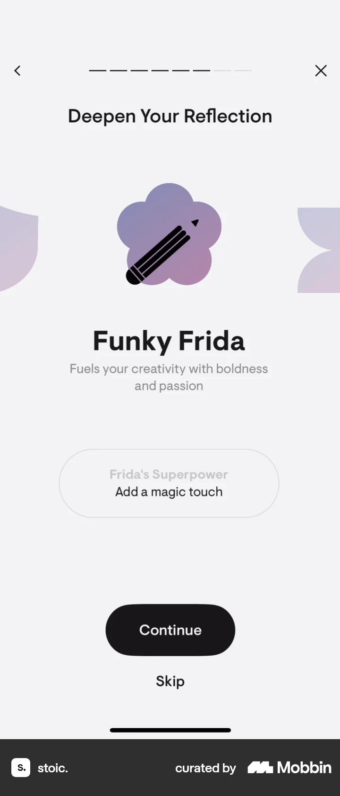 Funky Frida의 `Add a magic touch`와 Continue가 보인다. `Continue`를 누른다. 다음 화면에서는 `Frida is shaking things up...` AI 처리 안내와 사실 카드 Yes가 보인다.
13. 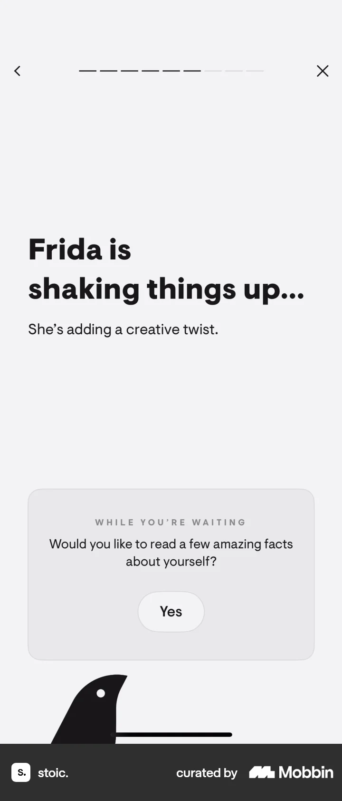 `Frida is shaking things up...` AI 처리 안내와 사실 카드 Yes가 보인다. 사용자 확인에 따르면 로딩 중 읽을거리 카드의 `Yes`를 눌렀다. 다음 화면에서는 AI 처리 안내가 유지된 채 평균 수명 관련 사실과 `Next`가 보인다. 이 입력이 AI 처리 속도나 완료 시점에 영향을 주지는 않는다.
14. 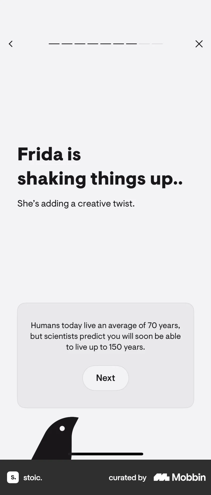 같은 AI 처리 화면에 평균 수명 관련 사실과 Next가 보인다. AI 응답이 나타날 때까지 기다린다. 다음 화면에서는 AI가 가족에게 존재감을 전하는 방법을 묻고, 가족에게 메모·재생목록·커피를 전하는 답변이 입력되어 있다.
15. 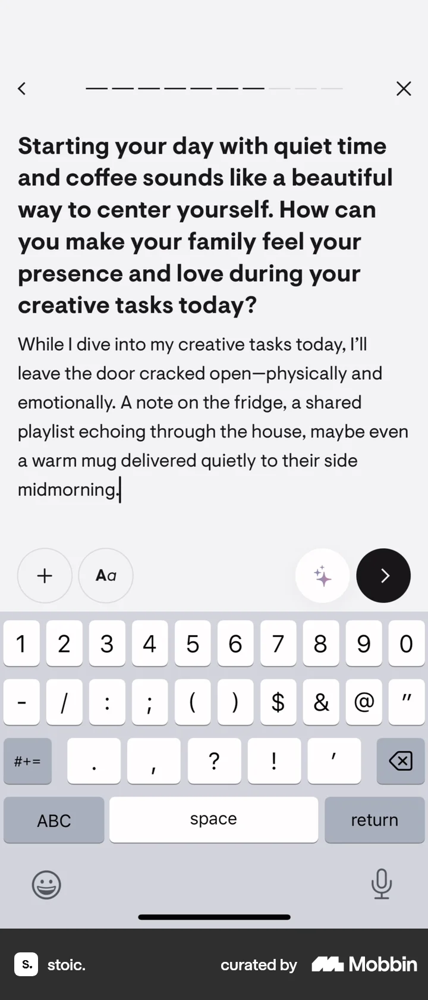 AI가 가족에게 존재감을 전하는 방법을 묻고, 가족에게 메모·재생목록·커피를 전하는 답변이 입력되어 있다. 다음 화살표를 누른다. 다음 화면에서는 첫 성찰 완료와 `1 DAY STREAK`, Use streaks 토글이 보인다.
16. 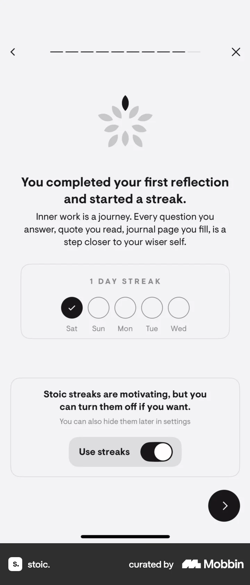 첫 성찰 완료와 `1 DAY STREAK`, Use streaks 토글이 보인다. 다음 화살표를 누른다. 다음 화면에서는 연속 기록 목표를 3·10·15·30일 중 고르는 화면에서 3 days가 선택되어 있다.
17. 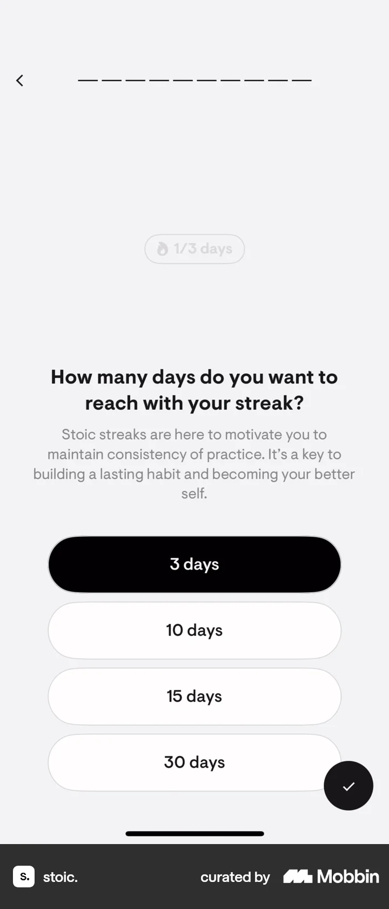 연속 기록 목표를 3·10·15·30일 중 고르는 화면에서 3 days가 선택되어 있다. 오른쪽 아래 완료 체크를 누른다. 다음 화면에서는 `1 DAY STREAK` 요약에 Family·Self-care 집중과 Daily Reflection·Journaling Prompt·Daily Focus·Sleep Metric 완료가 표시된다.
18. 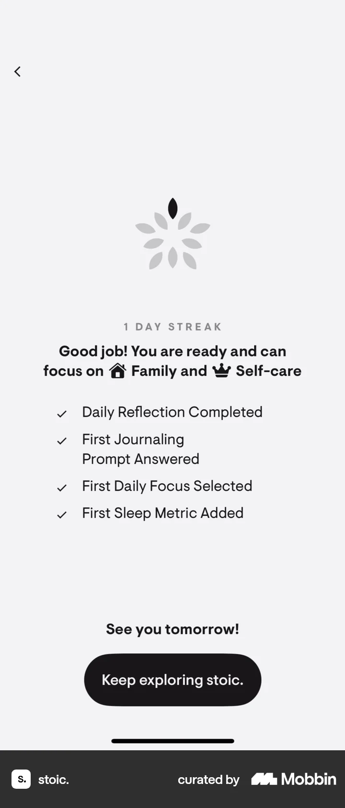 `1 DAY STREAK` 요약에 Family·Self-care 집중과 Daily Reflection·Journaling Prompt·Daily Focus·Sleep Metric 완료가 표시된다.

## BMad handoff notes

- **관찰된 진입 상태:** Today의 Morning Preparation Begin 카드.
- **주요 행동:** 수면 점수와 집중 영역을 고르고 계획을 작성한 뒤 AI 처리 중 읽을거리 카드를 넘기고 심화 질문에 답한 뒤 연속 기록 목표를 정한다.
- **기대 결과:** 첫 성찰 완료와 1일 연속 기록, Family·Self-care 집중 결과가 보인다.
- **되돌릴 수 있거나 파괴적인 동작:** 진행 중 뒤로 가기와 X가 보인다. 완료된 성찰 삭제·수정은 화면에서 확인 불가.
