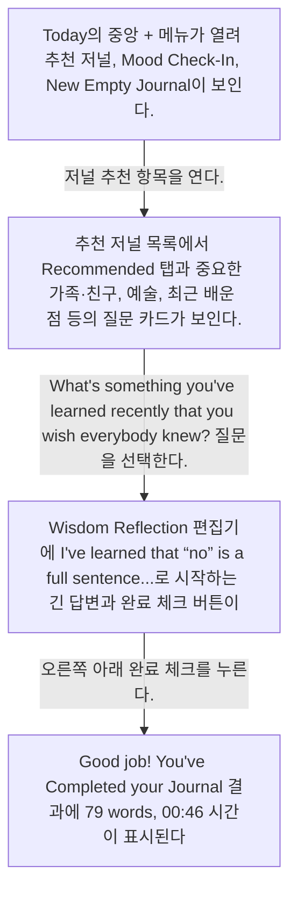
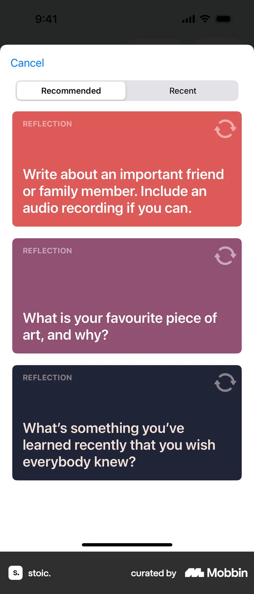
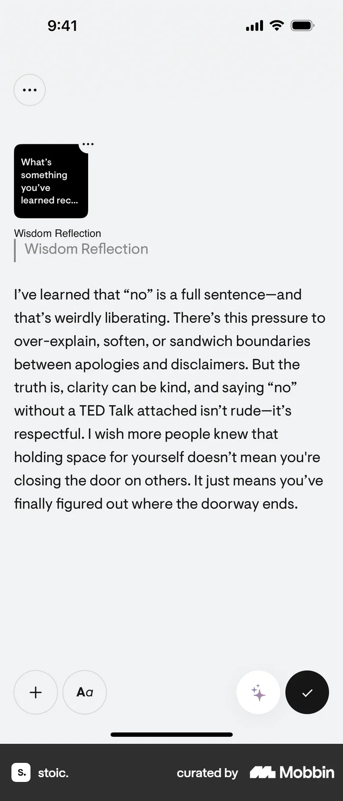
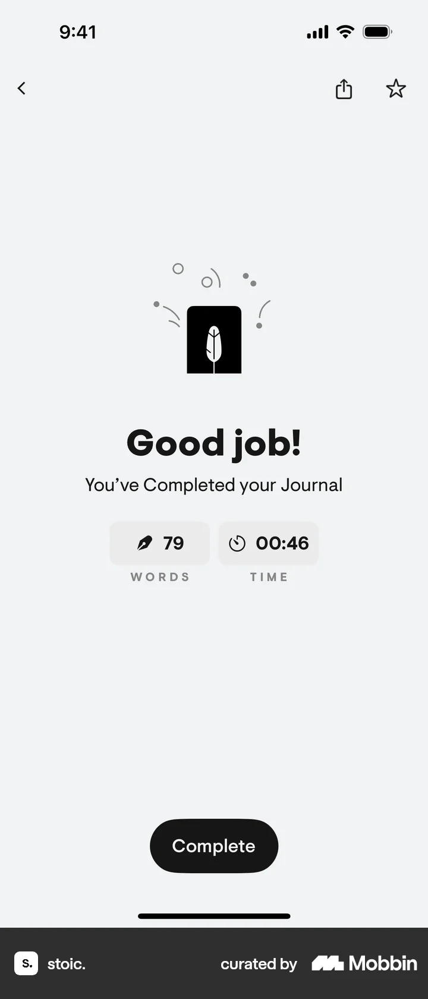

# Logging a journal entry

- Mobbin 상세 페이지: https://mobbin.com/flows/e2e1f9b5-b736-4442-a1c4-a5dabc5ac03b?tab=screens
- 앱·기기: stoic. iOS, 393×852
- 화면 수: 상세 페이지 4장 / 저장 이미지 4장 / 아래 설명 4개
- 검증 상태: **verified** — 목록 제목·상세 제목·URL과 화면별 이미지 수·순서·상태 변화를 대조했다.

## 화면별 기록

1.  Today의 중앙 `+` 메뉴가 열려 추천 저널, Mood Check-In, New Empty Journal이 보인다. 저널 추천 항목을 연다. 다음 화면에서는 추천 저널 목록에서 `Recommended` 탭과 중요한 가족·친구, 예술, 최근 배운 점 등의 질문 카드가 보인다.
2.  추천 저널 목록에서 `Recommended` 탭과 중요한 가족·친구, 예술, 최근 배운 점 등의 질문 카드가 보인다. `What's something you've learned recently that you wish everybody knew?` 질문을 선택한다. 다음 화면에서는 Wisdom Reflection 편집기에 `I've learned that “no” is a full sentence...`로 시작하는 긴 답변과 완료 체크 버튼이 보인다.
3.  Wisdom Reflection 편집기에 `I've learned that “no” is a full sentence...`로 시작하는 긴 답변과 완료 체크 버튼이 보인다. 오른쪽 아래 완료 체크를 누른다. 다음 화면에서는 `Good job! You've Completed your Journal` 결과에 79 words, 00:46 시간이 표시된다. 실제 서버 동기화 상태는 화면에서 확인 불가.
4.  `Good job! You've Completed your Journal` 결과에 79 words, 00:46 시간이 표시된다. 실제 서버 동기화 상태는 화면에서 확인 불가.

## BMad handoff notes

- **관찰된 진입 상태:** Today의 새 기록 메뉴가 열린 상태.
- **주요 행동:** 추천 질문을 골라 Wisdom Reflection 답변을 작성하고 완료한다.
- **기대 결과:** 저널 완료 화면에 단어 수와 작성 시간이 표시된다.
- **되돌릴 수 있거나 파괴적인 동작:** 편집 중 뒤로 가기 가능 여부와 완료 후 수정·삭제 경로는 화면에서 확인 불가.
