# Logging a mood check-in

- Mobbin 상세 페이지: https://mobbin.com/flows/76793f73-e2a2-4d7c-a972-b8fcb498ddb1?tab=screens
- 앱·기기: stoic. iOS, 393×852
- 화면 수: 상세 페이지 12장 / 저장 이미지 12장 / 아래 설명 12개
- 검증 상태: **blocked** — 11→12에서 호흡 운동 Yes·No 중 어느 입력이 사용됐는지 캡처에서 확인할 수 없다.

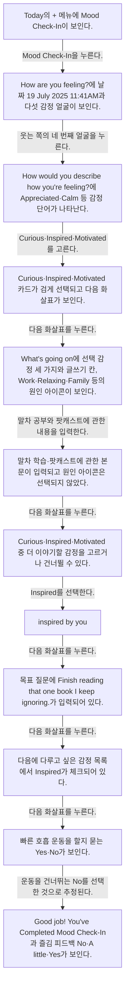

## 화면별 기록

1. 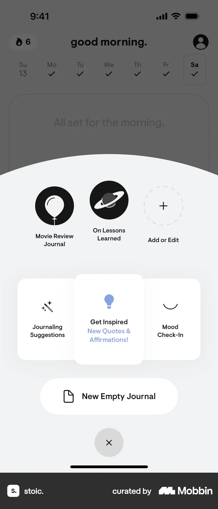 Today의 `+` 메뉴에 Mood Check-In이 보인다. Mood Check-In을 누른다. 다음 화면에서는 `How are you feeling?`에 날짜 19 July 2025 11:41AM과 다섯 감정 얼굴이 보인다.
2. 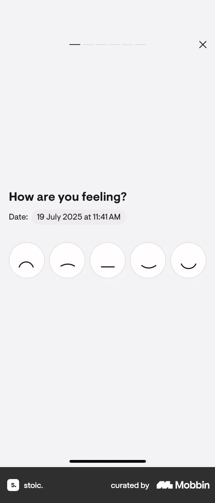 `How are you feeling?`에 날짜 19 July 2025 11:41AM과 다섯 감정 얼굴이 보인다. 웃는 쪽의 네 번째 얼굴을 누른다. 다음 화면에서는 `How would you describe how you're feeling?`에 Appreciated·Calm 등 감정 단어가 나타난다.
3. 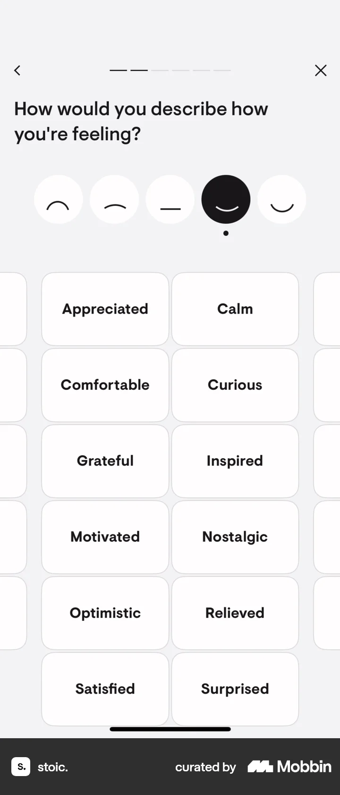 `How would you describe how you're feeling?`에 Appreciated·Calm 등 감정 단어가 나타난다. Curious·Inspired·Motivated를 고른다. 다음 화면에서는 Curious·Inspired·Motivated 카드가 검게 선택되고 다음 화살표가 보인다.
4. 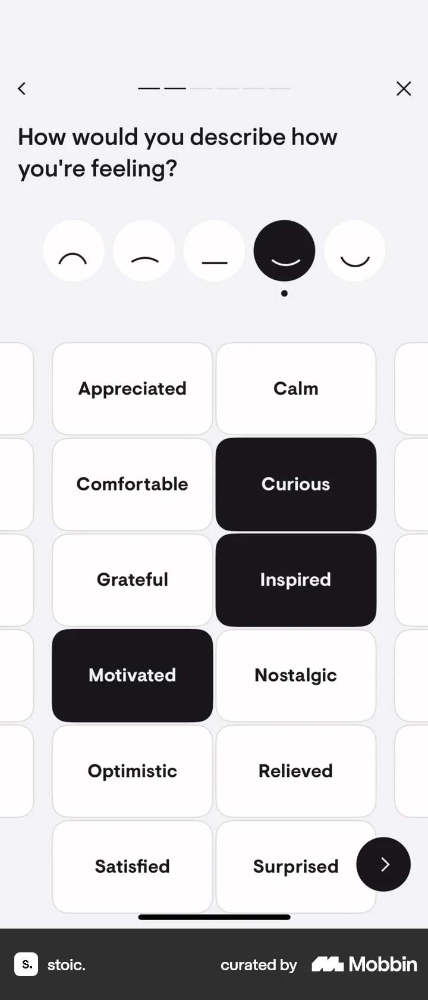 Curious·Inspired·Motivated 카드가 검게 선택되고 다음 화살표가 보인다. 다음 화살표를 누른다. 다음 화면에서는 `What's going on`에 선택 감정 세 가지와 글쓰기 칸, Work·Relaxing·Family 등의 원인 아이콘이 보인다.
5. 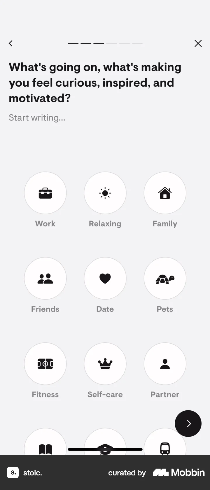 `What's going on`에 선택 감정 세 가지와 글쓰기 칸, Work·Relaxing·Family 등의 원인 아이콘이 보인다. 말차 공부와 팟캐스트에 관한 내용을 입력한다. 다음 화면에서는 말차 학습·팟캐스트에 관한 본문이 입력되고 원인 아이콘은 선택되지 않았다.
6. 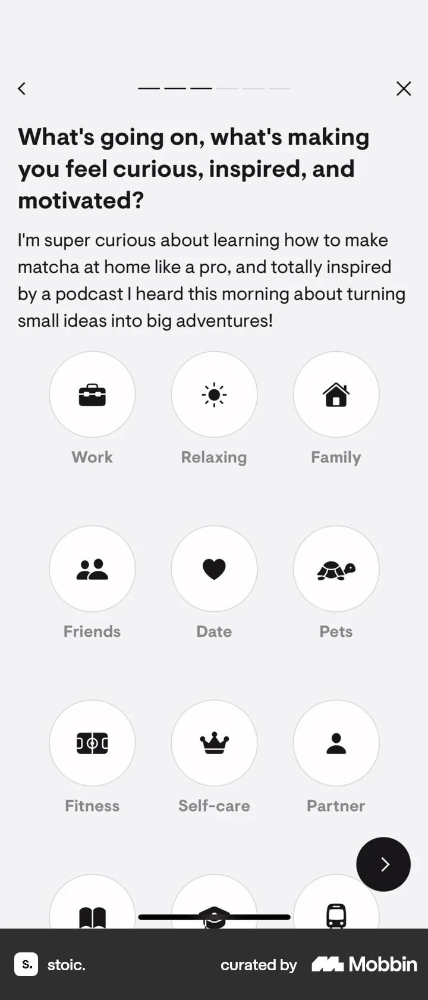 말차 학습·팟캐스트에 관한 본문이 입력되고 원인 아이콘은 선택되지 않았다. 다음 화살표를 누른다. 다음 화면에서는 Curious·Inspired·Motivated 중 더 이야기할 감정을 고르거나 건너뛸 수 있다.
7. 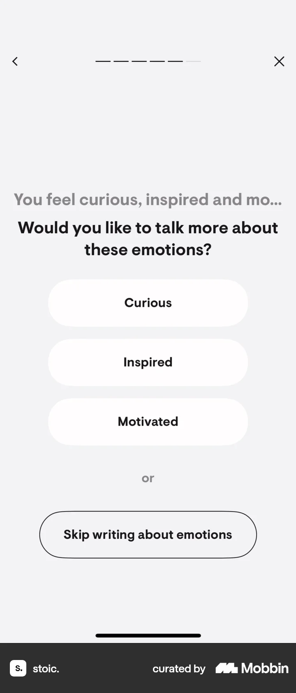 Curious·Inspired·Motivated 중 더 이야기할 감정을 고르거나 건너뛸 수 있다. `Inspired`를 선택한다. 다음 화면에서는 `inspired by you.` 안내에 영감을 활용하라는 문구가 보인다.
8. 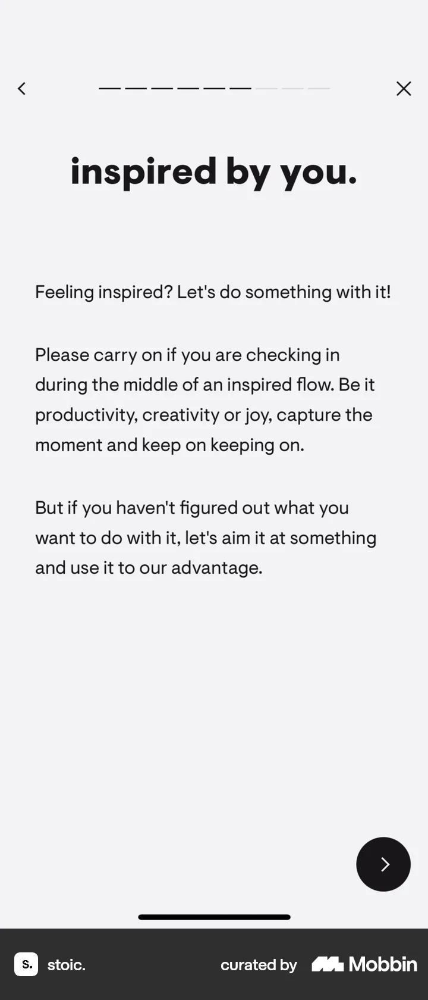 `inspired by you.` 안내에 영감을 활용하라는 문구가 보인다. 다음 화살표를 누른다. 다음 화면에서는 목표 질문에 `Finish reading that one book I keep ignoring.`가 입력되어 있다.
9. 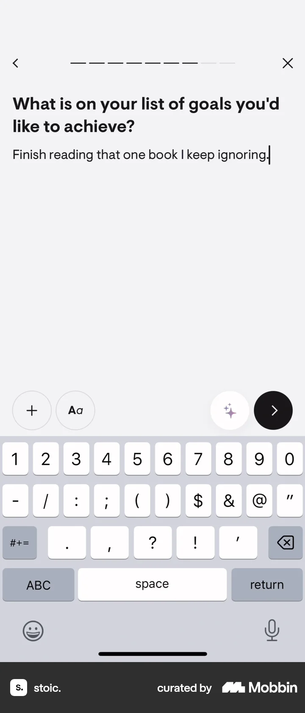 목표 질문에 `Finish reading that one book I keep ignoring.`가 입력되어 있다. 다음 화살표를 누른다. 다음 화면에서는 다음에 다루고 싶은 감정 목록에서 Inspired가 체크되어 있다.
10. 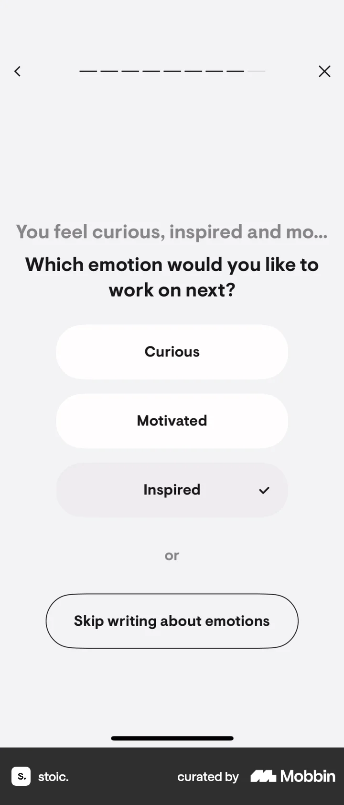 다음에 다루고 싶은 감정 목록에서 Inspired가 체크되어 있다. 다음 화살표를 누른다. 다음 화면에서는 빠른 호흡 운동을 할지 묻는 Yes·No가 보인다.
11. 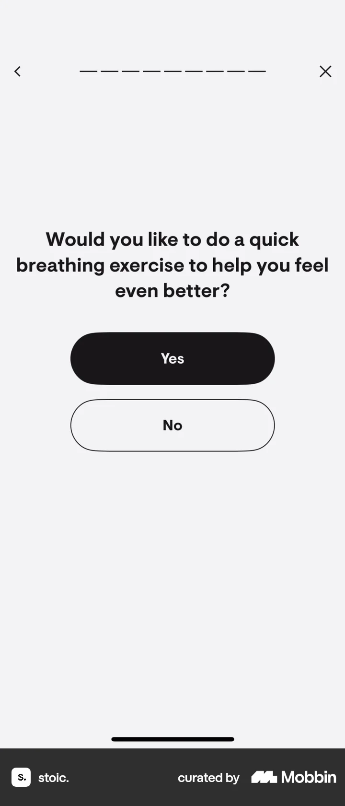 빠른 호흡 운동을 할지 묻는 Yes·No가 보인다. 운동을 건너뛰는 `No`를 선택한 것으로 추정된다. 다음 화면에서는 `Good job! You've Completed Mood Check-In`과 즐김 피드백 No·A little·Yes가 보인다.
12. 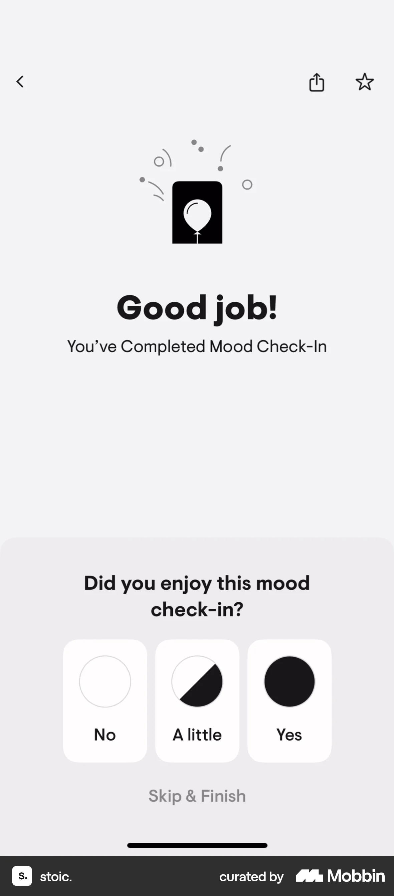 `Good job! You've Completed Mood Check-In`과 즐김 피드백 No·A little·Yes가 보인다.

## BMad handoff notes

- **관찰된 진입 상태:** Today의 새 기록 메뉴.
- **주요 행동:** 기분과 감정 단어를 고르고 상황·목표를 적어 기분 체크인을 완료한다.
- **기대 결과:** Mood Check-In 완료와 피드백 선택지가 보인다. 호흡 운동 수행은 확인 불가.
- **되돌릴 수 있거나 파괴적인 동작:** 편집 단계에는 뒤로 가기와 X가 보인다. 완료 후 수정·삭제는 화면에서 확인 불가.
