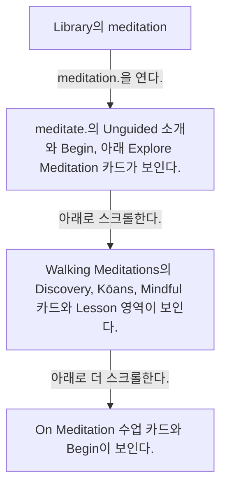
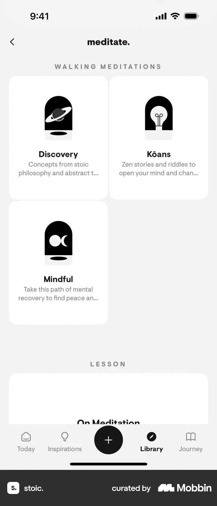
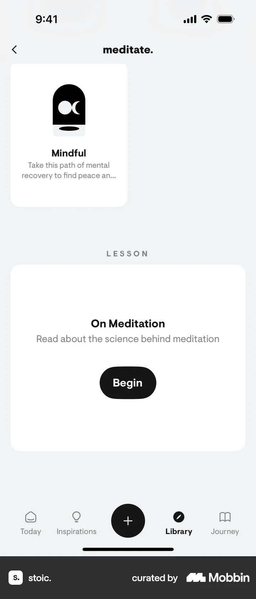

# Meditate from Library

- Mobbin 상세 페이지: https://mobbin.com/flows/a595b708-5ce7-4ca0-8df4-c42fd4c3eab2?tab=screens
- 앱·기기: stoic. iOS, 393×852
- 화면 수: 상세 페이지 4장 / 저장 이미지 4장 / 아래 설명 4개
- 검증 상태: **verified** — 목록 제목·상세 제목·URL과 화면별 이미지 수·순서·상태 변화를 대조했다.

## 화면별 기록

1.  Library의 `meditation.` 카드와 `breathing.` 카드가 보인다. `meditation.`을 연다. 다음 화면에서는 `meditate.`의 Unguided 소개와 `Begin`, 아래 Explore Meditation 카드가 보인다.
2.  `meditate.`의 Unguided 소개와 `Begin`, 아래 Explore Meditation 카드가 보인다. 아래로 스크롤한다. 다음 화면에서는 Walking Meditations의 Discovery, Kōans, Mindful 카드와 Lesson 영역이 보인다.
3.  Walking Meditations의 Discovery, Kōans, Mindful 카드와 Lesson 영역이 보인다. 아래로 더 스크롤한다. 다음 화면에서는 `On Meditation` 수업 카드와 `Begin`이 보인다.
4.  `On Meditation` 수업 카드와 `Begin`이 보인다.

## BMad handoff notes

- **관찰된 진입 상태:** Library의 meditation 카드.
- **주요 행동:** meditate 섹션을 열고 걷기 명상과 수업까지 스크롤한다.
- **기대 결과:** Unguided·Walking Meditations·On Meditation 진입점이 보인다.
- **되돌릴 수 있거나 파괴적인 동작:** 스크롤과 뒤로 가기로 탐색을 되돌릴 수 있다. 삭제 동작은 없다.
