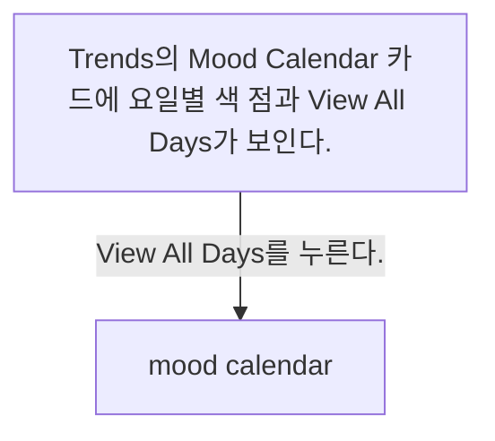
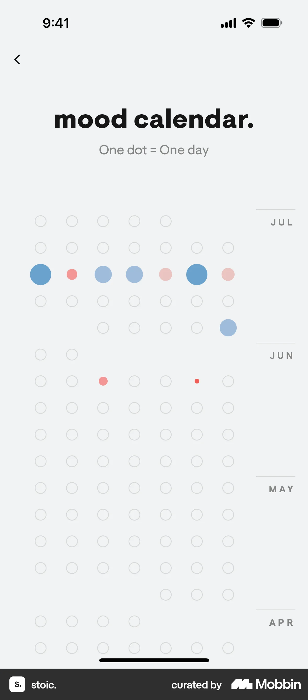

# Mood calendar from Trends & insights

- Mobbin 상세 페이지: https://mobbin.com/flows/df561c7b-5192-4325-b6a2-ed57e04ffb86?tab=screens
- 앱·기기: stoic. iOS, 393×852
- 화면 수: 상세 페이지 2장 / 저장 이미지 2장 / 아래 설명 2개
- 검증 상태: **verified** — 목록 제목·상세 제목·URL과 화면별 이미지 수·순서·상태 변화를 대조했다.

## 화면별 기록

1.  Trends의 `Mood Calendar` 카드에 요일별 색 점과 `View All Days`가 보인다. `View All Days`를 누른다. 다음 화면에서는 `mood calendar.` 전체 화면에 `One dot = One day` 안내와 JUL·JUN·MAY·APR의 날짜별 색 점이 보인다.
2.  `mood calendar.` 전체 화면에 `One dot = One day` 안내와 JUL·JUN·MAY·APR의 날짜별 색 점이 보인다.

## BMad handoff notes

- **관찰된 진입 상태:** Trends & insights의 주간 Mood Calendar 카드.
- **주요 행동:** View All Days를 눌러 전체 Mood Calendar로 이동한다.
- **기대 결과:** 여러 달의 일별 기분 점이 표시된다.
- **되돌릴 수 있거나 파괴적인 동작:** 뒤로 가기로 Trends에 돌아갈 수 있다. 삭제 동작은 없다.
