# Onboarding

- Mobbin 상세 페이지: https://mobbin.com/flows/0c54c507-3659-4b57-a758-adaa44ec3aeb?tab=screens
- 앱·기기: stoic. iOS, 393×852
- 화면 수: 상세 페이지 13장 / 저장 이미지 13장 / 아래 설명 13개
- 검증 상태: **blocked** — 목록 제목·상세 URL·이미지 13장은 일치하지만 1→2의 정확한 진입 입력과 10→11의 iOS 알림 권한 선택을 화면에서 확인할 수 없다.

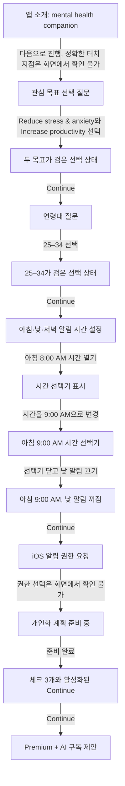

## 화면별 기록

1. 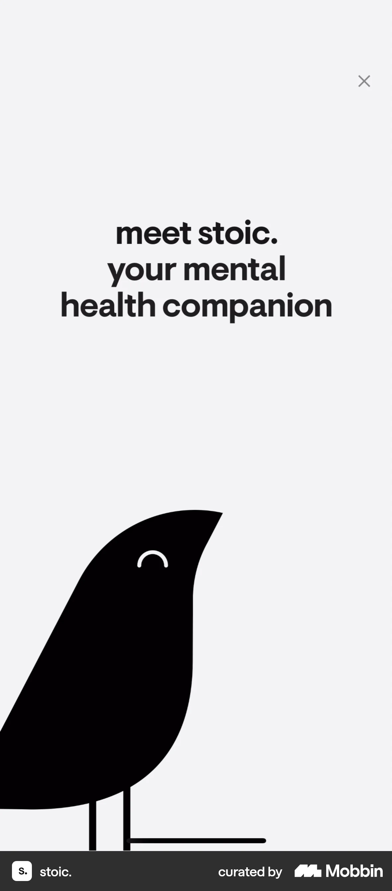 흰 소개 화면에 검은 새 그림과 `meet stoic. your mental health companion` 문구, 닫기 아이콘이 보인다. 다음 화면에서 맞춤화 질문이 시작되지만 이 전환의 정확한 터치 지점은 화면에서 확인 불가.
2. 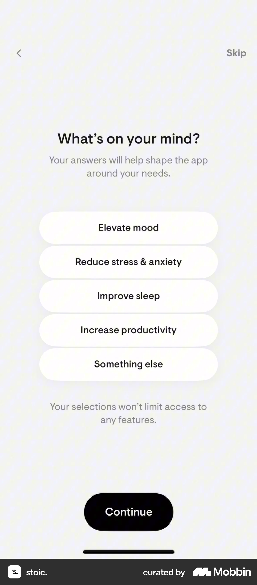 `What's on your mind?` 질문 아래 기분, 스트레스, 수면, 생산성 등 다섯 목표가 모두 흰 버튼으로 표시된다. 사용자가 스트레스 감소와 생산성 향상을 선택하면 다음 화면에서 두 항목이 검은 선택 상태로 바뀐다.
3. 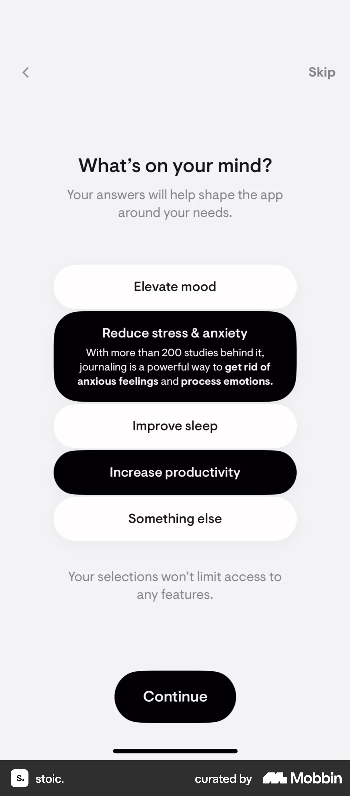 `Reduce stress & anxiety`와 `Increase productivity`가 검게 선택되어 있고 첫 항목의 설명이 펼쳐져 있다. `Continue`로 진행하면 다음 화면에 연령대 선택 질문이 나온다.
4. 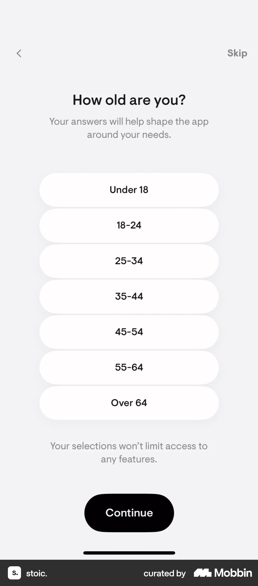 `How old are you?` 아래 `Under 18`부터 `Over 64`까지 연령대가 흰 버튼으로 나열된다. `25–34`를 선택하면 다음 화면에서 그 버튼만 검게 표시된다.
5. 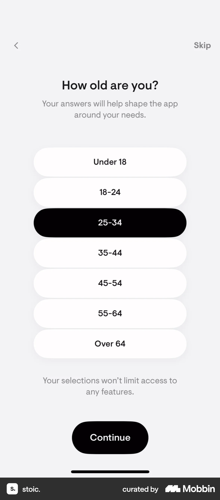 연령대 `25–34`가 선택된 상태다. `Continue`로 진행하면 아침·낮·저녁 저널링 알림 시간 설정 화면이 나타난다.
6. 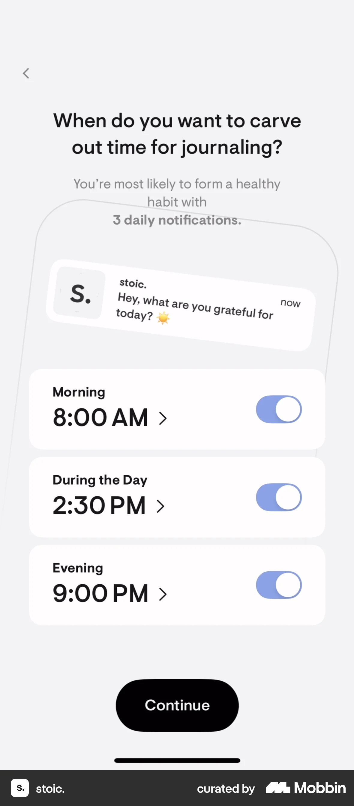 아침 8:00 AM, 낮 2:30 PM, 저녁 9:00 PM 알림이 모두 켜져 있다. 아침 시간을 열면 다음 화면에 iOS 휠 형태의 시간 선택기가 겹쳐 표시된다.
7.  아침 8:00 AM 행 위에 시·분·AM 선택 휠이 열려 있다. 시 값을 바꾸면 다음 화면에서 9:00 AM이 선택된다.
8. 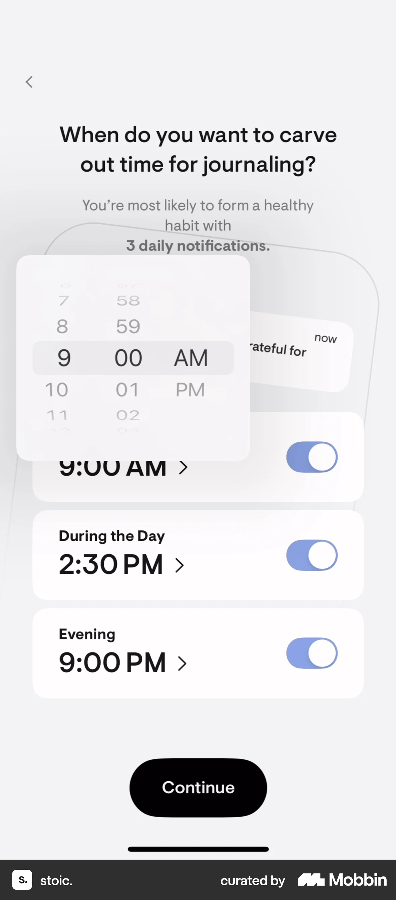 열린 시간 선택기에 아침 9:00 AM이 표시된다. 선택기를 닫고 낮 알림 스위치를 끄면 다음 화면에서 아침 시간은 9:00 AM으로 저장되고 낮 스위치가 회색으로 바뀐다.
9. 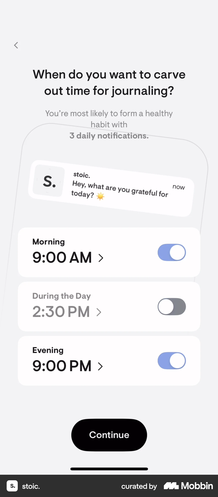 아침 9:00 AM과 저녁 9:00 PM은 켜져 있고 낮 2:30 PM은 꺼져 있다. `Continue`로 진행하면 iOS 알림 권한 요청 대화상자가 나타난다.
10. 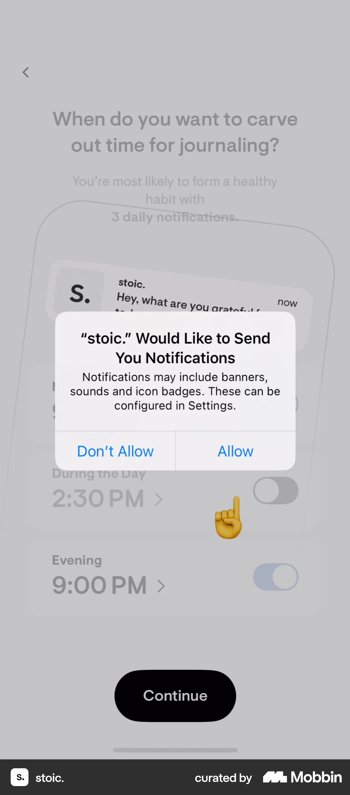 설정 화면 위에 `stoic. Would Like to Send You Notifications` iOS 대화상자와 `Don't Allow`·`Allow`가 보인다. 어느 버튼을 눌렀는지는 화면에서 확인 불가이며, 다음 화면은 개인화 계획 준비 상태다.
11. 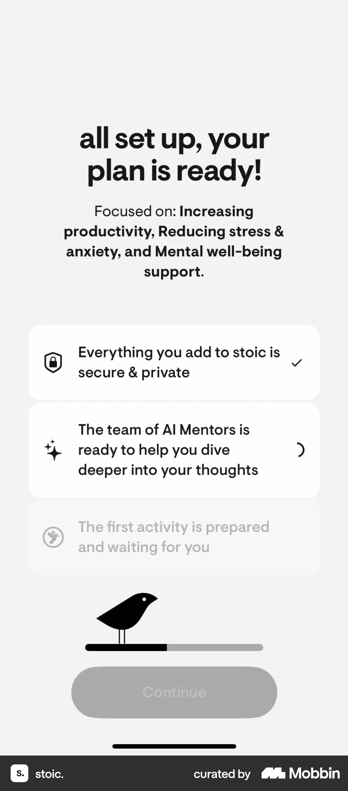 `all set up, your plan is ready!` 아래 선택 목표가 요약된다. 첫 항목만 체크되어 있고 진행 막대는 일부만 채워졌으며 `Continue`는 비활성이다. 다음 화면에서 나머지 항목이 완료된다.
12. 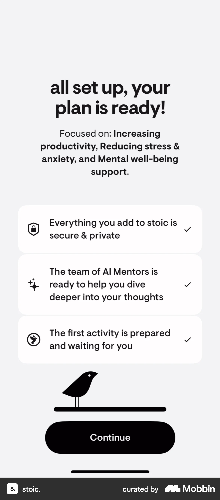 개인정보 보호, AI 멘토, 첫 활동 준비의 세 항목에 모두 체크가 있고 진행 막대가 끝까지 채워져 `Continue`가 활성화됐다. 이를 누르면 Premium + AI 제안 화면으로 이동한다.
13. 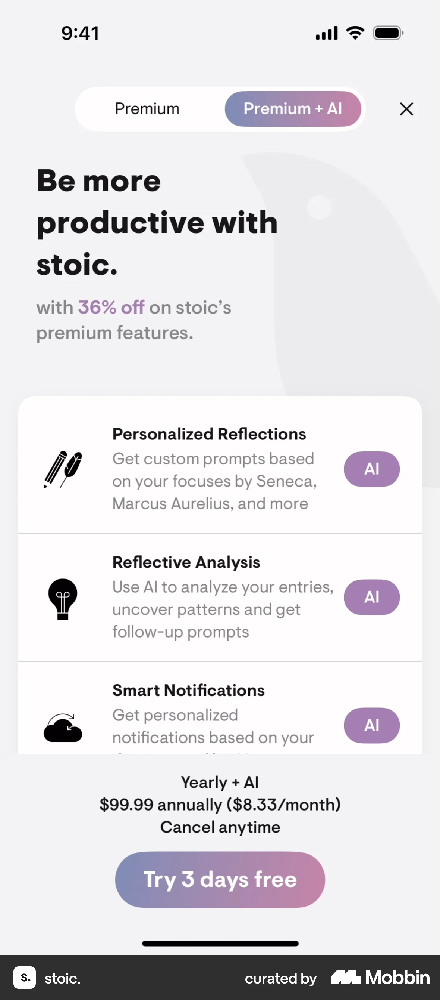 `Premium + AI` 탭에 개인화 성찰·분석·알림 혜택, 연간 가격과 `Try 3 days free`가 표시된다. 실제 무료 체험 시작 또는 결제 완료는 화면에서 확인 불가.

## BMad handoff notes

- **관찰된 진입 상태:** 앱 소개 화면에서 시작해 관심 목표와 연령대를 선택하고 저널링 알림 시간을 조정한다.
- **주요 행동:** 목표 2개 선택, 연령대 25–34 선택, 아침 알림 9:00 AM으로 변경, 낮 알림 끄기, 설정 화면의 `Continue`로 진행한다.
- **기대 결과:** 선택 목표를 반영한 계획 준비가 완료되고 Premium + AI 제안이 표시된다. 실제 계정 생성이나 구독 체결 여부는 화면에서 확인 불가.
- **되돌릴 수 있거나 파괴적인 동작:** 뒤로 가기와 목표·시간·알림 토글은 화면상 수정 가능하다. 알림 권한 선택의 결과와 구독 취소 방법은 화면에서 확인 불가. 삭제 동작은 관찰되지 않는다.
