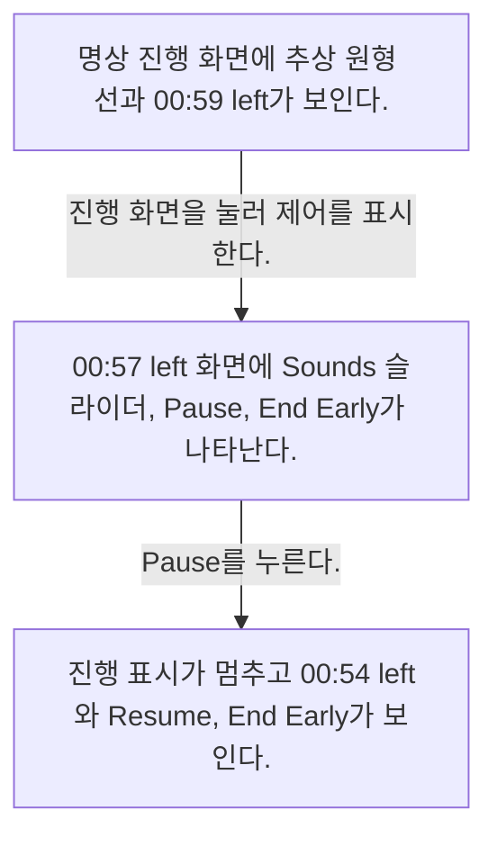
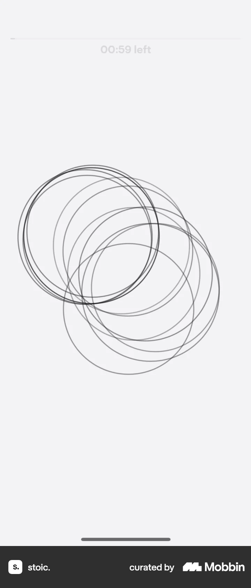
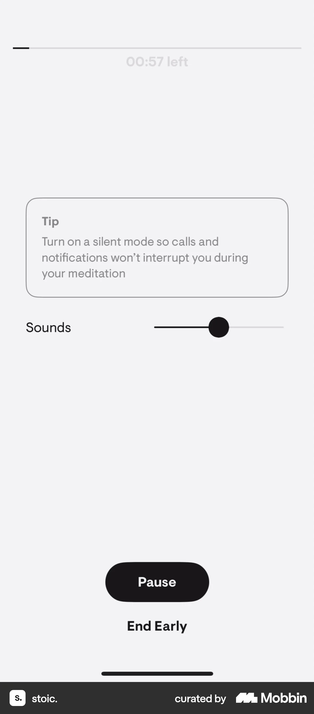
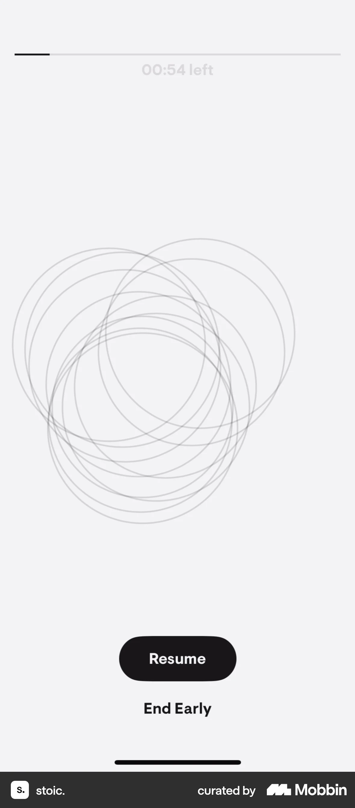

# Pausing an exercise from Completing an exercise (meditation)

- Mobbin 상세 페이지: https://mobbin.com/flows/43d32e65-4b97-4019-bc56-7238f502f9b1?tab=screens
- 앱·기기: stoic. iOS, 393×852
- 화면 수: 상세 페이지 3장 / 저장 이미지 3장 / 아래 설명 3개
- 검증 상태: **verified** — 목록 제목·상세 제목·URL과 화면별 이미지 수·순서·상태 변화를 대조했다.

## 화면별 기록

1.  명상 진행 화면에 추상 원형 선과 `00:59 left`가 보인다. 진행 화면을 눌러 제어를 표시한다. 다음 화면에서는 `00:57 left` 화면에 Sounds 슬라이더, `Pause`, `End Early`가 나타난다.
2.  `00:57 left` 화면에 Sounds 슬라이더, `Pause`, `End Early`가 나타난다. `Pause`를 누른다. 다음 화면에서는 진행 표시가 멈추고 `00:54 left`와 `Resume`, `End Early`가 보인다.
3.  진행 표시가 멈추고 `00:54 left`와 `Resume`, `End Early`가 보인다.

## BMad handoff notes

- **관찰된 진입 상태:** 1분 명상이 진행 중인 전체 화면.
- **주요 행동:** 진행 제어를 열고 Pause를 누른다.
- **기대 결과:** 동작 버튼이 Resume으로 바뀌어 일시 정지 상태를 나타낸다.
- **되돌릴 수 있거나 파괴적인 동작:** Resume으로 재개할 수 있고 End Early로 조기 종료할 수 있다. 삭제 동작은 없다.
