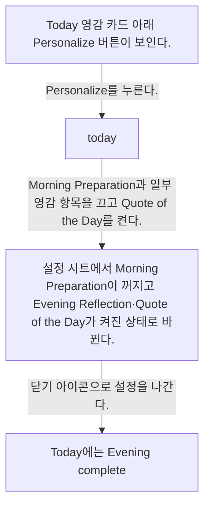
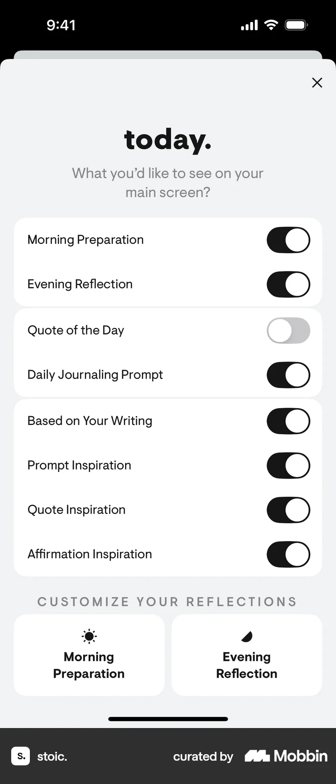
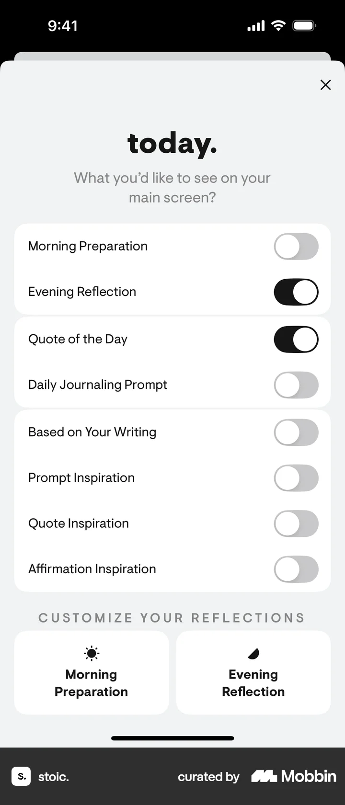
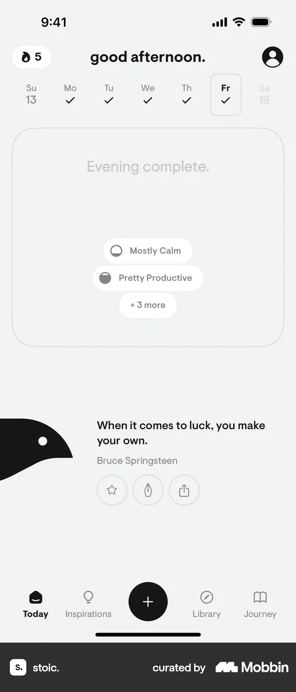

# Personalizing page content from Today

- Mobbin 상세 페이지: https://mobbin.com/flows/1db66219-d619-407d-a0a2-99c18bccafa7?tab=screens
- 앱·기기: stoic. iOS, 393×852
- 화면 수: 상세 페이지 4장 / 저장 이미지 4장 / 아래 설명 4개
- 검증 상태: **verified** — 목록 제목·상세 제목·URL과 화면별 이미지 수·순서·상태 변화를 대조했다.

## 화면별 기록

1.  Today 영감 카드 아래 `Personalize` 버튼이 보인다. `Personalize`를 누른다. 다음 화면에서는 `today.` 설정 시트에 Morning Preparation, Evening Reflection, Quote of the Day, Daily Journaling Prompt와 영감 항목의 토글이 보인다.
2.  `today.` 설정 시트에 Morning Preparation, Evening Reflection, Quote of the Day, Daily Journaling Prompt와 영감 항목의 토글이 보인다. Morning Preparation과 일부 영감 항목을 끄고 Quote of the Day를 켠다. 다음 화면에서는 설정 시트에서 Morning Preparation이 꺼지고 Evening Reflection·Quote of the Day가 켜진 상태로 바뀐다.
3.  설정 시트에서 Morning Preparation이 꺼지고 Evening Reflection·Quote of the Day가 켜진 상태로 바뀐다. 닫기 아이콘으로 설정을 나간다. 다음 화면에서는 Today에는 `Evening complete.` 카드와 Bruce Springsteen 명언이 나타나며 아침 준비 카드는 보이지 않는다.
4.  Today에는 `Evening complete.` 카드와 Bruce Springsteen 명언이 나타나며 아침 준비 카드는 보이지 않는다.

## BMad handoff notes

- **관찰된 진입 상태:** Today의 영감 카드와 Personalize 버튼이 보인다.
- **주요 행동:** Today 콘텐츠 토글을 변경하고 설정 시트를 닫는다.
- **기대 결과:** Morning Preparation은 숨겨지고 Evening 카드와 명언이 Today에 보인다.
- **되돌릴 수 있거나 파괴적인 동작:** 토글은 다시 바꿀 수 있다. 삭제 동작은 없다.
