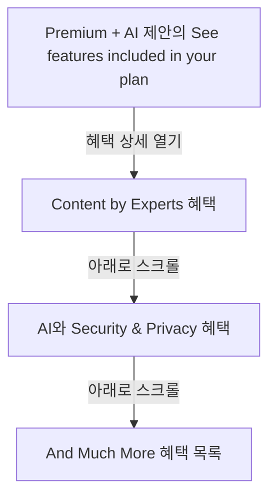
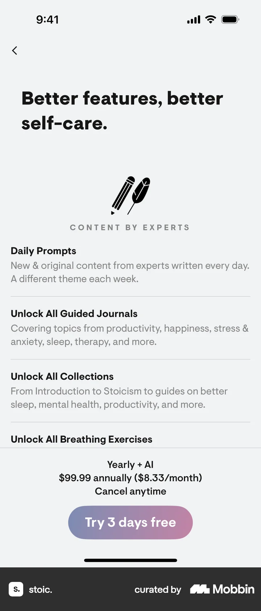
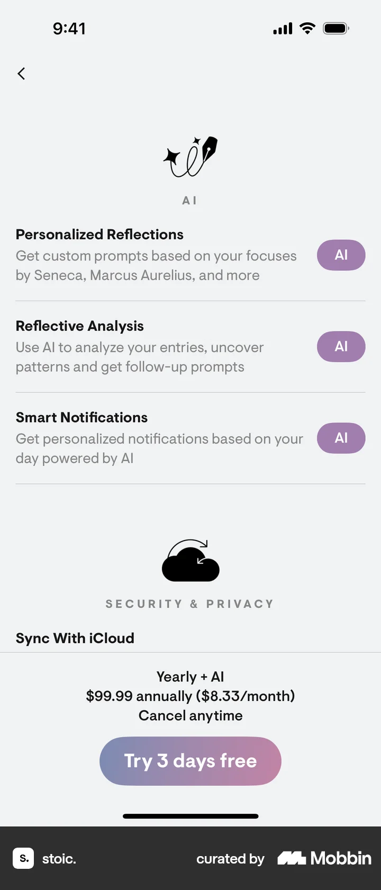
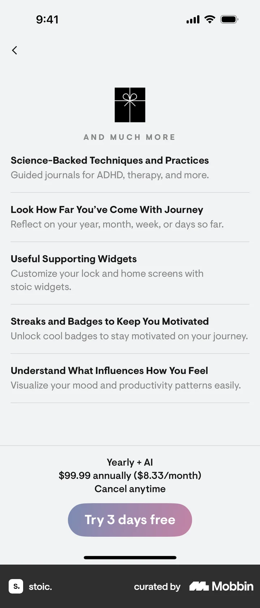

# Premium + AI features from Subscribing to premium

- Mobbin 상세 페이지: https://mobbin.com/flows/655eb98d-12b4-43de-b6b2-5cdcb33edd93?tab=screens
- 앱·기기: stoic. iOS, 393×852
- 화면 수: 상세 페이지 4장 / 저장 이미지 4장 / 아래 설명 4개
- 검증 상태: **verified** — 목록 카드와 상세 제목 `Premium + AI features on stoic.`, URL, 이미지 순서를 대조했다.

## 화면별 기록

1.  제안 화면의 혜택 목록 맨 아래 `See features included in your plan / 20+ features` 행과 연간 + AI 가격, `Try 3 days free`가 보인다. 혜택 행을 열면 별도 상세 화면으로 이동한다.
2.  `Better features, better self-care.` 제목과 `CONTENT BY EXPERTS`의 Daily Prompts, Guided Journals, Collections, Breathing Exercises가 보인다. 아래로 내리면 AI 기능과 개인정보 관련 혜택이 나타난다.
3.  `AI` 아래 Personalized Reflections, Reflective Analysis, Smart Notifications가, 아래 `SECURITY & PRIVACY`와 iCloud 동기화 항목이 보인다. 스크롤하면 추가 혜택 목록으로 이어진다.
4.  `AND MUCH MORE` 아래 과학 기반 연습, Journey 분석, 위젯, 연속 사용·배지, 기분 영향 분석이 나열된다. 하단의 연간 + AI 가격과 무료 체험 버튼은 유지되며, 실제 구독 시작은 확인 불가.

## BMad handoff notes

- **관찰된 진입 상태:** Premium + AI 제안의 혜택 요약에서 시작한다.
- **주요 행동:** `See features included in your plan`을 열고 상세 혜택을 세로로 탐색한다.
- **기대 결과:** 콘텐츠, AI, 개인정보, 기타 기능 범위를 확인할 수 있다.
- **되돌릴 수 있거나 파괴적인 동작:** 뒤로 가기와 스크롤은 되돌릴 수 있다. `Try 3 days free`를 통한 구독 결과는 관찰되지 않으며 삭제 동작은 없다.
