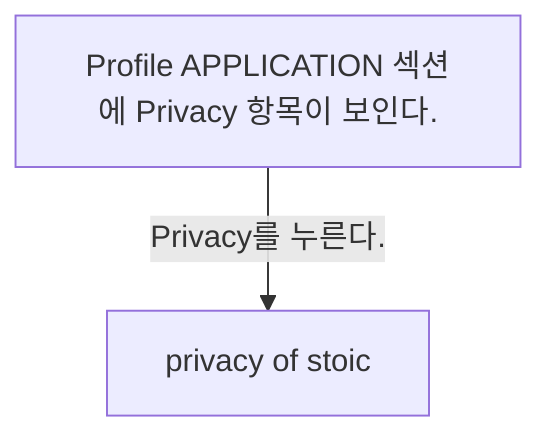
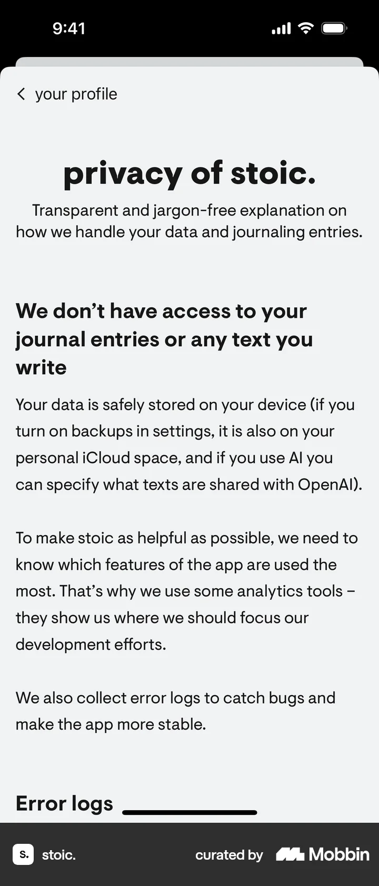

# Privacy policy from Profile

- Mobbin 상세 페이지: https://mobbin.com/flows/28ad29b5-f55f-4439-88fb-551189e690b3?tab=screens
- 앱·기기: stoic. iOS, 393×852
- 화면 수: 상세 페이지 2장 / 저장 이미지 2장 / 아래 설명 2개
- 검증 상태: **verified** — 목록 제목·상세 제목·URL과 화면별 이미지 수·순서·상태 변화를 대조했다.

## 화면별 기록

1.  Profile APPLICATION 섹션에 `Privacy` 항목이 보인다. `Privacy`를 누른다. 다음 화면에서는 `privacy of stoic.` 문서 첫 부분에 저널 글 접근 권한, 기기·iCloud 저장, AI 공유 선택 및 분석·오류 로그 설명이 보인다.
2.  `privacy of stoic.` 문서 첫 부분에 저널 글 접근 권한, 기기·iCloud 저장, AI 공유 선택 및 분석·오류 로그 설명이 보인다.

## BMad handoff notes

- **관찰된 진입 상태:** Profile의 APPLICATION 섹션.
- **주요 행동:** Privacy를 열어 개인정보 안내를 읽는다.
- **기대 결과:** 개인정보 설명 첫 화면이 열린다. 문서 전체 내용은 화면에서 확인 불가.
- **되돌릴 수 있거나 파괴적인 동작:** 왼쪽 위 뒤로 가기가 보인다. 삭제 동작은 없다.
