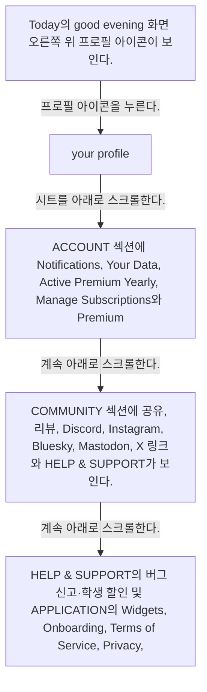
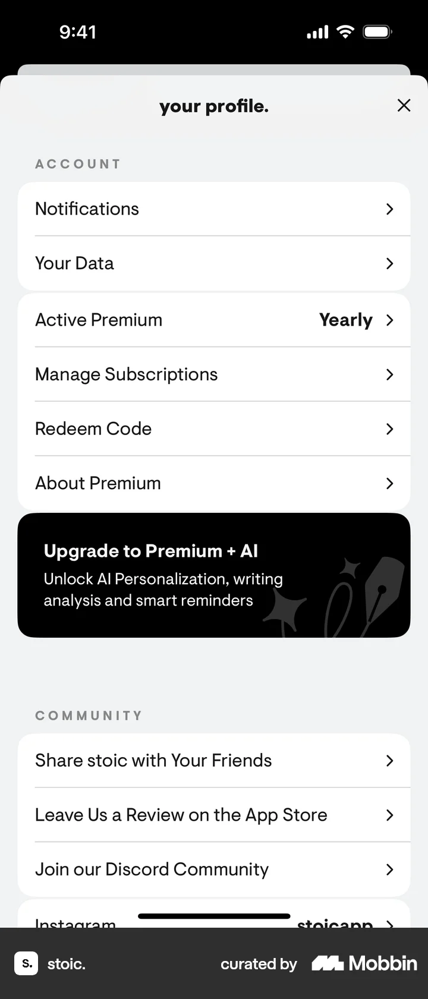
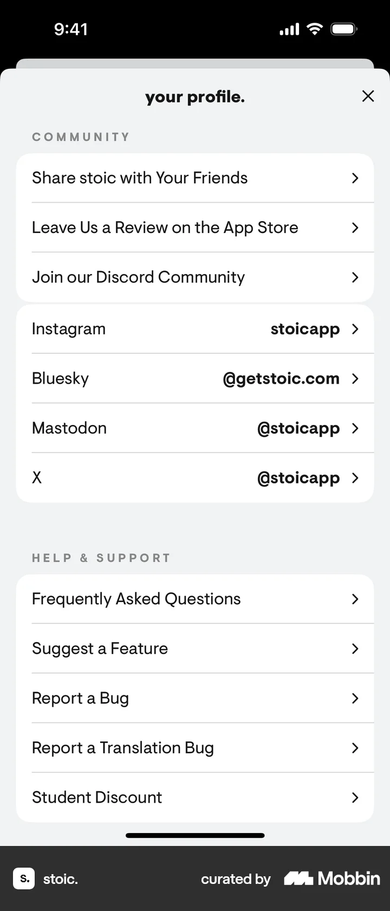
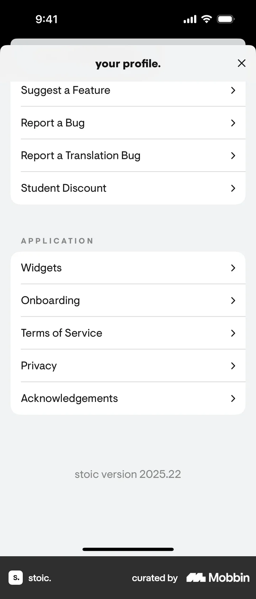

# Profile

- Mobbin 상세 페이지: https://mobbin.com/flows/eee28256-463d-467a-85da-a28fa4a20ddd?tab=screens
- 앱·기기: stoic. iOS, 393×852
- 화면 수: 상세 페이지 5장 / 저장 이미지 5장 / 아래 설명 5개
- 검증 상태: **verified** — 목록 제목·상세 제목·URL과 화면별 이미지 수·순서·상태 변화를 대조했다.

## 화면별 기록

1.  Today의 good evening 화면 오른쪽 위 프로필 아이콘이 보인다. 프로필 아이콘을 누른다. 다음 화면에서는 your profile. 시트에 Morning Preparation, Evening Reflection, Preferences, Appearance, Stoic Shield, Apple Health가 보인다.
2.  your profile. 시트에 Morning Preparation, Evening Reflection, Preferences, Appearance, Stoic Shield, Apple Health가 보인다. 시트를 아래로 스크롤한다. 다음 화면에서는 ACCOUNT 섹션에 Notifications, Your Data, Active Premium Yearly, Manage Subscriptions와 Premium + AI 배너가 보인다.
3.  ACCOUNT 섹션에 Notifications, Your Data, Active Premium Yearly, Manage Subscriptions와 Premium + AI 배너가 보인다. 계속 아래로 스크롤한다. 다음 화면에서는 COMMUNITY 섹션에 공유, 리뷰, Discord, Instagram, Bluesky, Mastodon, X 링크와 HELP & SUPPORT가 보인다.
4.  COMMUNITY 섹션에 공유, 리뷰, Discord, Instagram, Bluesky, Mastodon, X 링크와 HELP & SUPPORT가 보인다. 계속 아래로 스크롤한다. 다음 화면에서는 HELP & SUPPORT의 버그 신고·학생 할인 및 APPLICATION의 Widgets, Onboarding, Terms of Service, Privacy, Acknowledgements와 버전 2025.22가 보인다.
5.  HELP & SUPPORT의 버그 신고·학생 할인 및 APPLICATION의 Widgets, Onboarding, Terms of Service, Privacy, Acknowledgements와 버전 2025.22가 보인다.

## BMad handoff notes

- **관찰된 진입 상태:** Today 화면의 프로필 아이콘.
- **주요 행동:** 프로필 시트를 열어 섹션을 아래로 탐색한다.
- **기대 결과:** 개인화, 계정, 커뮤니티, 도움말, 앱 정보 항목과 버전을 확인한다.
- **되돌릴 수 있거나 파괴적인 동작:** 오른쪽 위 X로 시트를 닫을 수 있다. 삭제 동작은 없다.
