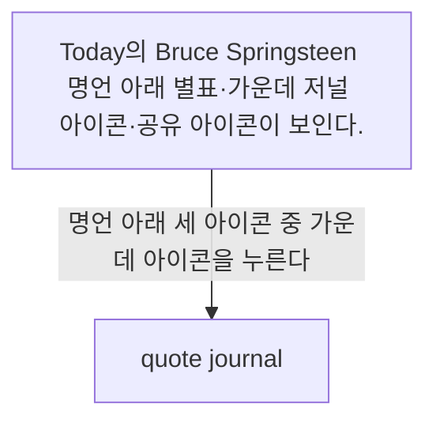
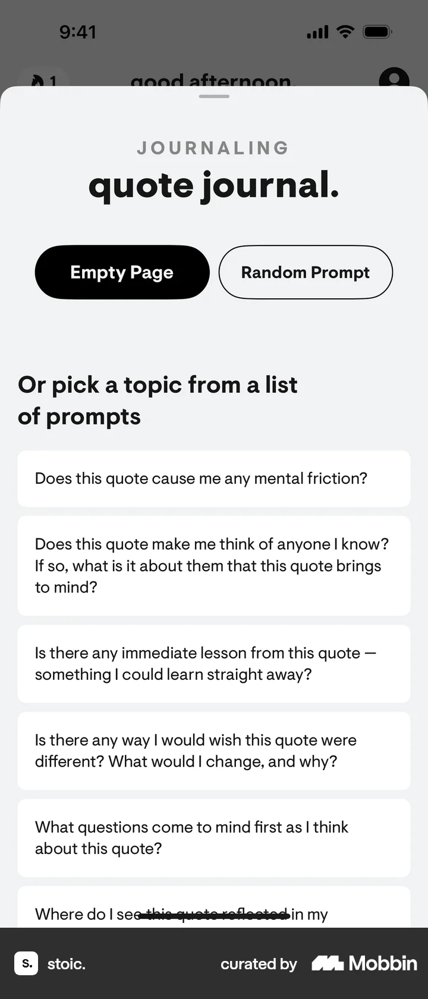

# Quote journal from Today

- Mobbin 상세 페이지: https://mobbin.com/flows/2fce81ba-d33e-4813-b2c4-d3c431abd018?tab=screens
- 앱·기기: stoic. iOS, 393×852
- 화면 수: 상세 페이지 2장 / 저장 이미지 2장 / 아래 설명 2개
- 검증 상태: **verified** — 목록·상세 제목·URL과 이미지 2장의 순서를 대조했다. 명언 아래 가운데 아이콘으로 저널 선택 창을 여는 동작은 사용자 확인을 받았다.

## 화면별 기록

1.  Today의 Bruce Springsteen 명언 아래 별표·가운데 저널 아이콘·공유 아이콘이 보인다. 명언 아래 세 아이콘 중 가운데 아이콘을 누른다(사용자 확인). 다음 화면에서는 `quote journal.` 시트에 `Empty Page`, `Random Prompt`와 명언에 관한 질문 목록이 열린다.
2.  `quote journal.` 시트에 `Empty Page`, `Random Prompt`와 명언에 관한 질문 목록이 열린다.

## BMad handoff notes

- **관찰된 진입 상태:** Today 탭의 명언 카드가 보인다.
- **주요 행동:** 명언 아래 가운데 아이콘으로 quote journal 시트를 연다.
- **기대 결과:** 빈 페이지·무작위 질문·명언 관련 질문 중 하나를 고를 수 있다. 실제 작성 완료는 확인 불가.
- **되돌릴 수 있거나 파괴적인 동작:** 시트를 닫아 돌아갈 수 있다. 삭제 동작은 없다.
