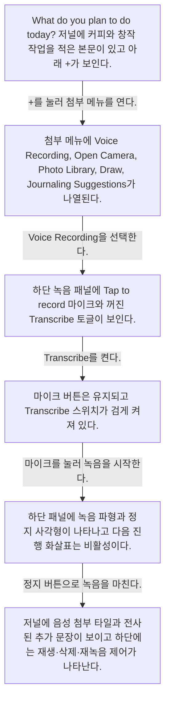
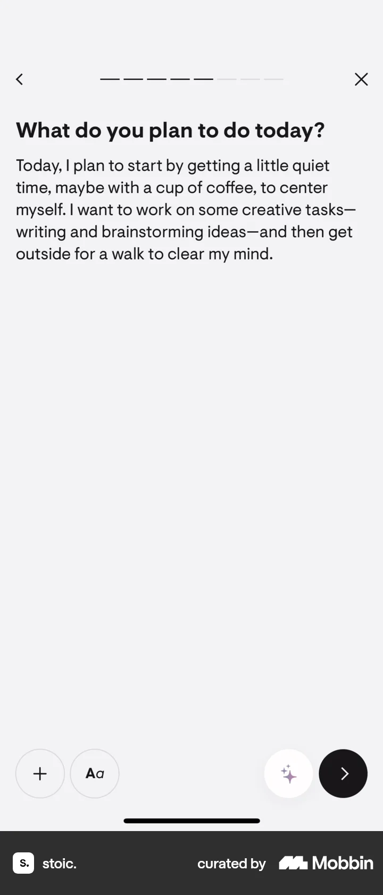
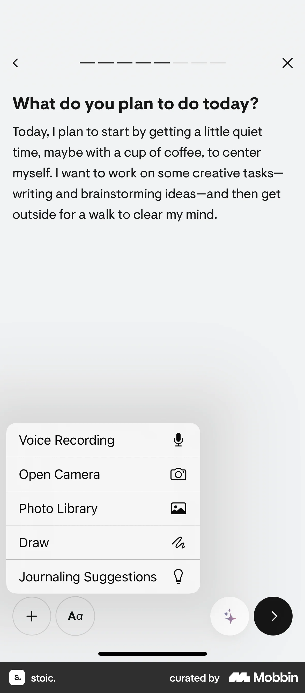
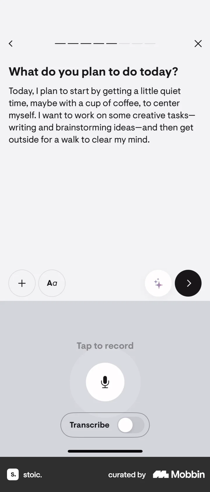
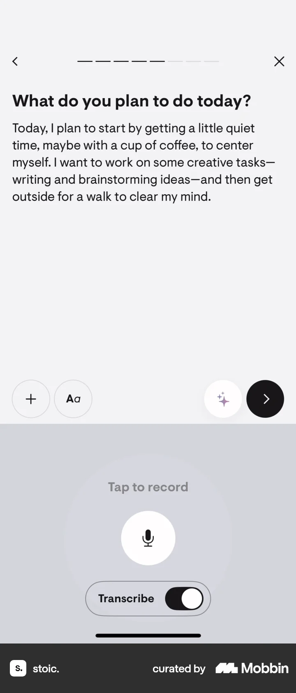
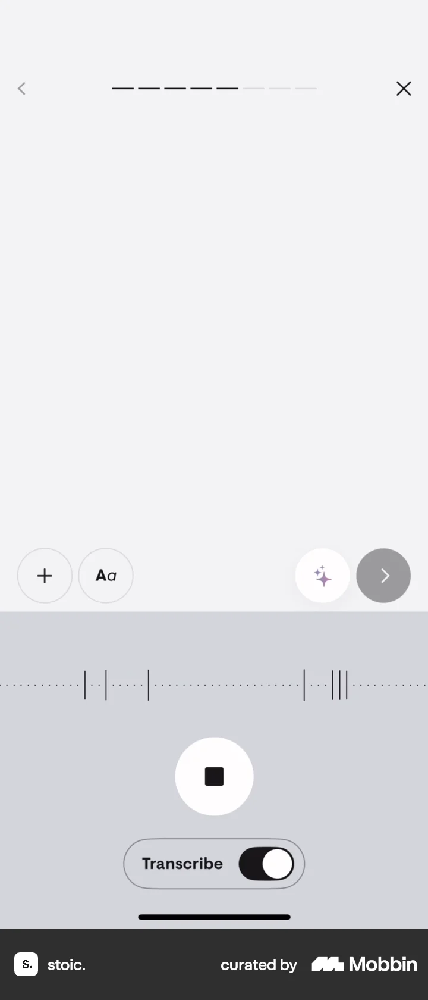
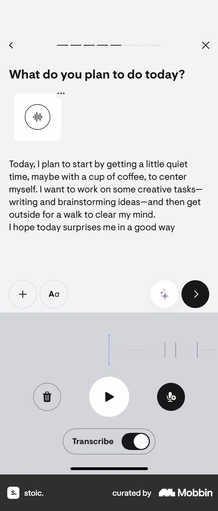

# Recording a voice note from Logging a daily reflection (morning)

- Mobbin 상세 페이지: https://mobbin.com/flows/42c5dd12-ff9d-4679-b61f-b037476ea54c?tab=screens
- 앱·기기: stoic. iOS, 393×852
- 화면 수: 상세 페이지 6장 / 저장 이미지 6장 / 아래 설명 6개
- 검증 상태: **verified** — 목록 제목·상세 제목·URL과 화면별 이미지 수·순서·상태 변화를 대조했다.

## 화면별 기록

1.  `What do you plan to do today?` 저널에 커피와 창작 작업을 적은 본문이 있고 아래 `+`가 보인다. `+`를 눌러 첨부 메뉴를 연다. 다음 화면에서는 첨부 메뉴에 Voice Recording, Open Camera, Photo Library, Draw, Journaling Suggestions가 나열된다.
2.  첨부 메뉴에 Voice Recording, Open Camera, Photo Library, Draw, Journaling Suggestions가 나열된다. Voice Recording을 선택한다. 다음 화면에서는 하단 녹음 패널에 `Tap to record` 마이크와 꺼진 `Transcribe` 토글이 보인다.
3.  하단 녹음 패널에 `Tap to record` 마이크와 꺼진 `Transcribe` 토글이 보인다. Transcribe를 켠다. 다음 화면에서는 마이크 버튼은 유지되고 `Transcribe` 스위치가 검게 켜져 있다.
4.  마이크 버튼은 유지되고 `Transcribe` 스위치가 검게 켜져 있다. 마이크를 눌러 녹음을 시작한다. 다음 화면에서는 하단 패널에 녹음 파형과 정지 사각형이 나타나고 다음 진행 화살표는 비활성이다.
5.  하단 패널에 녹음 파형과 정지 사각형이 나타나고 다음 진행 화살표는 비활성이다. 정지 버튼으로 녹음을 마친다. 다음 화면에서는 저널에 음성 첨부 타일과 전사된 추가 문장이 보이고 하단에는 재생·삭제·재녹음 제어가 나타난다.
6.  저널에 음성 첨부 타일과 전사된 추가 문장이 보이고 하단에는 재생·삭제·재녹음 제어가 나타난다.

## BMad handoff notes

- **관찰된 진입 상태:** 텍스트가 작성된 일일 성찰 편집기.
- **주요 행동:** 첨부 메뉴에서 음성 녹음을 열고 전사를 켠 뒤 녹음·정지한다.
- **기대 결과:** 음성 첨부와 전사 문장이 편집기에 표시된다. 전체 저널 저장 여부는 화면에서 확인 불가.
- **되돌릴 수 있거나 파괴적인 동작:** 마지막 화면에 재생·삭제·재녹음 제어가 보인다. 삭제 실행 결과는 이 플로우에서 확인 불가.
