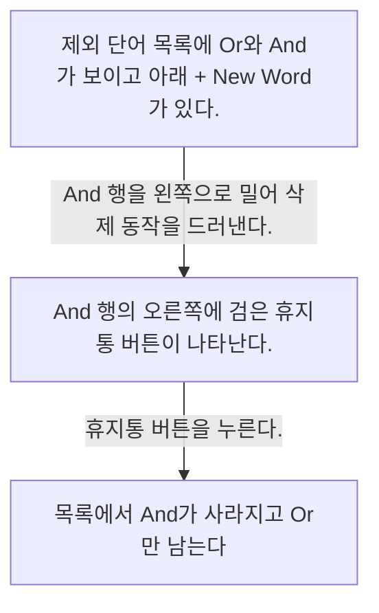
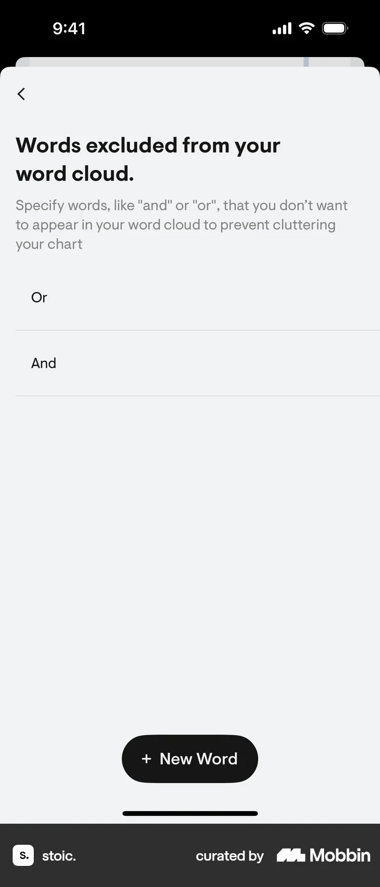
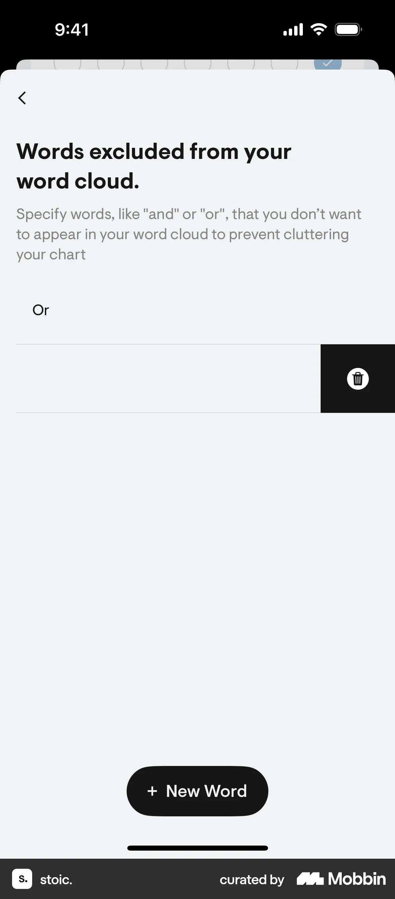
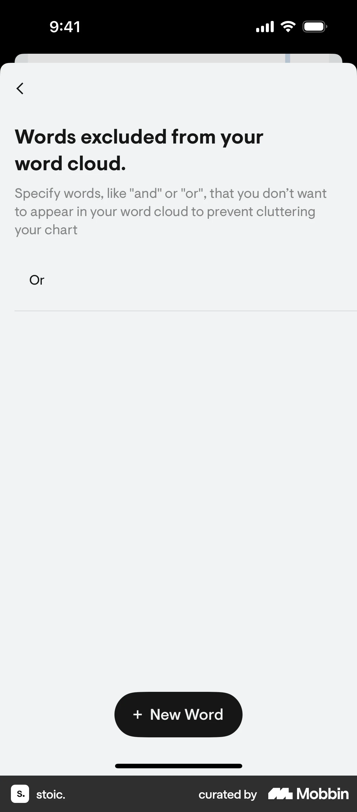

# Removing an excluded word from Excluding words from words cloud

- Mobbin 상세 페이지: https://mobbin.com/flows/576943f3-20e4-4c10-a7a7-fdf166ad01c9?tab=screens
- 앱·기기: stoic. iOS, 393×852
- 화면 수: 상세 페이지 3장 / 저장 이미지 3장 / 아래 설명 3개
- 검증 상태: **verified** — 목록 제목·상세 제목·URL과 화면별 이미지 수·순서·상태 변화를 대조했다.

## 화면별 기록

1.  제외 단어 목록에 `Or`와 `And`가 보이고 아래 `+ New Word`가 있다. `And` 행을 왼쪽으로 밀어 삭제 동작을 드러낸다. 다음 화면에서는 `And` 행의 오른쪽에 검은 휴지통 버튼이 나타난다.
2.  `And` 행의 오른쪽에 검은 휴지통 버튼이 나타난다. 휴지통 버튼을 누른다. 다음 화면에서는 목록에서 `And`가 사라지고 `Or`만 남는다. 단어 구름 차트에서 실제 반영은 화면에서 확인 불가.
3.  목록에서 `And`가 사라지고 `Or`만 남는다. 단어 구름 차트에서 실제 반영은 화면에서 확인 불가.

## BMad handoff notes

- **관찰된 진입 상태:** Words excluded 목록에 두 단어가 있다.
- **주요 행동:** And 행을 스와이프해 휴지통을 열고 삭제한다.
- **기대 결과:** 목록에서 And가 제거되고 Or만 남는다.
- **되돌릴 수 있거나 파괴적인 동작:** 삭제는 파괴적 동작이다. `+ New Word`로 다시 추가할 수 있어 보이나 실제 복원 화면은 확인 불가.
